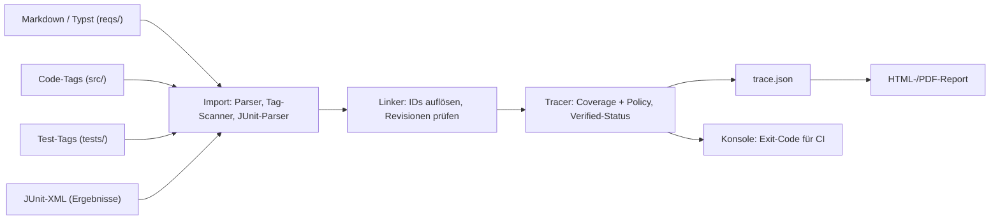
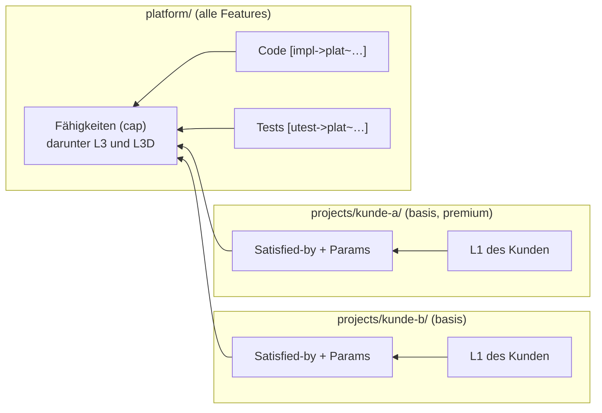
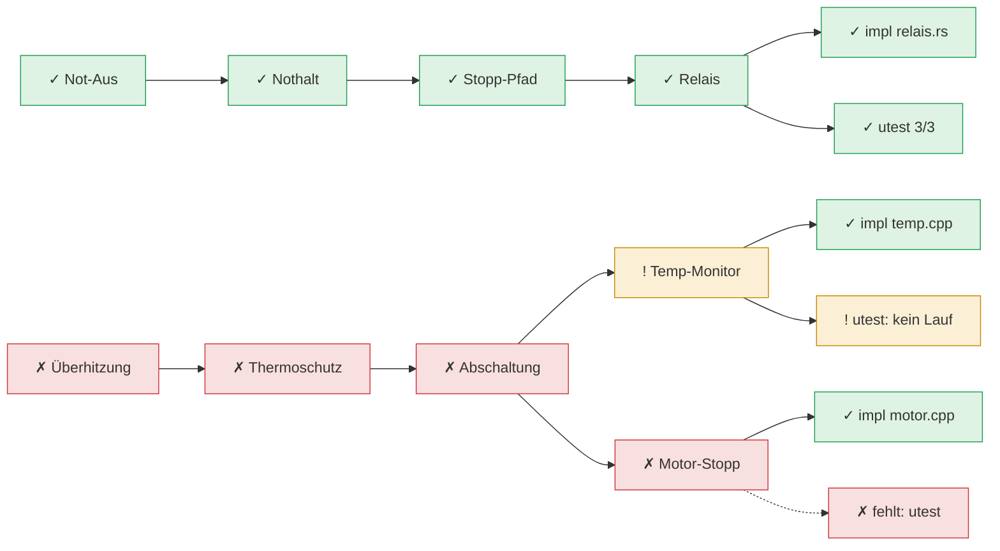

# shall – Requirements as Code: Konzept & Implementierungsplan

Oct 12, 2026 · @Peter

## Ziel & Kontext

Ein neues Projekt führt seine Requirements von Anfang an als Markdown-Dateien im Git-Repository, direkt neben dem Code. Git ist die einzige Quelle der Wahrheit, DOORS spielt keine Rolle. Ein Werkzeug in Rust prüft die Verlinkung über alle Ebenen bis zu Implementierung und Validierung und erzeugt einen HTML-Report.

Anforderungen an das System:

- **Requirements as Code:** ein Requirement = ein Markdown-Abschnitt mit eindeutiger ID und Metadaten, versioniert in Git, reviewbar per Merge Request.
- **Frei konfigurierbare Ebenen:** z. B. L1 (High-Level) → L2 → L3 (Requirements) → L3D (Design-Entscheidungen) wie im Automotive-Umfeld; andere Projekte definieren eigene Ebenen.
- **Blatt-Ebene:** jedes unterste Item teilt sich in mindestens eine Implementierung (Code) und mindestens eine Validierung (Unit-Test, Integrationstest, Review, Analyse).
- **Report:** HTML und PDF mit allen Requirements, Links nach oben und unten, am Ende Links auf Code-Stellen und Tests samt Ergebnis, plus Abdeckung je Ebene und Defektliste.
- **Betrieb:** lokal mit einem Kommando erzeugbar; im Regelfall baut die CI den Report als Ordner statischer Dateien, den ein beliebiger Pages-Dienst oder Webserver hostet.
- **Nebenbedingungen:** Rust (performant, stabil, eine statische Binary ohne Laufzeit), Open Source für ein breites Publikum, erweiterbar über Plugins, deterministische Ausgabe; Hosting und CI-System wählt der Anwender.

## Gibt es das schon? Marktüberblick

Ja: OpenFastTrace (OFT) deckt das Konzept fast vollständig ab – Markdown als natives Format, frei definierbare Ebenen über `Needs:`/`Covers:`, Tags in C++- und Rust-Code und ein HTML-Report. Was keinem Tool out of the box gelingt, ist die Kombination aus DOORS-Import, Markdown **und** echten Testergebnissen (pass/fail) im selben Report.

| Tool | Format der Requirements | Ebenen / Links | Code & Tests | Report | DOORS-Weg | Lizenz / Stack |
| --- | --- | --- | --- | --- | --- | --- |
| [OpenFastTrace](https://github.com/itsallcode/openfasttrace/blob/main/doc/user_guide.md) | Markdown (nativ), ID `req~name~1` | beliebige Artefakttypen (feat → req → dsn → impl/utest/itest), Shallow- und Deep-Coverage, Revision invalidiert Links | Tags `// [impl->dsn~x~1]` in C, C++, Rust u. v. m. | Plain, HTML, XML (aspec) | nur SpecObject/ReqM2-XML, kein ReqIF | GPL-3.0, Java 17 |
| [StrictDoc](https://strictdoc.readthedocs.io/en/stable/stable/docs/strictdoc_24_development_plan.html) | eigenes SDoc-Format; Markdown seit 2026 in Arbeit | Parent/Child-Relationen, Rollen, Traceability-Matrix | Marker im Code, Rust-Parsing seit 2026-Q1, Tests/Coverage geplant | statisches HTML + Web-UI | **ReqIF Import/Export** | Apache-2.0, Python |
| [Sphinx-Needs](https://www.sphinx-needs.com/) + [Test-Reports](https://sphinx-test-reports.readthedocs.io/en/stable/) | RST, Markdown via MyST | frei konfigurierbare Need-Typen und Link-Typen | Codelinks aus Kommentaren; JUnit-XML (gtest) als Testergebnis-Objekte | Sphinx-HTML, Tabellen, Graphen | über kommerzielles ubConnect | MIT, Python; useblocks GmbH (DE) |
| [LOBSTER (BMW)](https://github.com/bmw-software-engineering/lobster/wiki) | TRLC, Codebeamer, JSON – kein Markdown | Tracing-Policy mit Ebenen | eigene Tools für C++, gtest, Python | HTML- und CI-Report | über Codebeamer/JSON | AGPL-3.0, Python |
| [Doorstop](https://pypi.org/project/doorstop/) | ein YAML/Markdown-Item pro Datei | Dokumente mit Parent-Dokument | `ref`-Feld auf Dateien | HTML/Markdown publish | Import aus CSV/XLSX | LGPL, Python |

**Einordnung:**

- **OpenFastTrace** passt am besten zu deinem Bild. Ein JabRef-Beispiel zeigt den Ablauf: Requirement unter einer Markdown-Überschrift, `Needs: impl`, im Code ein Kommentar-Tag ([JabRef Devdocs](https://devdocs.jabref.org/requirements)). Lücken: keine Testergebnisse, kein ReqIF, Java-Runtime nötig. Für Rust gibt es den OFT-kompatiblen Klon [cargo-ovft](https://docs.rs/cargo-ovft).
- **StrictDoc** ist am stärksten beim DOORS-Übergang (ReqIF), aber Markdown ist dort noch jung.
- **Sphinx-Needs** ist das mächtigste Ökosystem inkl. Testergebnissen, verlangt aber den Sphinx-Build und hat viel Konfiguration.
- **LOBSTER** und **Doorstop** passen wegen fehlendem Markdown bzw. Ein-Datei-pro-Item weniger.

**Empfehlung:** Da Testergebnisse im Report und frei konfigurierbare Ebenen gewünscht sind, lohnt sich ein eigenes Werkzeug in Rust mit **OFT-kompatibler Syntax**. OFT bleibt so als Gegenprobe nutzbar. Vorher einen Nachmittag OFT am Beispielprojekt aus Schritt 0.2 ausprobieren, um die Lücken konkret zu sehen.

## Architektur des eigenen Systems

Das Werkzeug (`shall`, kurz für „Specifications Hooked to Actual Lines of Logic“ – und das Schlüsselwort jedes Requirements) ist eine Kommandozeilen-Anwendung, die vier Quellen einliest, daraus einen Graphen baut, ihn gegen eine Policy prüft und einen HTML-Report schreibt. Vorschlag: Rust als Sprache – gewählt, weil performant, speichersicher und als einzelne statische Binary lokal wie in der CI lauffähig.

### Repository-Layout

```text
reqs/
  L1_high_level/*.md     # Typ hlr
  L2_system/*.md         # Typ sys
  L3_requirements/*.md   # Typ swr
  L3D_design/*.md        # Typ dsn (Blatt-Ebene)
  verification/*.md      # Typ vrev / vana (Reviews, Analysen)
src/                     # Code mit [impl->dsn~...~N]
tests/                   # Tests mit [utest->dsn~...~N]
shall.toml            # Ebenen, Policy, Quellen, Report
```

### Requirement-Format (OFT-kompatibel)

Ein Requirement ist ein Abschnitt in einer Markdown-Datei. Erlaubte Schlüsselwörter: `Status`, `Rationale`, `Comment`, `Covers`, `Needs`, `Depends`, `Tags`; zusätzlich `Source` für die Herkunft (z. B. Lastenheft-Kapitel oder Ticket).

```markdown
### Motor bei Übertemperatur abschalten
`swr~motor.overtemp-shutdown~2`

Die Software schaltet den Motor innerhalb von 100 ms ab, wenn die
Wicklungstemperatur 85 °C überschreitet.

Rationale:
Schutz der Wicklung, siehe Thermomodell.

Status: approved
Source: Lastenheft Kap. 4.2

Covers:
- sys~motor.thermal-protection~1

Needs: dsn
```

Die Blatt-Ebene fordert Implementierung und Validierung:

```markdown
### Temperaturüberwachung im 10-ms-Task
`dsn~motor.temp-monitor~1`

Der Task `TempMonitor` liest alle 10 ms den Sensor und setzt bei
> 85 °C das Abschaltsignal.

Covers:
- swr~motor.overtemp-shutdown~2

Needs: impl, utest
```

### Alternative: Requirements in Typst

Neben Markdown können Requirements in [Typst](https://typst.app) geschrieben werden. Das lohnt sich vor allem für Formeln, Tabellen und eine sauber gesetzte Spezifikation als PDF. Beide Formate dürfen im selben Projekt gemischt werden; das Format ergibt sich aus der Dateiendung (`.md` bzw. `.typ`), IDs und Links funktionieren formatübergreifend.

```typst
#import "@preview/shall:0.1.0": req

== Motor bei Übertemperatur abschalten
#req(
  id: "swr~motor.overtemp-k4f2~2",
  covers: "cap~motor.overtemp-protection~1",
  needs: "dsn",
  status: "approved",
  source: "Lastenheft Kap. 4.2",
  rationale: [Schutz der Wicklung, siehe Thermomodell.],
)[
  Die Software schaltet den Motor innerhalb von $t <= 100 "ms"$ ab,
  wenn die Wicklungstemperatur $T_W > 85 degree.C$ überschreitet.
]
```

- **Gleiches Modell:** `id`, `covers`, `needs`, `depends`, `satisfied_by`, `params`, `features`, `tags`, `status`, `source` und `rationale` entsprechen eins zu eins den Markdown-Schlüsselwörtern. Listenfelder akzeptieren einen einzelnen String oder ein Array, damit niemand über Typsts `("x",)` für Ein-Element-Arrays stolpert.
- **Typst-Paket `shall`:** Die Funktion `req` setzt das Item im PDF als Kasten mit ID, Status und anklickbaren Links auf die abgedeckten Items (über `label(id)`, weil die Kurzschreibweise `<…>` kein `~` erlaubt). So ist die kompilierte Spezifikation selbst navigierbar.
- **Bonus:** `typst compile reqs/main.typ` liefert eine fertige Spezifikation als PDF für Kunden oder Audits – ohne Umweg über den Report.

**Was dadurch zusätzlich zu tun ist:**

| Thema | Aufgabe | Risiko |
| --- | --- | --- |
| Einlesen | Dateien mit der Crate `typst-syntax` parsen (nur Syntax, kein Kompilieren) und `req(…)`-Aufrufe samt Zeilennummern extrahieren. Argumente müssen Literale sein; berechnete Werte werden als Defekt gemeldet. | gering: schnell, keine Fonts, kleine Abhängigkeit |
| Berechnete Items (optional) | Modus `typst.mode = "eval"`: Dokument mit der `typst`-Bibliothek auswerten und alle `req`-Elemente per Introspektion abfragen – nötig, wenn Items per Schleife, `#include` oder Variablen entstehen. | mittel: langsamer, große Abhängigkeit, darum eigene Cargo-Feature |
| Text im HTML-Report | Beschreibung und Rationale als Typst-Inhalt rendern: bevorzugt über Typsts HTML-Export (Formeln seit 0.15 als MathML), sonst je Item als SVG, notfalls als reiner Text. | hoch: der HTML-Export ist laut Typst noch experimentell und hinter einem Feature-Flag |
| Typst-Paket | `req` für den PDF-Satz schreiben und auf Typst Universe veröffentlichen; Version passend zu `shall` halten. | gering |
| Versionen | Typst ist vor 1.0 und ändert sich zwischen Versionen. Crate-Versionen pinnen, unterstützte Typst-Version in der Doku nennen, Fixtures je Version testen. | mittel |
| Werkzeuge | `shall new --format typ` erzeugt das Gerüst in Typst; `shall export --oft` wandelt Typst-Items in Markdown (Formeln nur als Text, also verlustbehaftet). | gering |
| Tests | Beispielprojekt aus 0.2 zusätzlich in Typst; Goldtest: beide Fassungen müssen dieselbe `trace.json` ergeben. | gering |

Im Editor hilft der Typst-Sprachserver Tinymist (Vorschau, Vervollständigung); `shall`-Meldungen im Format `datei.typ:42: …` sind wie bei Markdown anklickbar.

Quellen: [Typst HTML-Export (Doku)](https://www.typst.app/docs/reference/html), [Typst 0.15.0 Release Notes](https://github.com/typst/typst/releases/tag/v0.15.0)

### ID-Schema und ID-Vergabe

IDs müssen eindeutig sein und werden vom Werkzeug erzeugt, nicht von Hand ausgedacht. Fortlaufende Nummern scheiden aus: Zwei Branches vergeben sonst dieselbe Nummer, und beim Merge müsste eine umnummeriert werden – mit gebrochenen Links und Code-Tags.

**Format:** `typ~slug-zufall~revision`, z. B. `swr~motor.overtemp-k4f2~1`

| Teil | Herkunft | Zweck |
| --- | --- | --- |
| `typ` | Ebene aus `shall.toml` (nur ASCII-Buchstaben, keine Ziffern) | Position in der Hierarchie |
| `slug` | aus dem Titel beim Anlegen, punktgetrennt nach Komponente; beginnt mit einem Buchstaben | Lesehilfe in Code-Tags und Reviews |
| `zufall` | 4–5 Zeichen Crockford-Base32 in Kleinbuchstaben (`0-9a-z` ohne `i`, `l`, `o`, `u`) beim Anlegen | macht parallele Branches praktisch kollisionsfrei |
| `revision` | startet bei 1, von Hand erhöht | markiert inhaltliche Änderungen |

**Regeln:**

- **Erzeugen statt ausdenken:** `shall new swr "Motor bei Übertemperatur abschalten"` legt ein fertiges Item-Gerüst mit neuer ID an; ein VSCode-Snippet bzw. Task ruft dasselbe auf.
- **Nie umbenennen:** Slug und Zufall bleiben nach dem Anlegen fest, auch wenn sich der Titel ändert. Der Slug ist eine Lesehilfe, keine Beschreibung, die aktuell gehalten werden muss.
- **Nicht aus Inhalt oder Position ableiten:** Kein Hash über den Text, keine Nummer nach Reihenfolge in der Datei – sonst ändert sich die ID bei jeder Bearbeitung.
- **Inhaltliche Änderung = neue Revision:** Eine sachliche Änderung erhöht `~1` auf `~2`. Alle Links auf die alte Revision werden ungültig und müssen bewusst nachgezogen werden – das ist der Mechanismus für Impact-Analyse. Tippfehler-Korrekturen brauchen keine neue Revision.
- **Eindeutigkeit wird erzwungen:** Doppelte IDs sind ein Defekt der höchsten Schwere – über alle Dateien, Plattform und Projekte hinweg. Plattform-Items tragen beim Import den Namensraum (`plat~…`).
- **Gelöschte IDs werden nicht wiederverwendet:** `shall new` prüft gegen die Git-Historie, damit alte Links in Reports und Tickets nie auf etwas Neues zeigen.
- **OFT-kompatibel:** Jede gültige ID ist auch für OpenFastTrace gültig. `shall` erlaubt eine ASCII-Teilmenge der OFT-Grammatik: Typ `[A-Za-z]+`, Name `[A-Za-z][A-Za-z0-9_-]*(\.[A-Za-z0-9_-]+)*`, Revision ohne führende Nullen und höchstens 2³¹−1 (OFT speichert sie als Java-`int`). Darum tragen Ebenen Kürzel wie `hlr`, `sys`, `swr`, `dsn` statt `l1`…`l3d`; die lesbaren Namen „L1 – …“ stehen in `shall.toml`.

Die übrigen Beispiele in diesem Dokument lassen den Zufallsanteil der Lesbarkeit halber weg.

### Links und Policy

| Link | Richtung | Bedeutung |
| --- | --- | --- |
| `Covers:` | Kind → Eltern | dieses Item verfeinert/erfüllt das Eltern-Item |
| `Needs:` | Eltern → Typen | welche Artefakttypen das Item abdecken müssen |
| `Depends:` | seitlich | Abhängigkeit, ohne Einfluss auf Coverage |
| `sys --> swr : hlr~x~1` | Weiterleitung | Ebene sys wird für dieses Item übersprungen |
| Tag `[impl->…]` | Code → Blatt (dsn) | Implementierung |
| Tag `[utest->…]`, `[itest->…]` | Test → Blatt | Validierung durch Test |
| Item `vrev`/`vana` mit `Covers:` | Doku → Blatt | Validierung durch Review/Analyse |

In `shall.toml` steht die erlaubte Kette (welcher Typ welchen abdecken darf). Ein Link, der dagegen verstößt, ist ein Fehler.

### Konfigurierbare Ebenen

Die Ebenen sind nicht fest eingebaut, sondern stehen in `shall.toml`. Die L1/L2/L3/L3D-Kette ist eine mitgelieferte Vorlage; ein kleines Projekt kommt mit `req` und `dsn` aus.

```toml
[[level]]
type  = "hlr"
name  = "L1 – High-Level-Requirements"
needs = ["sys"]

[[level]]
type  = "sys"
name  = "L2 – System-Requirements"
needs = ["swr"]

[[level]]
type  = "swr"
name  = "L3 – Software-Requirements"
needs = ["dsn"]

[[level]]
type  = "dsn"
name  = "L3D – Design-Entscheidungen"
needs = ["impl", "utest"]   # Default, pro Item überschreibbar

[verification]
types = ["utest", "itest", "vrev", "vana"]

[sources]
impl  = ["src/**/*.{rs,cpp,hpp,c,h}"]
utest = ["tests/**", "src/**/*_test.cpp"]
junit = ["build/test-results/**/*.xml"]

[report]
code_url = "https://git.example.org/team/projekt/src/commit/{sha}/{path}#L{line}"
```

**Wenn eine Ebene der darüberliegenden 1:1 entspricht** (wie L1 = L2 im letzten Projekt), muss niemand abschreiben. Eine Weiterleitung `sys --> swr : hlr~bremse.notbremse~1` (OFT-Syntax) erklärt das L1-Item direkt für L3 zuständig; der Report zeigt es als „durchgereicht“ statt als Lücke.

### Code- und Test-Tags

```cpp
// [impl->dsn~motor.temp-monitor~1]
void TempMonitor::run() { /* ... */ }

// [utest->dsn~motor.temp-monitor~1]
TEST(TempMonitor, ShutsDownAbove85C) { /* ... */ }
```

```rust
// [utest->dsn~motor.temp-monitor~1]
#[test]
fn shuts_down_above_85c() { /* ... */ }
```

Der Scanner merkt sich Datei und Zeile und erkennt die direkt folgende Testdefinition (`TEST`, `TEST_F`, `TEST_P` bzw. `#[test] fn`). So lässt sich das Tag mit dem Ergebnis aus der JUnit-XML verbinden (gtest: `--gtest_output=xml`; Rust: z. B. `cargo nextest` mit JUnit-Ausgabe).

### Status-Regeln für ein Requirement

- **Covered:** jeder Typ aus `Needs` hat mindestens ein gültiges abdeckendes Item.
- **Deep covered:** zusätzlich sind alle abdeckenden Items selbst (rekursiv) covered.
- **Verified:** deep covered **und** alle verknüpften Tests sind in der letzten Ausführung grün; Reviews haben Status `approved`.
- **Defekte:** fehlende Coverage, veraltete Revision, unbekannte ID, doppelte ID, verbotener Link, Tag ohne Ziel (verwaister Code), fehlgeschlagener oder nicht ausgeführter Test.

### Verarbeitungs-Pipeline



Alle Quellen werden zu einem Graphen zusammengeführt; `trace.json` ist die einzige Datenquelle für den HTML-Report, die Konsole liefert den Exit-Code für die CI.

## Wiederverwendung: Plattform, Projekte, Varianten

Die Codebasis wird zur **Plattform** mit eigenen Requirements für alles, was sie kann. Ein neuer Auftrag oder eine neue Variante ändert die Plattform nicht, sondern **ordnet nur zu und wählt aus**. In der Fachsprache ist das Produktlinien-Entwicklung mit einem „150-%-Modell“: Die Plattform enthält mehr, als ein einzelnes Projekt braucht.



Alle Pfeile zeigen vom Projekt in die Plattform; die Plattform kennt keine Kunden und bleibt bei jedem neuen Auftrag unverändert.

### Rollen

| Rolle | Ort | Inhalt | Ändert sich bei neuem Auftrag? |
| --- | --- | --- | --- |
| Plattform | Ordner `platform/` im Monorepo | Plattform-Requirements (Fähigkeiten, Design), Code, Tests, Feature-Liste | nein |
| Komponente | Ordner, Git-Submodul oder externes Repo | eigene Requirements, Code, Tests; wird von Plattform und/oder Projekten importiert | nein |
| Projekt | Ordner `projects/<kunde>/` | Kundenanforderungen (L1/L2), Zuordnung zu Plattform und Komponenten, Parameter, Ergänzungen | ja – nur hier wird gearbeitet |
| Variante | Abschnitt in der `shall.toml` des Projekts | Auswahl von Features | ein neuer Eintrag |

### Ebenen der Plattform: eine stabile Fähigkeiten-Ebene

Die Plattform bekommt oberhalb von L3 eine eigene Ebene **Fähigkeiten** (Typ `cap`). Kundenprojekte verlinken mit `Satisfied-by:` nur auf diese Ebene.

```text
Kunde L1 ──Satisfied-by──▶ plat cap ──▶ plat L3 ──▶ plat L3D ──▶ Code / Test
```

- **Stabilität für Projekte:** Eine Fähigkeit ist grob formuliert, z. B. „Übertemperaturschutz für den Motor; Schwelle und Reaktionszeit sind parametrierbar.“ Die Plattform kann L3 und L3D darunter verfeinern und umbauen, ohne dass ein Projekt betroffen ist. Nur wenn sich eine Fähigkeit selbst ändert, müssen Projekte nachziehen.
- **Leistungsbeschreibung:** Die Liste der Fähigkeiten beschreibt zugleich lesbar, was die Plattform kann – nützlich für Angebote an neue Kunden.
- **Weniger Links:** Ein Kunde ordnet einige Dutzend Fähigkeiten zu statt hunderter Detail-Requirements.

```toml
# platform/shall.toml
[[level]]
type  = "cap"
name  = "Fähigkeiten"
needs = ["swr"]

[[level]]
type  = "swr"
name  = "L3 – Software-Requirements"
needs = ["dsn"]

[[level]]
type  = "dsn"
name  = "L3D – Design-Entscheidungen"
needs = ["impl", "utest"]

[satisfied_by]
targets  = ["cap"]   # Kundenanforderungen dürfen nur auf Fähigkeiten zeigen
fallback = ["swr"]   # optional erlaubt, erzeugt aber eine Warnung
```

Für das Werkzeug bleibt das Konfiguration: Die Vorlage `shall init --template platform` legt diese Ebenen an, andere Projekte können es anders schneiden.

### Kernregel: Links zeigen vom Projekt zur Plattform

Im OFT-Modell zeigt `Covers:` vom Kind zum Eltern-Item. Für Wiederverwendung wäre das falsch herum: Ein Plattform-Item müsste die IDs jeder Kundenanforderung kennen, und jedes neue Projekt würde die Plattform ändern. Deshalb bekommt das Werkzeug das zusätzliche Schlüsselwort `Satisfied-by:`. Es steht im Kunden-Item, zeigt nach unten und gilt im Graphen wie ein umgekehrtes `Covers`.

```markdown
### Abschaltung bei Übertemperatur
`hlr~kunde-a.overtemp~1`

Der Antrieb schaltet bei Übertemperatur innerhalb von 100 ms ab.

Satisfied-by:
- plat~motor.overtemp-protection~1

Params:
- motor.shutdown_time_ms = 100
```

- `Params:` hält fest, mit welchem Parameterwert die Plattform die Anforderung erfüllt; der Report zeigt ihn neben dem Link.
- Kann die Plattform eine Kundenanforderung nicht erfüllen, bekommt das Item ganz normal `Needs: swr` und wird im Projekt-Repo verfeinert und umgesetzt – oder als Erweiterung an die Plattform gemeldet.
- `Satisfied-by:` und `Params:` sind bewusste Erweiterungen gegenüber OFT. Für die Gegenprobe wandelt `shall export --oft` sie in Standard-`Covers` um.

### Repository-Struktur und Importe

Standard ist ein Monorepo. Komponenten, die auch außerhalb gebraucht werden, können zusätzlich als Git-Submodul oder externes Repo eingebunden werden.

```text
repo/
  shall.toml              # Workspace: Liste aller Mitglieder
  platform/
    shall.toml            # Ebenen, Features, Importe der Plattform
    reqs/  src/  tests/
  components/
    can-stack/               # z. B. Git-Submodul mit eigenem shall.toml
  projects/
    kunde-a/
      shall.toml          # Importe, Varianten, Parameter
      reqs/
    kunde-b/
```

```toml
# projects/kunde-a/shall.toml
[[import]]
name = "plat"
path = "../../platform"

[[import]]
name = "can"
path = "../../components/can-stack"     # Submodul im Monorepo
# extern: git = "https://git.example.org/team/can-stack.git", rev = "v1.2.0"
```

**Regeln für das Import-Geflecht (1:n):**

- Eine Komponente kann von beliebig vielen Projekten und auch von der Plattform importiert werden. Importe sind transitiv: Importiert die Plattform `can-stack`, sieht das Projekt beides.
- Jede Komponente hat genau einen Namensraum (`can~…`). Wird sie über zwei Wege erreicht, lädt das Werkzeug sie nur einmal.
- Zwei verschiedene Stände derselben Komponente im selben Projekt sind ein Defekt – wie ein Versionskonflikt bei Abhängigkeiten.
- Zyklen im Import-Graphen sind ein Defekt.
- Links zeigen nur in Importrichtung: Projekt → Plattform → Komponente, nie zurück.

**Plattform-Stand im Monorepo:** Requirements, Code und Tests müssen immer aus demselben Stand kommen – sonst bescheinigt der Report etwas, das gar nicht gebaut wird. Daraus folgen drei Regeln:

- **Interne Importe (`path` im selben Repo) folgen immer dem aktuellen Stand.** Erhöht jemand die Revision eines Plattform-Items, zeigen die betroffenen Projekte sofort veraltete Links – im selben Merge Request, in dem die Änderung passiert. Ein `rev` an einem internen Import ist ein Konfigurationsfehler.
- **Einen Projektstand einfrieren** (z. B. nach einer Kundenabnahme) geht über einen Release-Branch oder Tag des **ganzen** Repos, etwa `release/kunde-a-1.0`. Dort passen Requirements, Code und Tests zusammen, und der Report dieses Branches bleibt stabil.
- **Feste Stände per `rev` gibt es nur für externe Komponenten** (externes Repo oder Submodul): Dort sind Code und Requirements gemeinsam auf denselben Stand festgelegt.

`shall upgrade-check` zeigt auf einem Release-Branch, was beim Nachziehen auf den aktuellen `master` zu prüfen wäre, und bei externen Komponenten, was ein neuer `rev` verändert.

### Varianten über Features

Plattform-Items tragen die Features, zu denen sie gehören; Code-Tags und Tests erben sie über das Item, auf das sie zeigen.

```markdown
`plat~diag.uds-readout~1`

Features: diag_uds
```

```toml
[variant.basis]
features = ["motor_ctrl", "can"]

[variant.premium]
features = ["motor_ctrl", "can", "diag_uds", "ota"]
```

- Feature-Namen sind identisch mit den Cargo-Features bzw. CMake-Optionen. So steuert eine Liste Build **und** Traceability.
- `shall report --variant premium` blendet alles aus, was nicht zur Variante gehört.
- Ausdrücke wie `Features: ota && !eu_market` sind ein späterer Ausbau.

### Was „mehr als gefordert“ im Report bedeutet

- **Plattform-Report:** alle Fähigkeiten, alle Features. Code muss hier immer auf ein Plattform-Item zeigen, sonst gilt er als verwaist.
- **Projekt-Report pro Variante:** Kundenanforderung → Plattform → Code und Tests. Plattform-Items der gewählten Features, die kein Kunde verlangt, erscheinen als **„bereitgestellt, nicht angefordert“** – eine Information, kein Defekt. Items außerhalb der Variante tauchen nicht auf.
- **Testergebnisse** kommen aus dem Build der jeweiligen Variante (eine JUnit-XML pro Variante), weil Features das Verhalten ändern.

### Neuer Auftrag in der Praxis

1. Projektordner anlegen: `shall init projects/kunde-c --template project` (Vorlage mit `shall.toml` und Ordnern).
2. Plattform und benötigte Komponenten per `[[import]]` einbinden; externe Komponenten mit festem `rev`.
3. Kundenanforderungen als L1 (und bei Bedarf L2) schreiben.
4. Pro Kundenanforderung `Satisfied-by:` auf vorhandene Plattform- oder Komponenten-Items setzen; der Report listet alle noch nicht zugeordneten.
5. Varianten als Feature-Auswahl eintragen.
6. Lücken projektspezifisch umsetzen oder als Plattform-Erweiterung einplanen.

Die Plattform-Requirements werden dabei nicht angefasst.

## Erweiterbarkeit und Open Source

Das Werkzeug wird als Open-Source-Projekt für ein breites Publikum entwickelt. Der Kern bleibt schlank und allgemein; Spezialfälle wie ein eigenes Importformat, eine Firmenregel oder ein besonderer Report kommen über Erweiterungen dazu, ohne den Kern zu forken.

### Drei Stufen der Erweiterung

| Stufe | Mittel | Geeignet für | Aufwand für Anwender |
| --- | --- | --- | --- |
| 1. Konfiguration | eigene Felder, Ebenen, Regex-Regeln und Report-Templates (`minijinja`) bzw. CSS in `shall.toml` | Layout, Firmen-Branding, einfache Prüfregeln, Zusatzfelder | keine Programmierung |
| 2. Prozess-Plugins | externes Programm, Austausch per JSON über stdin/stdout | Importer, Exporter, eigene Checks, Tag-Scanner für weitere Sprachen | beliebige Sprache, z. B. ein Python-Skript |
| 3. Rust-Bibliothek | `shall-core` als Crate einbinden und eigenes Werkzeug bauen | tiefe Eingriffe, eigene Pipelines | Rust |

Bewusst **nicht** vorgesehen sind nativ nachgeladene Bibliotheken (`.so`/`.dll`): Rust hat keine stabile ABI, und ein abstürzendes Plugin würde das ganze Werkzeug mitreißen. WebAssembly-Plugins (Sandbox, plattformunabhängig) sind ein möglicher späterer Ausbau.

### Erweiterungspunkte

| Punkt | Pipeline-Schritt | Beispiele |
| --- | --- | --- |
| `importer` | Import | ReqIF, Excel/CSV, Jira, Polarion-Export |
| `scanner` | Import | Tags in weiteren Sprachen oder Annotationsformen (`@req` in Doxygen) |
| `results` | Import | Testergebnisse aus anderen Formaten als JUnit-XML |
| `build` | Build-Abgleich (M9) | weitere Build-Systeme |
| `check` | Tracer | Firmenregeln, Normen-Checklisten, Formulierungs-Lint |
| `exporter` | Ausgabe | Confluence, Excel-Matrix, eigene HTML-Ansichten |

```toml
[[plugin]]
name    = "jira-import"
kind    = "importer"
command = ["shall-jira", "--project", "ABC"]

[[plugin]]
name    = "wording-lint"
kind    = "check"
command = ["python3", "tools/wording_lint.py"]
```

**Plugin-Protokoll:** `shall` startet das Programm, schreibt eine JSON-Anfrage nach stdin (`schema_version`, Art, Konfiguration, bei Checks und Exportern der Graph) und liest die Antwort von stdout – Items, Defekte oder Dateien. stderr landet im Log, ein Absturz wird als Plugin-Fehler gemeldet und reißt den Lauf nicht mit. Zusätzlich funktionieren Unterbefehle wie bei `git` und `cargo`: Ein Programm `shall-foo` im `PATH` ist als `shall foo` aufrufbar.

### Grundsätze für ein breites Publikum

- **Stabile, versionierte Verträge:** Markdown-Syntax, `shall.toml`, `trace.json` und das Plugin-Protokoll haben je ein veröffentlichtes JSON-Schema mit Versionsnummer. Brechende Änderungen nur mit neuer Hauptversion (SemVer).
- **Englisch als Projektsprache:** Code, CLI-Meldungen, Dokumentation und Standard-Schlüsselwörter auf Englisch; der Report ist übersetzbar (zunächst Englisch und Deutsch).
- **Keine Annahmen über Branche oder Werkzeuge:** Automotive-Ebenen sind nur eine von mehreren Vorlagen; Hosting, Git-Server und CI bleiben dem Anwender überlassen.
- **Einfache Installation:** fertige Binaries für Linux, macOS und Windows, `cargo install`, Container-Image.
- **Dogfooding:** Das Werkzeug verfolgt seine eigenen Requirements mit sich selbst; der eigene Report ist zugleich die beste Demo.
- **Lizenz:** MIT – kurz, verständlich, für Firmen ohne Hürde und mit fast allem kombinierbar. Beiträge stehen ebenfalls unter MIT (inbound = outbound), ohne CLA. Ein Developer Certificate of Origin (DCO, `Signed-off-by` im Commit) war vorgesehen, ist aber vorerst gestrichen: Solange das Projekt nur einen Maintainer hat, behindert es nur; sobald externe Beiträge kommen, kann es wieder eingeführt werden. Ein späterer Wechsel neuer Versionen auf eine andere Lizenz (z. B. EUPL-1.2) bleibt möglich; veröffentlichte Versionen bleiben MIT. Da nur die Syntax von OFT übernommen wird und kein Code, gibt es keine Bindung an dessen GPL.

## Implementierungsplan in Arbeitspaketen

Der Plan hat zwölf Meilensteine; nach M2 gibt es ein nutzbares MVP (Konsole), nach M5 den vollständigen HTML-Report. Jedes Paket ist so geschnitten, dass es in einer Sitzung von 1–4 Stunden fertig wird und mit Tests abgeschlossen ist. Größen: S = unter 2 h, M = 2–4 h, L = mehrere Sitzungen.

### M0 – Fundament

- [x] **0.1 Projekt-Skelett (S)**
  - `cargo new shall`, Crates: `clap` (CLI), `anyhow`/`thiserror` (Fehler), `serde` + `toml` (Konfiguration).
  - Unterbefehle als Stubs: `shall check`, `shall report`, `shall new`.
  - Fertig, wenn: `shall --version` lokal und in der CI läuft.
  - Umsetzung: Workspace mit den Crates aus 10.1; die Stubs sind inzwischen durch die echten Befehle ersetzt. Die CI (`ci.yml`) baut und testet Pull Requests unter Linux (gepinnte Toolchain, MSRV, stable) und Windows und führt dort `shall --version` aus; macOS läuft in `macos.yml` nach jedem Merge auf `master` oder von Hand, weil GitHub dafür oft keinen Runner bereitstellt. Lokal prüft `scripts/check.sh` Windows und macOS nur per clippy.
- [x] **0.2 Beispielprojekt als Testfixture (M)**
  - Ordner `fixtures/motor/` mit 3 Ebenen, ca. 8 Requirements, etwas C++-Code mit gtest und einer JUnit-XML.
  - Absichtlich eingebaute Fehler: ein unabgedecktes Requirement, eine veraltete Revision, ein verwaistes Code-Tag, ein roter Test.
  - Datei `expected-defects.txt` als „goldene“ Erwartung.
  - Fertig, wenn: die Fixture eingecheckt ist und jeder Fehler dokumentiert ist.
- [x] **0.3 Datenmodell (M)**
  - `ItemId { typ, name, revision }` mit `FromStr`/`Display` für `typ~name~rev`.
  - `Item { id, title, description, rationale, status, needs: Vec<Typ>, covers: Vec<ItemId>, depends, tags, source, location: Datei+Zeile }`.
  - Fertig, wenn: Unit-Tests für gültige und ungültige IDs grün sind.

### M1 – Markdown-Import

- [x] **1.1 ID-Erkennung (M)**
  - Zeilenbasierter Zustandsautomat: Eine Zeile, die nur aus `` `typ~name~rev` `` besteht, startet ein Item; die direkt vorangehende Überschrift wird Titel.
  - Code-Blöcke (```` ``` ````) werden übersprungen, damit Beispiele nicht als Items zählen.
  - Fertig, wenn: alle Items der Fixture mit Datei und Zeile erkannt werden.
- [x] **1.2 Schlüsselwörter (M)**
  - `Needs:` (kommagetrennt), `Covers:`/`Depends:` (Aufzählungsliste), `Status:`, `Tags:`, `Source:`, `Rationale:`, `Comment:`.
  - Freier Text bis zum ersten Schlüsselwort = Beschreibung; nächstes Item oder gleich hohe Überschrift beendet das Item.
  - Fertig, wenn: Snapshot-Tests (Crate `insta`) die geparsten Items der Fixture festschreiben.
- [x] **1.3 Diagnose-Ausgabe (S)**
  - Fehler im Format `datei.md:42: unbekanntes Schlüsselwort 'Neds'`, damit VSCode sie im Terminal anklickbar macht.
  - Doppelte IDs melden, auch über Plattform und Projekt hinweg; höchste Schwere. (`check::duplicate_ids` arbeitet auf beliebigen Item-Mengen; über Projekte hinweg greift es, sobald M8.1 die Importe zusammenführt. Die Ausgabe im Terminal kommt mit 2.5.)

* [x] **1.4 `shall new` – ID-Erzeugung (M)**
  - Slug aus dem Titel (Umlaute transliterieren, Kleinbuchstaben, Bindestriche), 4–5 Zeichen Base32-Zufall anhängen (Crate `rand`).
  - Gegen alle bekannten IDs prüfen, auch gelöschte aus der Git-Historie (`git log -S`); bei Kollision neu würfeln.
  - Item-Gerüst mit Titel, ID, `Covers:`-Platzhalter und Default-`Needs` der Ebene an die Zieldatei anhängen.
  - VSCode-Task bzw. Snippet, der das Kommando aufruft (`contrib/vscode/tasks.json`).
  - Umsetzung: `shall new <typ> "<titel>" [--file <datei>] [--component <name>]`; ohne `--file` wird nur die ID ausgegeben. Bekannt sind alle IDs aus Markdown-Dateien des Projekts (ohne von Git ignorierte) und aus der Git-Historie dieses Klons (alle Branches, Tags, Stashes und das Reflog, in einem `git log -G`-Lauf, unabhängig von Diff-Einstellungen); Code-Tags kommen mit M3 dazu. In einem flachen Klon oder bei nicht lesbarer Historie bricht `shall new` ab, außer mit `--no-history`. Zieldateien müssen Markdown sein, im Projekt liegen (auch nach Auflösen von Links) und dürfen nicht von Git ignoriert sein. Nicht abgeholte Branches anderer bleiben eine bekannte Grenze; dagegen hilft der Zufallsanteil.
  - Fertig, wenn: 10 000 erzeugte IDs ohne Kollision sind und eine gelöschte ID nie wieder vergeben wird (Test).

### M2 – Linker, Coverage, Konsole (MVP)

- [x] **2.1 Index und Auflösung (M)**
  - `HashMap<(typ,name), Vec<Item>>`; jedes `Covers` auflösen.
  - Defekte: unbekannte ID, falsche Revision (`COVERING_WRONG_VERSION`), doppelte ID.
- [x] **2.2 Shallow Coverage (S)**
  - Pro Item: welche Typen aus `Needs` sind abgedeckt, welche fehlen, welche Abdeckung war nicht gefordert.
- [x] **2.3 Deep Coverage (M)**
  - Rekursive Auswertung mit Memoisierung und Zyklenerkennung (Zyklus = Defekt).
- [x] **2.4 Policy aus `shall.toml` (M)**
  - Erlaubte Kette, z. B. `hlr→sys→swr→dsn→{impl,utest,itest,vrev}`; verbotene Links als Defekt.
  - Umsetzung (`shall_core::trace`): Ein `Covers:`-Link ist gültig, wenn das Ziel in genau dieser Revision existiert und den Typ des verlinkenden Items braucht (`Needs:` des Items, sonst `needs` seiner Ebene – damit ist der Default-Teil von 6.1 erledigt). Ungültige Links (unbekannt, veraltete oder noch nicht existierende Revision, gegen die Ebenen) sind Defekte an der Zeile des Links und zählen nicht als Abdeckung. Fehlende Abdeckung wird je fehlendem Typ am Item gemeldet; „nicht deep covered“ ist nur ein Status. Ein Item-Typ muss Ebene, von einer Ebene gebraucht oder Prüftyp aus `[verification]` sein; sonst ist er ein Fehler, oder eine Warnung, wenn ihn nur `Needs:` von Items nennen (oft ein Tippfehler). Links auf eine doppelt vergebene ID sind mehrdeutig und zählen nicht; die Links aller Kopien werden geprüft, fehlende Abdeckung an Kopien wird nicht zusätzlich gemeldet. Wie in OFT brauchen Items mit `Status: rejected` keine Abdeckung, ihre Links werden ignoriert, Links auf sie sind Defekte, auch vor einer abweichenden Revision. Ohne `[[level]]` gelten nur die `Needs:` der Items. Zyklen werden je starker Zusammenhangskomponente einmal am ersten Item (nach Fundstelle) gemeldet, unabhängig von der Suchreihenfolge. `Trace` enthält zusätzlich jeden Link mit Status (gültig, unbekannt, veraltet, zu neu, mehrdeutig, abgelehnt, nicht gefordert) als Grundlage für Report und `trace.json`.
  - Offen für 2.5/7.5 und M3: Defekte sind bisher nur Meldungstexte; für die Prüfmodi `new` und `mature` und für Defekte an Code-Tags (Meldung `tag [impl->…]: …` statt der ID des erzeugten Items) braucht `Diagnostic` eine Art und das Item eine Herkunft.
- [x] **2.5 Konsolen-Report und Exit-Code (S)**
  - Ausgabe ähnlich OFT: `ok`/`not ok`, Coverage pro Item, Zusammenfassung; Exit-Code abhängig vom Prüfmodus (siehe 7.5).
  - Fertig, wenn: `shall check fixtures/motor` genau die Defekte aus `expected-defects.txt` liefert (Integrationstest).
  - Umsetzung (`shall-cli`, Modul `check`): stdout enthält nur die Meldungen, sortiert nach Pfad und Zeile, Fehler als `path:line: message`, Warnungen als `path:line: warning: message`; die Zusammenfassung (`ok`/`not ok`, Anzahl Fehler und Warnungen, gelesene Requirements, Tags und Testergebnisse) geht nach stderr. Coverage pro Item zeigt erst der Report (M5), weil die Konsole sonst bei großen Projekten unlesbar wird. Modi vorerst `report` (Exit-Code 0) und `strict` (1 bei jedem Defekt, auch Warnungen, damit z. B. nicht lesbare Eingaben oder Muster ohne Treffer einen Release nicht unbemerkt passieren); `new`, `mature` und `[check]` in `shall.toml` bleiben bei 7.5. Exit-Code 2, wenn ein Befehl nicht laufen kann (kein `shall.toml`, ungültige Konfiguration); ein ungültiges Muster ist ein Fehler an seiner Zeile in `shall.toml`, die übrigen Muster werden gelesen. Nicht lesbare oder Nicht-UTF-8-Dateien sind Fehler, weil ihr Inhalt fehlt. Die Zusammenfassung zählt Tags, nicht Tag-Items. Defekte eines Tag-Items nennen immer das Tag, auch bei fehlender Abdeckung von `>>`-Tags. Die Fixture liest ihre Requirements nur aus `reqs/`, weil ihr README IDs am Zeilenanfang enthält.
- [x] **2.6 Gegenprobe mit OFT (S)**
  - Dieselbe Fixture mit `oft trace` laufen lassen und Ergebnisse vergleichen; Abweichungen dokumentieren.
  - Bekannte Abweichungen beim Markdown-Import (Details im Modul `shall_core::markdown`): `shall` liest Schlüsselwörter wie `Status:` überall im Item, OFT `Status:` unter der ID, aber nicht direkt hinter dem Text, `Covers:`, `Rationale:` oder `Comment:`; tiefere Überschriften beenden in `shall` kein Item; Code-Blöcke werden in `shall` auch innerhalb von Items übersprungen; Setext-Überschriften erkennt `shall` noch nicht.
  - Umsetzung: Einmalige Gegenprobe von Hand mit OFT 4.11.0 (Prüfsumme des JARs geprüft) auf Java 21, mit `shall export --oft` und den Ordnern `src` und `tests` der Fixture. OFT liest dieselben 16 Items, auch die 7 Tags, und meldet `not ok - 16 total, 4 direct, 1 transitive defects`; Export und Original ergeben je Item dasselbe Ergebnis (ok/not ok), nur liest OFT ein `Status:` hinter dem Text allein im Export, weil dieser es direkt unter die ID setzt. Dieselben Ursachen wie in `expected-defects.txt`, außer dem roten Test, weil OFT keine Testergebnisse liest. Die Zahl 4 stimmt nur zufällig überein: Die veraltete Revision zählt OFT an beiden Enden des Links, `shall` einmal am Link; `swr~motor.overtemp-shutdown-k4f2~2` ist daher in OFT „not ok“, in `shall` ohne Defekt. Über die Fixture hinaus mit kleinen Testprojekten (nicht im Repo) geprüft: Die vier Import-Abweichungen oben treten wie beschrieben auf, OFT erkennt Setext-Überschriften. Der Export übersteht `Satisfied-by:`, `Params:`, Weiterleitungen, abgelehnte Items und Beschreibungen mit Überschriften, IDs und Code-Zäunen (`Rationale:` und `Comment:` wurden dafür nicht geprüft); OFT meldet dort wie `shall` keinen Defekt bei gleichen 9 Items. Ohne Export meldet OFT dort 7 direkte Defekte, alle wegen der Standard-Needs der Ebenen; `Satisfied-by:` liest OFT nur als Text und verliert den Link ohne Defekt, solange das Item kein eigenes `Needs:` hat. Der Export ist also nötig, sobald ein Projekt eines von beidem nutzt. Neue Regelunterschiede, in denen `shall` strenger ist: Abdeckung nur durch ein abgelehntes Item zählt nicht, `Depends:` auf unbekannte oder abgelehnte Items ist ein Fehler, zwei Revisionen eines Namens sind eine doppelte ID. Ein Fehler in `shall` hat sich nicht gezeigt, `shall` blieb unverändert; die Abweichungen stehen im User Guide unter „Cross-checking with OpenFastTrace“.
  - Offen: Die Gegenprobe läuft nicht automatisch, weil die CI dafür Java bräuchte; neue OFT-Versionen sind damit nicht abgesichert. Automatisieren ließe sie sich als eigener Workflow in der CI dieses Repos, ähnlich `macos.yml`. Entscheidung: Die drei strengeren Regeln bleiben vorerst so, weil sie echte Fehler finden.

### M3 – Code- und Test-Tags

- [x] **3.1 Tag-Scanner (M)**
  - Dateien mit Crate `ignore` durchlaufen (respektiert `.gitignore`), Tags per Regex `\[\s*(\w+)(~[^\]\s]*)?\s*->\s*([^\]\s]+)\s*\]` finden.
  - Jedes Tag erzeugt ein Item `impl~<name>-<hash>~0` mit `Covers` auf das Ziel.
  - Stand: Erkennung fertig (`shall_core::tags`), mit den OFT-Formen mehrere Ziele (`[impl->a, b]`, ein Item je Ziel), `>>` mit gebrauchten Typen (Name wie das Ziel, ohne Hash) und eigenem Namen bzw. eigener Revision (`[impl~name~1->…]`, `[impl~~2->…]`); Kurz-Tags `[[name:1]]` nicht. Ein Text ist nur ein Tag, wenn sein erstes Ziel wie eine ID beginnt (`typ~name`), damit `a[p->len]` oder `m[r->x&~1]` keine sind. Erzeugte Namen: Zielname plus FNV-1a-Hash aus Pfad, Typ, Zieltyp und -name (ohne Revision) und Vorkommen dieses Paars in der Datei – stabil, wenn andere Tags eingefügt werden oder die Revision des Ziels steigt; anders als OFT (CRC32 über Pfad und Zeile), daher stimmen die IDs bei der Gegenprobe nicht überein. Tag-Items sind `approved`. Ein fehlerhaftes Tag, das nicht wie eine ID beginnt (z. B. `[impl->dsn ~x~1]`), wird ohne Meldung ignoriert und fällt nur als fehlende Abdeckung auf; zwei `>>`-Tags mit gleichem Zielnamen ergeben dieselbe ID und damit einen Duplikat-Defekt. Defekte nennen das Tag. Die CLI liest die Dateien nach den Globs aus `[sources]` (3.3).
- [x] **3.2 Testnamen erkennen (M)**
  - Nach einem `utest`/`itest`-Tag die nächste Testdefinition suchen: gtest `TEST(_F|_P)?\((\w+),\s*(\w+)\)`, Rust `#[test]` + `fn (\w+)`.
  - Ergebnis: `test_key = Suite.Name` bzw. `modulpfad::name`.
  - Umsetzung: gtest `TEST`, `TEST_F`, `GTEST_TEST`, `TEST_P`, `TYPED_TEST(_P)` (auch über mehrere Zeilen) und Rust-Funktionen mit `#[test]`, `#[…::test(…)]`, `#[rstest]` oder `#[test_case(…)]`. Steht Code vor dem Tag in derselben Zeile, ist diese Zeile die Definition; sonst wird nach dem Tag gesucht (auch hinter `*/` in derselben Zeile). Kommentare und Literale erkennt ein kleiner Lexer für C, C++ und Rust, der auch die Inline-Module zählt. Gespeichert werden Art (gtest, parametrisiert, typisiert, Rust), Zeile der Definition und bei Rust die umgebenden Inline-Module; den Modulpfad der Datei selbst und das Testbinary für `cargo nextest` leitet 4.2 aus dem Dateipfad ab. Der Test wird nach jedem Tag gesucht; M4 wertet ihn nur für Prüftypen aus.
- [x] **3.3 Konfigurierbare Quellen (S)**
  - In `shall.toml`: Globs pro Quelle, z. B. `impl = ["src/**/*.{cpp,hpp,rs}"]`, `utest = ["tests/**"]`.
  - Stand: `[sources]` wird gelesen (`requirements`, ohne Angabe alle Markdown-Dateien; `junit`; jeder weitere Schlüssel mit einer Liste von Mustern sind Code- und Testdateien, der Typ kommt aus dem Tag; Schlüssel mit anderen Werten lädt die Konfiguration trotzdem und meldet sie über `invalid_keys`). Die CLI wertet die Globs mit `globset` aus (`*` bleibt im Verzeichnis, `**` geht über Verzeichnisse); Dateien, die unter mehreren Schlüsseln passen, werden einmal gelesen. Warnungen an der Zeile in `shall.toml`: Schlüssel, die kein bekannter Typ sind (Tippfehler), Schlüssel ohne Musterliste und Muster ohne Treffer. Symbolische Links werden verfolgt; eine Datei, die die Muster über mehrere Pfade auswählen, wird einmal gelesen (erst auswählen, dann zusammenfassen; unter ihrem eigenen Pfad, wenn er ausgewählt ist, sonst unter dem ersten; gleich ist eine Datei bei gleichem Gerät und Inode). Ausgewählte kaputte Links und Link-Schleifen sind Warnungen, nicht lesbare Verzeichnisse Fehler. Dateien, die `.gitignore` ausschließt, werden übersprungen: in einem Git-Arbeitsbaum wie bei Git mit den `.gitignore`-Dateien bis zu seiner Wurzel, außerhalb (Archiv, Docker-Kontext) mit denen des Projekts, damit z. B. ein `*` in einem übergeordneten Dotfiles-Verzeichnis nicht alles ausblendet; in einem Arbeitsbaum behalten verschachtelte Repositorys und Submodule ihre eigenen Regeln; globale Excludes und `.git/info/exclude` zählen nicht, damit das Ergebnis nicht vom Rechner abhängt. JUnit-Muster, die mit einem Verzeichnis beginnen (`build/**/*.xml`), finden darunter auch ignorierte Dateien, weil Testergebnisse meist in einem ignorierten Build-Verzeichnis liegen; Muster ohne festen Anfang folgen `.gitignore`, damit nicht `target/` oder `node_modules/` durchsucht werden. Für Rust-Tests liest die CLI die Paketnamen aus dem nächsten `Cargo.toml` (4.2).

### M4 – Testergebnisse und weitere Validierung

- [x] **4.1 JUnit-XML einlesen (M)**
  - Crate `quick-xml`; `testcase classname/name` → `passed | failed | skipped`.
  - Umsetzung (`shall_core::junit`): `<failure>` und `<error>` ergeben `failed`, `<skipped>`, gtests `status="notrun"` (deaktivierte Tests) und `result="skipped"` (`GTEST_SKIP` vor gtest 1.11) `skipped`; nextests `<flakyFailure>`/`<rerunFailure>` ändern nichts. Ohne oder mit leerem `classname` gilt der Name der umgebenden `<testsuite>`; gtests `file`-Attribut wird mitgelesen. Ungültiges XML, auch eine abgeschnittene Datei (typisch nach einem Absturz), ist ein Fehler an der Zeile, die Ergebnisse bis dahin bleiben erhalten; in einer abgeschnittenen Datei auch der abgebrochene Testfall, wenn er schon fehlgeschlagen oder übersprungen ist; eine Datei ohne JUnit-Wurzel und nicht lesbare Attribute ergeben eine Warnung. Fehler, die gtest außerhalb eines Tests meldet (Testfall mit leerem Namen, z. B. `SetUpTestSuite`), sind ein Fehler, weil kein Tag sie trifft.
- [x] **4.2 Ergebnisse zuordnen (S)**
  - Join über `test_key`; Tag ohne Ergebnis = „nicht ausgeführt“ (Defekt, konfigurierbar als Warnung).
  - Umsetzung (`shall_core::results`): Nur Tags der Prüftypen aus `[verification]` werden zugeordnet. gtest über `classname`/`name`, parametrisierte Tests über `Instanz/Suite` und `Name/…`, typisierte über `Suite/…`; alle Instanzen zählen. Das `file`-Attribut von gtest ordnet ein Ergebnis der Prüf-Tag-Datei zu, die es nennt (bei mehreren passenden die längste); Ergebnisse einer anderen Tag-Datei zählen nie, und nennen Ergebnisse die Datei des Tags, zählen nur diese (gleiche Testnamen in anderen Testprogrammen). Rust über den Modulpfad aus dem Dateipfad: Crate ist das Verzeichnis vor dem letzten `src`, sonst vor dem letzten `tests` (`src/a/b.rs` → `a::b`, auch unter `src/tests/`; `tests/x.rs` ohne; `tests/x/a.rs` ist Modul `a` des Tests `x` oder, wie `tests/common/`, Modul `x::a`, `tests/x/mod.rs` nur Modul `x`; `#[path]` wird nicht ausgewertet) plus Inline-Module; Fälle von `#[rstest]` und `#[test_case]` (`pfad::name::fall`) zählen mit (auch Tests eines gleichnamigen Moduls daneben, selten). `classname::name` zählt für Namen ohne `::` in einer `<testsuite>` mit `package="test"` oder einer, die nicht wie die Klasse heißt, wie libtests eigene JUnit-Ausgabe sie schreibt (`classname="a::tests" name="n"` in `<testsuite name="test" package="test">`); nextest-Namen enthalten den Pfad schon, und nextest benennt die Suite wie die Klasse (das Binary), sodass ein Test `works` an der Crate-Wurzel nicht als Modul `crate::works` gilt. Bei nextest muss die Binary-ID zur Datei passen (Bibliothek für `src/lib.rs`, Bibliothek oder Paket-Binary für `src/main.rs` und Module, `crate::bin/x` für `src/bin/x.rs`, `crate::x` für `tests/x.rs`); mit Paketnamen aus `Cargo.toml` (`Packages`, liest die CLI) muss auch das Crate stimmen, ohne sie gewinnt bei mehreren Crates das wie das Verzeichnis benannte. nextest lässt ignorierte Tests in der JUnit-Datei weg, sie gelten daher als nicht ausgeführt. Ein fehlgeschlagenes Ergebnis macht den Test fehlgeschlagen (Fehler), nur übersprungene ergeben eine Warnung, kein Ergebnis „nicht ausgeführt“ mit der Schwere aus `[verification] not-executed` (`error` oder `warning`). Ein Prüf-Tag ohne Testdefinition danach ist eine Warnung. Defekte stehen an der Zeile des Tags, gleiche Meldungen (Tag mit mehreren Zielen) einmal. Ergebnisse ohne Tag sind kein Defekt. Ohne `junit` in `[sources]` werden Tests nicht zugeordnet.
- [x] **4.3 Reviews und Analysen (S)**
  - Items vom Typ `vrev`/`vana` in Markdown, mit `Covers:` und `Status: approved` als Nachweis.
  - Umsetzung: Kein eigener Parser – ein Item eines Prüftyps aus `[verification]` in einer Requirement-Datei ist ein Review bzw. eine Analyse und deckt mit `Covers:` wie jedes Item ab, sodass Ebenen oder Items es per `needs` fordern können. Als Nachweis für „Verified“ (4.4) zählt es nur mit `Status: approved` – wie in OFT auch ohne `Status:`, daher rät das Handbuch, laufende Reviews als `draft` zu markieren; ein Review in `draft` oder `proposed` deckt ab, ist aber kein Defekt, sondern hält nur „Verified“ darüber auf (wie ein Requirement im Entwurf; ob das reicht, entscheiden die Prüfmodi in 7.5). Die Fixture hat dafür ein Review des Relaistreibers in `verification/`. Im Report erscheinen Reviews bis 5.3 als eigene Tabelle ihres Typs, in der Zusammenfassung von `shall check` zählen sie zu den Requirements.
- [x] **4.4 Status „Verified“ hochrechnen (M)**
  - Ein Requirement ist verified, wenn alle Blätter darunter implementiert und erfolgreich validiert sind.
  - Umsetzung (`shall_core::verify`): verified = deep covered, nicht abgelehnt, keine Kopie einer doppelten ID und kein unbekannter Typ, eigener Nachweis erfüllt (Prüf-Tag: Test `passed`; Prüf-Item aus Markdown: `approved`) und alle gültig abdeckenden Items verified. Ohne `junit`-Quellen ist kein Test bestanden. Der Status anderer Items zählt nicht (Reifegrad ist Sache der Prüfmodi, 7.5); Build-Daten (M9) kommen später dazu. Berechnet iterativ (keine Rekursion über lange Ketten), nur für tief gedeckte Items, die azyklisch sind. `trace.json` hat dafür `verified` je Item (neues Feld ohne Erhöhung von `schema_version`, weil noch nichts veröffentlicht ist), der Report eine Spalte „Verified“ in der Zusammenfassung je Ebene und in den Tabellen. `shall check` gibt den Status nicht aus, er ist kein Defekt.

### M5 – HTML-Report

- [x] **5.1 JSON-Export (S)**
  - Der komplette Graph als `trace.json` – einzige Datenquelle für den Report und für spätere Auswertungen.
  - Umsetzung (`shall_core::export`, `shall report --out <dir>`): `schema_version` 1 und `generator` (Name, Version) vorweg, dann `levels`, `verification_types`, `items` (Felder des Items, Coverage aus dem Tracer, bei Prüf-Tags Test und Urteil, die Ergebnisse als Indizes in `test_results`, weil einzeilige JUnit-Dateien Orte mehrdeutig machen), `links` mit Status und den Orten von Quell- und Ziel-Item (Kopien einer doppelten ID bleiben unterscheidbar), `test_results` (alle JUnit-Testfälle, auch ohne Tag; `null` ohne `junit`-Quellen) und `defects` wie `shall check` sie ausgibt. Deterministisch: keine Zeitstempel, Pfade relativ zur Wurzel mit `/`, feste Reihenfolge; ein Snapshot-Test der Fixture prüft das. `--out` ist relativ zum aktuellen Verzeichnis; bis 5.2 schreibt `shall report` nur `trace.json`. Das JSON-Schema dazu folgt mit 10.2, Commit und Build-Info mit 5.7. Offen für 5.3: Links abgelehnter Items fehlen (wie im Tracer), die Detailseite eines abgelehnten Items braucht dafür `covers`/`depends` am Item. Der Ausgabeordner wird nicht von den Projektdateien ausgenommen; das Handbuch rät, ihn zu ignorieren.
- [x] **5.2 Seitengerüst (M)**
  - Templates mit `minijinja`; eine einzelne HTML-Datei mit eingebettetem CSS.
  - Startseite: Zusammenfassung (Anzahl Items, Coverage % je Ebene, Defektzahl), dann eine Tabelle pro Ebene.
  - Umsetzung (`shall_report::render`, `site/index.html`): Templates und CSS liegen in `crates/shall-report/templates/` und werden eingebunden (`include_str!`), Kennzahlen rechnet Rust, das Template zeigt nur an (`UndefinedBehavior::Strict`). Zusammenfassung: Requirements, Tags, Test-Urteile, Fehler und Warnungen, je Ebene gedeckt und tief gedeckt mit Prozent (abgerundet, damit 100 % vollständig heißt; abgelehnte Items zählen nicht, Testergebnisse sind keine Abdeckung – das kommt mit 4.4/5.9). Test-Urteile zählen je Tag, nicht je Ziel. Tabellen je Ebene in der Reihenfolge aus `shall.toml`, danach Requirement-Typen ohne Ebene; ist der Typ unbekannt (vertippt), zeigt der Report statt Abdeckung `?`, weil das Item ein Fehler ist – dieselbe Regel wie im Tracer, der dafür `unknown_type` je Item setzt (auch in `trace.json`, als neues Feld ohne Erhöhung von `schema_version`, weil noch nichts veröffentlicht ist). Zwei `[[level]]` mit gleichem Typ lehnt `shall.toml` jetzt ab. Die Tabellen listen nur Requirements, keine Tag-Items. Kopien doppelter IDs sind markiert. Status nie nur über Farbe: ✓ ! ✗ – ? mit Legende und Text für Screenreader; helles und dunkles Farbschema über `prefers-color-scheme`. Snapshot-Test der Fixture.
- [x] **5.3 Requirement-Detail (L)**
  - Text mit `pulldown-cmark` gerendert; Anker = ID, z. B. `#swr~motor.overtemp-shutdown~2`.
  - Links nach oben (Covers) und nach unten (abdeckende Items).
  - Am Ende: Implementierungen als Permalink `…/blob/<commit-sha>/src/x.cpp#L42` und Tests mit Ergebnis-Badge.
  - Umsetzung (`shall_report`): Details aller Requirements unter den Ebenen-Tabellen in `index.html`, Anker = ID (Kopien doppelter IDs `-2`, `-3`, …), die ID in der Tabelle verlinkt dorthin. Text, Rationale und Kommentar über `pulldown-cmark` (Tabellen, Durchstreichen); rohes HTML wird als Text gezeigt und Links behalten nur Adressen ohne Schema oder mit `http`, `https`, `mailto`, damit eine Requirement-Datei im Report nichts ausführen kann. Nach oben die Links wie geschrieben (`Covers:`, `Satisfied-by:` mit `Params:`, `Depends:`) mit Grund bei ungültigen; dafür hat `trace.json` jetzt `covers`/`depends`/`satisfied_by` je Item, sodass auch abgelehnte Items ihre Links zeigen. Nach unten abdeckende Requirements (ohne die Ziele von `Satisfied-by:`, die dort stehen), fehlende Typen, Code-Tags und Tests mit Ergebnis-Badge (Zeichen und Text, nicht nur Farbe). Dazu eingehend: welche Requirements das Item per `Satisfied-by:` erfüllt, welche per `Depends:` davon abhängen, und jeder ungültige Link darauf mit Quelle und Grund, damit eine Lücke zeigt, wer abdecken wollte. Überschriften im Markdown rutschen unter die des Requirements (die flachste wird `<h5>`, Abstände bleiben bis `<h6>`); bei zwei Tags mit derselben eigenen ID auf einer Zeile zählt die Kopie, deren Link das Ziel nennt; ungültige Links auf eine doppelte ID erscheinen nur an der Quelle. Links werden über Hash-Tabellen nach Ort aufgelöst (24 000 Requirements in rund 3 s). Permalinks auf den Commit brauchen `code_url` und Commit-SHA und kommen mit 5.7; bis dahin `pfad:zeile`. `pulldown-cmark` 0.13.4 ohne Default-Features (nur `html`).
- [x] **5.4 Baumansicht (M)**
  - Aufklappbarer Baum Stakeholder → Design → Code/Test mit `<details>`/`<summary>`, ohne JavaScript.
  - Umsetzung (`shall_report::tree`): Wurzeln sind Requirements, die nichts gültig abdecken (weder per `Covers:` noch als Ziel von `Satisfied-by:`), auch abgelehnte; danach in Dokumentreihenfolge jedes noch nicht gezeigte Requirement, etwa aus einem Zyklus ohne Wurzel. Darunter abdeckende Requirements, fehlende Typen, Code, Tests; ein Tag, das selbst Abdeckung braucht (`>>`), ist ein eigener Knoten mit seiner Lücke. Als flache Liste aus öffnen/Blatt/schließen mit explizitem Stack gebaut (keine Rekursion, auch nicht im Template); ein erneut erscheinender Knoten zeigt seine Kinder nur beim ersten Mal, damit gemeinsam genutzte Teile den Baum nicht explodieren lassen und Zyklen enden. Kopien einer doppelten ID am selben Ort gelten als ein Knoten.
- [x] **5.5 Filter und Suche (M)**
  - Wenig Vanilla-JS: Filter nach Status, Typ, Tag; Volltextsuche über Titel und ID.
  - Umsetzung (`shall_report`, `templates/filter.js`): ein Formular über den Ebenen-Tabellen mit Abdeckung, Status, Typ (Ebenen samt Typen ohne Ebene), Tag und Suche (alle Wörter in ID oder Titel, ohne Groß-/Kleinschreibung); es filtert Tabellenzeilen und Details über `data-*`-Attribute und zählt die gezeigten Requirements. Das Skript ist wie das CSS eingebettet, ohne Bibliothek und ohne Netz; ohne JavaScript bleibt das Formular verborgen (`hidden`) und alles sichtbar. Baum und Defektliste filtert es nicht.
- [x] **5.6 Defektliste (S)**
  - Eigener Abschnitt mit allen Defekten, sortiert nach Schwere, jeweils mit Link zur Fundstelle.
  - Umsetzung (`shall_report`): Abschnitt „Defects“ nach den Ebenen-Tabellen, Fehler vor Warnungen, innerhalb in der Reihenfolge von `shall check` (Datei, Zeile); Schwere als Zeichen und Wort. Die Fundstelle verlinkt auf die Details des Requirements, in dem der Defekt liegt (dieselbe Datei, Zeile zwischen ID und `end_line` des Items, das der Parser jetzt festhält; außerhalb eines Items, etwa bei einer kaputten ID oder einem Item außerhalb der Variante, kein Link); Defekte in Code, Tests, JUnit- und Konfigurationsdateien zeigen `pfad:zeile` – Code-Permalinks kommen mit 5.7. Die Zähler oben verlinken auf die Liste.

#### Green Graph – jede L1-Kette auf einen Blick

Der Report zeigt die Abhängigkeiten jeder L1-Anforderung als Graph von links nach rechts: L1 → L2 → L3 bzw. Fähigkeit → L3D → Code und Tests. Jeder Knoten trägt einen Status, und der schlechteste Status eines Kindes wandert nach oben – eine L1 ist nur grün, wenn die gesamte Kette darunter grün ist.

| Status | Zeichen | Bedeutung |
| --- | --- | --- |
| grün | ✓ | vollständig abgedeckt, alle Tests bestanden, Reviews `approved`; mit M9 zusätzlich nachweislich gebaut |
| gelb | ! | Kette vollständig, aber Nachweis fehlt noch: Test nicht gelaufen, Item im Status `draft`, keine Build-Daten |
| rot | ✗ | Lücke oder Defekt: fehlende Abdeckung, veraltete Revision, roter Test, nicht gebaut |
| grau | – | außerhalb der gewählten Variante oder „bereitgestellt, nicht angefordert“ |

Fehlende Abdeckung erscheint als gestrichelter roter Platzhalter-Knoten, z. B. „fehlt: utest“ – die Lücke ist so direkt dort sichtbar, wo sie entsteht.



Oben ist die Kette bis zum bestandenen Test geschlossen. Unten macht der fehlende Test unter „Motor-Stopp“ die ganze Kette bis zur L1 rot; der nicht gelaufene Test unter „Temp-Monitor“ allein wäre nur gelb.

**Gestaltung:**

- **Nie nur Farbe:** Jeder Status hat zusätzlich ein Zeichen (✓ ! ✗), weil rund 8 % der Männer Rot und Grün schlecht unterscheiden. Eine farbenblind-freundliche Palette ist wählbar.
- **Zwei Ebenen der Ansicht:** Eine Übersicht zeigt alle L1 als farbige Kacheln, gruppiert nach Tags oder Komponenten – das skaliert auch bei Hunderten. Ein Klick öffnet den Graphen genau dieser L1.
- **Blätter bündeln:** Viele Implementierungen oder Tests unter einem L3D werden zu einem Knoten wie „utest 12/12 ✓“ zusammengefasst und lassen sich aufklappen.
- **Ohne Server und ohne große Bibliothek:** Layout (Ebenen-Layout nach Sugiyama) und SVG entstehen beim Erzeugen des Reports in Rust; im Browser braucht es nur wenig JavaScript für Klicken, Aufklappen und Zoom. Damit bleibt `index.html` offline nutzbar und deterministisch.
- **Variante wählbar:** Der Graph zeigt die gewählte Variante; nicht enthaltene Teile sind grau oder ausgeblendet.

* [x] **5.9 Status je Knoten (M)**
  - Grün/Gelb/Rot/Grau nach der Tabelle oben berechnen; schlechtester Kind-Status wandert nach oben; Platzhalter-Knoten für fehlende Abdeckung erzeugen. Ergebnis landet in `trace.json`.
  - Umsetzung (`verify::Light`, `light` je Item in `trace.json`, „Chain“ in den Details): eigene Ampel je Item – grau für abgelehnte; rot für fehlende Typen, eigene ungültige Links (veraltete Revision usw.; `Covers:` aus der Variante hinaus zählt nicht), roten Test, doppelte ID, unbekannten Typ und Zyklen; gelb für fehlenden Nachweis (Test übersprungen, nicht gelaufen, ohne Definition oder ohne `junit`-Quellen, Review nicht `approved`) und Items in `draft`/`proposed`; sonst grün. Die Ampel der Kette ist das Schlechteste aus eigener und der aller gültig abdeckenden Items (rot vor gelb vor grün), iterativ berechnet. Die Platzhalter für fehlende Abdeckung sind `missing` je Item (der Baum zeigt sie schon als Blätter, der Graph in 5.10). Grau ist „abgelehnt“ und, seit 8.6, „bereitgestellt, nicht angefordert“. Ein nicht gelaufener Test ist gelb, rot, wenn `[verification] not-executed` ihn zum Fehler macht. Grün heißt immer verified; ein verified Item ist trotzdem rot, wenn ein eigener Link ungültig ist, und gelb im Entwurf. In der Rangfolge steht Grau unten, damit das Maximum über mehrere Ampeln (z. B. später für Kacheln) Rot nicht verdeckt. Build-Daten (M9) kommen später als zusätzliche Gründe für Gelb/Rot dazu.
* [x] **5.10 Graph-Layout und SVG (L)**
  - Ebenen-Layout (Sugiyama: Ebenen zuweisen, Kreuzungen minimieren, Positionen setzen) in Rust, Ausgabe als Inline-SVG; Blätter zu Zähl-Knoten bündeln.
  - Umsetzung (`shall_report::graph`): je Wurzel (wie im Baum) ein Graph der abdeckenden Requirements, jedes einmal; Tags je Item und Typ gebündelt (`impl ×N`, Tests `utest bestanden/alle`, schlechteste Ampel), fehlende Typen als gestrichelte rote Platzhalter, zyklusschließende Kanten weggelassen. Spalten = längster Pfad von der Wurzel (Kahn), Reihenfolge per Baryzentrum in vier Durchläufen, feste Knotengröße, Kanten als kubische Kurven; Kanten über mehrere Spalten ohne Dummy-Knoten (Vereinfachung gegenüber Sugiyama). Inline-SVG in `<details>`, Zeichen + Text + Tooltip, Knoten verlinken auf die Details; kein JavaScript. Ein Requirement, das ein früherer Graph schon mit seinem Unterbau zeigt, ist in späteren nur ein Knoten mit Ampel und Link („↗ shown above“) – sonst wüchse der Report mit Wurzeln × gemeinsamem Unterbau (Review: 500 Wurzeln über einem gemeinsamen Requirement ergaben 601 MB). Das SVG ist eine Gruppe (`role="group"`), jeder verlinkte Knoten trägt seinen Text als `aria-label`. Offen: Bei sehr großen Projekten bleibt `index.html` groß (2 000 Wurzeln, 20 000 Requirements: 38 → rund 90 MB); 5.11/5.12 sollten Graphen bei Bedarf per Skript aus eingebetteten Daten zeichnen, statt alle vorab als SVG.
* [x] **5.11 Übersicht als Kacheln (M)**
  - Alle L1 als farbige Kacheln mit Zeichen, gruppiert nach Tag oder Komponente; Klick öffnet den Graphen.
  - Umsetzung (`shall_report`, Abschnitt „Overview“): eine Kachel je Wurzel der Graphen (dieselben wie im Baum) in Farbe und Zeichen ihrer Ampel, gruppiert nach Komponente = Teil des Namens vor dem ersten Punkt (Gruppen nach Namen sortiert, „Without component“ zuerst), je Gruppe die Zahl grüner, gelber, roter und grauer Kacheln. Ein Klick springt zum Graphen (`#graph-<ID>`), das eingebettete Skript klappt ihn auf. Gruppieren nach Tags fehlt noch: Ein Item kann mehrere Tags haben, die Kachel stünde dann mehrfach – das gehört zur Interaktion (5.12) als Umschalter.
* [ ] **5.12 Interaktion (M)**
  - Wenig Vanilla-JS: aufklappen, Zoom und Verschieben, Klick auf Knoten springt zum Requirement bzw. zur Code-Stelle.
* [x] **5.13 Badge und Export (S)**
  - SVG-Badge für das README („L1: 42/45 grün“); Graph zusätzlich als DOT oder Mermaid exportierbar.
  - Umsetzung (`shall_report::diagram`): `shall report` schreibt immer `badge.svg` (`requirements | grün/alle green` über die Wurzeln ohne abgelehnte; Farbe grün, wenn alle grün sind, rot bei einem roten, sonst gelb; feste Zeichenbreite statt Schriftmessung, damit die Datei reproduzierbar bleibt), `graph.dot` und `graph.mmd`: jedes Requirement einmal, Kanten zu den abdeckenden Requirements, Tags je Typ gebündelt, fehlende Typen gestrichelt, Ampel als Zeichen, Klasse und Farbe; Knotennamen `n0`, `n1`, … in Item-Reihenfolge. Badge statt „L1“: es zählt die Wurzeln, weil die Ebenen konfigurierbar sind.

#### PDF-Export

Neben HTML erzeugt `shall report --format pdf` (oder `--format html,pdf`) denselben Report als PDF – für Audits, Kundenabnahmen und Archivierung. Gesetzt wird er mit der Typst-Bibliothek direkt aus `trace.json`: kein Browser, kein LaTeX, keine externe Installation, und das für Requirements in Markdown wie in Typst.

**Inhalt:**

- **Deckblatt:** Projekt, Variante, Commit-SHA und Datum aus `--build-info`, Prüfmodus.
- **Zusammenfassung:** Abdeckung je Ebene, Anzahl Defekte, Green-Graph-Kacheln aller L1.
- **Green Graph je L1** als eingebettete Vektorgrafik (dasselbe SVG wie im HTML).
- **Traceability-Matrix** je Ebenenpaar als Tabelle, über Seiten umbrechend.
- **Requirement-Details** mit Beschreibung, Rationale, Status und internen Links nach oben und unten; Code- und Test-Links als Permalinks auf den Commit, Testergebnisse mit Status.
- **Defektliste** und Anhang mit Plugin- und Konfigurationsübersicht.

**Eigenschaften:**

- **Klickbar:** Inhaltsverzeichnis, Lesezeichen und alle Querverweise sind PDF-Links; jede Requirement-ID ist ein Sprungziel.
- **Archivtauglich:** optional als PDF/A (`--pdf-standard a-2b`), für langfristige Ablage bei Audits.
- **Reproduzierbar:** Schriften sind eingebettet und werden mitgeliefert, Erstellungsdatum kommt aus `--build-info`; gleicher Stand ergibt dasselbe PDF.
- **Anpassbar:** eigenes Typst-Template mit Firmenlogo, Farben und Kopfzeile über `[report.pdf] template = "reqs/report-template.typ"` (Erweiterungsstufe 1).
- **Große Projekte:** `--pdf-scope hlr` (nur Zusammenfassung und L1) oder ein PDF je Variante, damit Dokumente nicht ausufern.

* [ ] **5.14 Typst-Template für den Report (M)**
  - Deckblatt, Zusammenfassung, Matrix, Details, Defektliste als Typst-Template; Daten aus `trace.json` (Typst liest JSON nativ).
* [ ] **5.15 Markdown → Typst (M)**
  - Beschreibungen aus Markdown (`pulldown-cmark`) in Typst-Markup umsetzen: Absatz, Hervorhebung, Listen, Tabellen, Code, Links; Typst-Items werden direkt eingebettet.
* [ ] **5.16 PDF über die Typst-Bibliothek erzeugen (M)**
  - In-Prozess kompilieren, mitgelieferte Schriften, Datum aus `--build-info`, optional PDF/A; Cargo-Feature `pdf`, in den Release-Binaries aktiv.
* [ ] **5.17 Goldtest und eigene Templates (S)**
  - PDF des Beispielprojekts zweimal erzeugen und byte-gleich vergleichen; `[report.pdf] template` und `--pdf-scope` umsetzen.

### M6 – Konfigurierbare Ebenen

- [x] **6.1 Ebenen aus `shall.toml` (M)**
  - `[[level]]`-Einträge einlesen und prüfen: eindeutige Typen, `needs` verweist nur auf bekannte Typen, keine Zyklen.
  - Default-`Needs` pro Ebene, damit nicht jedes Item `Needs:` wiederholen muss.
  - Kann vor 2.4 gezogen werden, die Policy baut darauf auf.
  - Umsetzung (`config::Config::parse`, M2 und 6.1): Ebenen werden eingelesen, doppelte Typen und – neu – Zyklen in den `needs` sind Konfigurationsfehler (auch eine Ebene, die sich selbst braucht, und ein Kreis, den erst die Ebenen eines Imports schließen; die Meldung nennt den Kreis, z. B. `swr -> dsn -> swr`). Für Anforderungen eines Typs, die einander verfeinern, bekommt die Ebene die Needs der Blätter und die verfeinerten Items `Needs: req`. Default-Needs je Ebene gibt es seit M2. „Nur bekannte Typen“ wird nicht statisch geprüft: Die Typen von Code und Tests stehen in den Tags, nicht in `shall.toml` – die Schlüssel von `[sources]` gruppieren nur Muster –, also wäre jeder Tag-Typ „unbekannt“. Stattdessen meldet der Tracer Items unbekannter Typen und warnt bei Typen, die nur aus `Needs:` bekannt sind.
- [x] **6.2 Weiterleitung (S)**
  - Syntax `sys --> swr : hlr~x~1` parsen; im Tracer zählt das Item als von sys abgedeckt, sobald swr es abdeckt.
  - Umsetzung (`markdown`, `Item::forwarded`): Wie in OFT erzeugt die Zeile (Spalte 0, mehrere Typen mit Komma) ein Item `sys~x~1` mit Name und Revision des Ziels, das `hlr~x~1` abdeckt und die genannten Typen braucht; `swr`-Items decken `sys~x~1` ab. Der Tracer braucht dafür nichts Eigenes: Ketten-, Revisions- und Duplikatprüfung greifen wie bei geschriebenen Items, Varianten erben die Features über `Covers:`. Die Zeile beendet das Item davor; ungültige Teile und der eigene Typ als übersprungener sind Fehler, eine Zeile ohne ID rechts oder ohne einzelnes Wort links bleibt Text. Ein Schlüsselwort direkt danach gehört zu keinem Item und bekommt eine Warnung. Der Status ist wie in OFT `approved`; der Prüfmodus `mature` beurteilt das Item und alles, was es abdeckt, aber nach dem Status des weitergeleiteten Items (auch über Weiterleitungen von Weiterleitungen). Der Report zeigt „→ forwarded to swr“, `shall export --oft` schreibt wieder eine Weiterleitung (als Ziel eines `Satisfied-by:` ein ausgeschriebenes Item). Offen für die Gegenprobe mit OFT (2.6): ob OFT Einrückung vor der Zeile und Text nach der ID zulässt und ob es das Item davor beendet.
- [x] **6.3 Projektvorlagen (S)**
  - `shall init --template automotive` (L1/L2/L3/L3D), `--template platform` (Fähigkeiten/L3/L3D), `--template project` (Kunden-L1 mit Plattform-Import) bzw. `--template simple` (req/dsn) legt Ordner, Beispiel-Items und `shall.toml` an.
  - Umsetzung (`shall-cli/src/init.rs`, `templates/init/`): Die Vorlagen sind Dateien mit Platzhaltern `@@typ~basis@@` für erzeugte IDs (wie `shall new`, aber ohne Git-Historie, weil alle Dateien neu sind) und `@@typ~basis|anderer@@` für das Item einer Weiterleitung; `simple` ist der Standard. Jede Vorlage enthält eine Beispielkette bis zur Design-Entscheidung, `automotive` zusätzlich eine Weiterleitung (6.2). `shall init` überschreibt nichts, auch nicht über einen Symlink (`create_new`), prüft vor dem ersten Schreiben und räumt bei einem Fehler das schon Geschriebene wieder weg. Danach warnt es mit der Meldung, an der `shall check` scheitern würde (dieselbe Workspace-Prüfung, z. B. Verzeichnis kein Mitglied oder ein Muster in `members`, das noch nichts findet), und bei `project` ohne Workspace oder ohne `shall.toml` unter `--platform` (Standard `../../platform`, als TOML-String geschrieben). Nach `shall init` meldet `shall check` nur die Lücken des Beispiels: fehlende Abdeckung der Design-Entscheidungen und leere Code-Muster, bei `project` das noch nicht zugeordnete Kunden-Requirement. Im Abschnitt „Neuer Auftrag in der Praxis“ ersetzt es das frühere `shall new-project`.
- [x] **6.4 Ebenen-Namen im Report (S)**
  - Überschriften, Spalten und Filter im HTML nutzen die Namen aus der Konfiguration.
  - Umsetzung (`shall_report`): Zusammenfassung, Tabellen, Details und der Typ-Filter nennen die Ebenen mit `name` aus `shall.toml` (Zusammenfassung und Überschriften mit dem Typ daneben), in ihrer Reihenfolge dort; Typen ohne Ebene folgen unter ihrem Typ.

### M7 – CI und Alltag

- [x] **7.1–7.4** siehe Abschnitt „CI-Integration“.

### M8 – Plattform, Projekte, Varianten

- [x] **8.1 Workspace und Importe per Pfad (M)**
  - Workspace-`shall.toml` im Root listet alle Mitglieder; `[[import]]` mit `path`; jedes Item kennt seine Herkunft.
  - `shall check --workspace` prüft alle Projekte in einem Lauf und parst gemeinsam genutzte Plattform und Komponenten nur einmal.
  - Umsetzung (`shall-cli`, `Config::with_imports`): `[workspace] members` (Pfade, `*` je Verzeichnisebene); eine Workspace-`shall.toml` ist kein Projekt. Ein Projekt unterhalb eines Workspaces muss Mitglied sein (wie bei Cargo). `[[import]]` mit `name` und `path` (relativ zum Projekt, innerhalb des Workspaces); `rev` ohne `git` ist ein Konfigurationsfehler, `git` kommt mit 8.3. Ein Import bringt Items, Ebenen und Prüftypen mit (eine Ebene, die beide definieren, muss dieselben Needs haben), seine `[satisfied_by]`-Typen (vereinigt: Ziel, wenn irgendwo Ziel, sonst Fallback) sowie seine eigenen JUnit-Quellen; ein importiertes Verzeichnis muss Mitglied des Workspaces sein; IDs werden nicht umbenannt (OFT-Kompatibilität), die Namensräume aus dem Konzept sind damit die Komponenten-Präfixe im Namen. Jedes Item trägt `import` (Name des Imports, sonst `null`) bis in `trace.json`. Alle Pfade in Meldungen und `trace.json` sind relativ zur Workspace-Wurzel; relative gtest-`file`-Attribute werden auf das Projekt bezogen. Dateien eines in ein anderes geschachtelten Projekts gehören nur dem inneren. `shall check` in der Workspace-Wurzel bzw. `--workspace` prüft alle Mitglieder, liest Requirement- und Code-Dateien jedes Projekts einmal (auch wenn mehrere es importieren; Testergebnisse je importierendem Projekt), gibt Defekte gemeinsam genutzter Projekte einmal aus und je Mitglied plus Workspace eine Zusammenfassung. Rust-Pfade werden ab dem Projektverzeichnis gelesen (`Packages::add_project`), damit ein Mitglied unter `src/` kein Crate-Wurzel-Irrtum wird; relative `file`-Attribute werden mit `..` normalisiert. Mitglieder, die per Symlink aus dem Workspace führen, und ein unlesbarer Workspace oberhalb sind Fehler; gesucht wird bis zur Wurzel des Git-Arbeitsbaums (`.git` als Verzeichnis oder Datei, also auch in einem Submodul), und nur eine `shall.toml` mit `workspace` wird dabei geparst. Doppelte IDs werden je Projekt samt Importen geprüft, nicht zwischen Mitgliedern, die einander nicht importieren; die Features importierter Items prüft nur das importierte Projekt mit seinen Varianten. Importe eines Imports verfolgt seit 8.2 der Import-Graph; `shall report` für den ganzen Workspace (`site/<projekt>/…`) und `--variant` zusammen mit `--workspace` fehlen noch.
- [x] **8.2 Import-Graph (M)**
  - Transitive Importe auflösen, Komponenten deduplizieren, Defekte für zwei Stände derselben Komponente, Zyklen und Links gegen die Importrichtung.
  - Umsetzung (`Reader::project` in `shall-cli`, `shall_core::imports`): Importe von Importen werden in Breitensuche aufgelöst, jedes Projekt einmal (der `Reader` liest es ohnehin nur einmal); der Name ist der kürzeste Weg mit Punkt, z. B. `plat.motor` (Import-Namen enthalten keinen Punkt, also kein Konflikt), ein direkt importiertes Projekt behält seinen Namen. Ebenen, `[satisfied_by]`, Prüftypen und JUnit-Quellen kommen von allen Importen. Ein Zyklus im Import-Graphen ist ein Konfigurationsfehler mit dem Weg (`projects/a -> platform -> projects/a`). Links gegen die Importrichtung: Ein Link (`Covers:`, `Depends:`, `Satisfied-by:`, auch ein Tag) eines Projekts auf ein Item eines Projekts, das es nicht (transitiv) importiert, ist ein Fehler am Link mit eigenem Status `against_imports`, den der Tracer vor der Abdeckung vergibt (`trace::trace_imports`, `imports::Imports`), sodass er nichts abdeckt und das Item rot macht (ein solches Item gilt nie als „bereitgestellt, nicht angefordert“, sonst wäre es grau); die Meldung nennt die Projekte nach ihrem Verzeichnis, nicht nach dem Import-Namen, damit `shall check` im Workspace sie einmal ausgibt – damit ist auch der offene Punkt aus 8.4 erledigt (Plattform-Item mit `Covers:` auf ein Kunden-Item). Zwei Stände derselben Komponente gibt es erst mit externen Importen (`git`/`rev`); seit 8.3 sind sie ein Fehler, bei `path`-Importen ist ein Verzeichnis immer genau ein Stand.
- [x] **8.3 Externe Komponenten (M)**
  - `git`/`rev` auflösen und in `.shall/cache/<name>/<rev>` ablegen (Crate `gix` oder `git`-Aufruf); `--offline` nutzt nur den Cache. Submodule liefern ihren Stand über den Submodul-Commit; ein `rev` an einem internen `path`-Import wird als Konfigurationsfehler gemeldet.
  - Umsetzung (`shall-cli/src/component.rs`): `git`-Aufruf, kein `gix`. Je Komponente ein Bare-Spiegel `.shall/cache/<name>-<hash>/repo.git` (Hash: FNV-1a der normalisierten URL, damit zwei Repositorys unter demselben Import-Namen sich keinen Spiegel teilen; Fetch aller Branches und Tags) und je Commit ein Baum `…/<commit>/`, geschrieben aus den Objekten wie bei `shall diff` (ohne Hooks, Filter, `GIT_*`, Symlinks und Submodule, damit eine fremde Komponente keine Dateien außerhalb einliest), unter einem Prozess-eigenen Namen geschrieben und dann umbenannt; eine Sperrdatei je Komponente (`File::lock`) lässt parallele Läufe den Cache teilen. `rev` ist Tag, Branch oder Commit-ID, kein Ausdruck. Ein Tag oder eine volle Commit-ID im Cache wird nicht neu geholt (Tags bewegen sich nicht), ein Branch bei jedem Lauf; globales `--offline` holt nie und nimmt den Stand des Spiegels. `.shall/.gitignore` ignoriert den Cache. Ein `git` ohne Schema oder Host ist ein Pfad relativ zum importierenden Projekt; in einer Komponente selbst ist ein relativer Pfad ein Fehler. Externe Komponenten liegen außerhalb der Mitgliedsprüfung des Workspaces und dürfen selbst nur `git`-Importe haben. Dieselbe Komponente (gleiche normalisierte URL) in zwei Ständen oder unter zwei Namen ist ein Konfigurationsfehler – der offene Punkt aus 8.2. `shall diff` und `--since` lesen frühere Stände mit dem Cache des Arbeitsbaums, mit denselben Pfaden für Komponentendateien wie heute (sonst gälten ihre Defekte in Modus `new` als neu) und mit relativen `git`-Pfaden auf den echten Arbeitsbaum bezogen. `shall export --oft` schreibt Komponentendateien unter `components/<name>-<hash>/`. Submodule bleiben `path`-Importe, ihr Stand ist der Submodul-Commit; `rev` an `path` war schon ein Fehler. Offen: Pfade der Komponentendateien in Meldungen enthalten den Cache-Pfad mit Commit.
- [x] **8.4 `Satisfied-by:` und `Params:` (M)**
  - Parsen, im Graphen als umgekehrte Coverage-Kante einhängen, Parameter am Link speichern; erlaubte Zielebenen aus `[satisfied_by]` prüfen (Standard: nur `cap`, `fallback` als Warnung).
  - Umsetzung (`shall_core::markdown`, `shall_core::trace`): `Satisfied-by:` ist eine ID-Liste wie `Covers:`, `Params:` eine Liste `name = value` (Name ohne Leerzeichen, Wert nicht leer, jeder Name einmal; `Params:` ohne `Satisfied-by:` ist eine Warnung). Ein gültiger Link trägt das Ziel in `covered_by` der Quelle ein, eigener `LinkKind::SatisfiedBy`. Ein Item mit `Satisfied-by:` braucht die Typen seiner Ziele plus das eigene `Needs:`, aber nicht die `needs` seiner Ebene – die Plattform tritt an die Stelle der Ebenen darunter; erfüllt sie nur teilweise, ergänzt das Item `Needs: swr`. Ein Zieltyp außerhalb von `targets` und `fallback` ist der Link-Status `disallowed` (Fehler), ein `fallback`-Typ gültig mit Warnung; ohne `[[level]]` ist jeder Typ erlaubt, wie bei den übrigen Typprüfungen. Ein Typ in `targets` und `fallback` zugleich ist ein Konfigurationsfehler. Die Typen aus `[satisfied_by]` zählen nicht als bekannte Typen: Ein `cap`-Item ohne `cap`-Ebene bekommt die Warnung „nur aus `Needs:`/`Satisfied-by:` bekannt“. Die Parameter hängen am Item, nicht am einzelnen Link, weil die Syntax sie so schreibt; `trace.json` hat dafür `params` je Item, die Anzeige neben dem Link kommt mit 5.3. Tiefe Abdeckung, Zyklen und „Verified“ laufen unverändert über `covered_by`. Nur erlaubte Zieltypen werden zu Needs; ist kein Ziel erlaubt, gelten die Needs ohne `Satisfied-by:` (ein Link auf einen unzulässigen Typ erzeugt keinen Need und versteckt keinen; ein kaputter Link eines erlaubten Typs zählt weiter als Need, weil seine Absicht klar ist). Ein `Covers:` aus einem Typ, den nur die Ebene verlangt hätte, ist `unwanted`; die Meldung nennt dann `Needs:` als Abhilfe. Ein Plattform-Item, das mit `Covers:` auf ein Kunden-Item zeigt, widerspricht der Kernregel (Links nur vom Projekt zur Plattform); seit 8.2 ist das ein Fehler.
- [x] **8.5 Features und Varianten (M)**
  - `Features:` am Item, `[variant.*]` in der Konfiguration, Filterschritt vor dem Tracer.
  - `--variant <name>` bzw. `--all-variants` schreibt `site/<projekt>/<variante>/` plus eine Übersichtsseite.
  - Umsetzung (`shall_core::variant`, `trace::trace_variant`): `Features:` ist eine Liste wie `Tags:`, Namen nach den Regeln von Cargo. Ein Item mit `Features:` gehört zur Variante, wenn sie alle wählt (Komma = und; Ausdrücke bleiben späterer Ausbau). Items ohne `Features:` – auch Tags und Tests – erben über `Covers:`: drin, wenn mindestens ein abgedecktes Item drin ist oder keins existiert (verwaiste Tags bleiben sichtbar); iterativ, Items in einem Zyklus zählen als drin, damit der Zyklus gemeldet wird. `Satisfied-by:` und `Depends:` vererben nicht: Kundenanforderungen sind in jeder Variante, und ein solcher Link auf ein Item außerhalb ist ein Fehler der Variante (`outside_variant`); ein `Covers:` dorthin ist kein Defekt, weil Tags und Requirements mehreren Varianten dienen. Der Tracer bekommt die Items der Variante und Namen und Revisionen der übrigen: IDs bleiben global, eine doppelte ID ist in jeder Variante ein Fehler und Links darauf sind mehrdeutig, und ein Link auf ein abgelehntes Item oder eine falsche Revision außerhalb ist `rejected` bzw. veraltet statt `outside_variant`. Testergebnisse wertet `results::evaluate_variant` aus: Die Dateien von Tags außerhalb behalten ihre Ergebnisse, damit sie nicht einem gleichnamigen Test innerhalb zugeschlagen werden. `[variant.<name>]` hat `features` und optional eigene `junit`-Muster (eine JUnit-XML pro Variante); Variantennamen sind als Verzeichnisnamen eingeschränkt (Buchstaben, Ziffern, `_`, `-`; ohne `.`, damit weder `index.html` noch ein in TOML zu quotierender Name möglich ist; nicht nur in Groß-/Kleinschreibung verschieden). Ein Feature, das keine Variante wählt, und ein unbekannter Schlüssel in `[variant.<name>]` sind Warnungen (Tippfehler); `junit = []` heißt „keine Testergebnisse“. Ein Ergebnis ohne Dateiangabe (gtest ohne `file`) geht wie ohne Variante an jeden gleichnamigen Test der Variante. `shall check|report --variant`, `shall report --all-variants` schreibt `<out>/<variante>/` und eine Übersicht `<out>/index.html`; das Projekt wird dafür einmal gelesen und je Variante neu verfolgt. `<projekt>/` im Pfad kommt mit dem Workspace (8.1). `trace.json` hat `variant` (oder `null`) und `features` je Item. Die Fixture hat das Feature `estop` und die Varianten `basis`/`safety`.
- [x] **8.6 Status „bereitgestellt, nicht angefordert“ (S)**
  - Eigener Status und Filter im Report; zählt nicht als Defekt.
  - Umsetzung (`verify::provided`, `provided` in `trace.json`): ein Item aus einem Import ist „bereitgestellt, nicht angefordert“, wenn das Projekt es nicht anfordert. Angefordert ist, was eigene Items abdecken, samt der Items darüber (etwa eine Fähigkeit, die eigener Code umsetzt), und alles unter den eigenen Items und unter dem, was sie direkt abdecken, per `Covers:` oder `Satisfied-by:` – die übrigen Kinder eines Items darüber bleiben bereitgestellt (Geschwister-Fähigkeiten unter einem Plattform-Oberitem). `provided` wird vor den Ampeln berechnet; ein bereitgestelltes Item ist grau und zählt in den Ketten darüber nicht mit, sodass es kein Rot verdeckt und keins erzeugt; es bleibt in Tabellen und Zählung (seine Defekte sind Defekte der Plattform). Der Report markiert es in Tabelle und Details, zählt es nicht im Badge, und der Filter „Requested“ (nur wenn es solche Items gibt) zeigt oder verbirgt sie. `shall check` meldet seine Defekte weiter – „zählt nicht als Defekt“ heißt hier: der Status selbst ist keiner. Ohne Importe ist nichts bereitgestellt; die eigenen Items eines Projekts sind immer angefordert.
- [x] **8.7 Upgrade-Bericht (M)**
  - `shall upgrade-check --to master` (auf einem Release-Branch) bzw. `shall upgrade-check can --to v1.3.0` (externe Komponente) listet alle Zuordnungen, die durch Revisionssprünge ungültig würden.
  - Umsetzung (`shall_core::diff::upgrade`, `shall upgrade-check --to <REV> [PATH]`): liest den Zielstand wie `shall diff` aus den Git-Objekten und listet jeden heute gültigen Link (samt Importen), dessen Ziel der Zielstand seit der Merge-Base mit `HEAD` revidiert oder entfernt hat (Merge-Semantik: was nur der Release-Branch geändert hat, zählt nicht), mit dem Hinweis, ob der Zielstand denselben Link derselben Quelle (Tags nach vollem Namen, der bei einem Revisionswechsel des Ziels gleich bleibt) schon auf die neue Revision gezogen hat („updated there“) oder ob er nach dem Upgrade zu prüfen bleibt („to review“). Seit 8.3 verschiebt `--import <name> --to <rev>` nur eine externe Komponente auf einen neuen `rev` (der heutige Stand ist dann auch die Basis) und braucht keinen Git-Arbeitsbaum.
- [x] **8.8 `shall export --oft` (S)**
  - Erweiterungen in Standard-OFT umschreiben, damit die Gegenprobe weiter funktioniert.
  - Umsetzung (`shall_core::oft`, `shall export --oft --out <dir>`): schreibt jede Requirement-Datei des Projekts und seiner Importe als OFT-Markdown unter ihrem Pfad: `Status:` direkt unter der ID-Zeile, `Needs:` mit den wirksamen Needs (auch den Standard-Needs der Ebene, OFT kennt keine Ebenen), ein gültiges `Satisfied-by:` als `Covers:` im Ziel zurück zum Kunden-Item, `Source:`/`Features:`/`Params:` als Liste in `Comment:` (als Listeneinträge, damit keine Zeile mit einem Schlüsselwort beginnt). Text zwischen Items entfällt; Zeilen in Texten, die OFT als Überschrift, ID, Schlüsselwort oder Code-Zaun läse, werden um ein Leerzeichen eingerückt (OFT beendet Items an jeder Überschrift und liest auch in Code-Blöcken). Doppelte `Covers:` durch umgedrehte `Satisfied-by:` werden zusammengefasst. Jede Datei beginnt mit einer Markierung; `shall` überspringt so markierte Dateien beim Lesen mit Warnung, damit ein Export im Projekt (Standard `oft/`) nicht wieder eingelesen wird. Code und Tests brauchen keinen Export. Ein Test liest den Export wieder ein und traced ihn ohne Ebenen mit derselben Abdeckung wie das Original; die eigentliche Gegenprobe mit OFT ist in 2.6 beschrieben.

### M9 – Build-Abgleich: Ist der verlinkte Code wirklich gebaut?

Ein `[impl->…]`-Tag beweist nur, dass Code existiert. M9 prüft, ob er im Build der jeweiligen Variante tatsächlich landet, in drei Stufen:

| Stufe | Frage | Quelle |
| --- | --- | --- |
| 1. Datei | Wird die Datei mit dem Tag gebaut? | `compile_commands.json` + `.d`-Dateien / `ninja -t deps` (CMake), `.d`-Dateien unter `target/` (Cargo), `bazel aquery` (Bazel) |
| 2. Region | Liegt die Stelle im aktiven Zweig von `#ifdef` bzw. `#[cfg]`? | `clang -E -C` mit den Flags je Übersetzungseinheit; Rust: `#[cfg]` per `syn` gegen aktive Features auswerten |
| 3. Binary | Ist der Code nach dem Linker im Binary? | DWARF-Zeilentabelle des Binarys mit Debug-Infos (Crate `gimli`) |

```toml
[build.premium]                       # pro Variante
compile_commands = "build/premium/compile_commands.json"
depfiles         = ["build/premium/**/*.d"]
binaries         = ["build/premium/bin/steuergeraet.elf"]
```

- [ ] **9.1 Datei-Abgleich C/C++ (M)**
  - `compile_commands.json` einlesen; Header über `.d`-Dateien bzw. `ninja -t deps` auflösen. Ergebnis: Menge gebauter Dateien pro Variante.
- [ ] **9.2 Datei-Abgleich Cargo und Bazel (M)**
  - Cargo: `.d`-Dateien unter `target/<profil>/deps/`. Bazel: `bazel aquery --output=jsonproto`, alternativ über eine erzeugte `compile_commands.json`.
- [ ] **9.3 Binary-Abgleich per DWARF (L)**
  - Zeilentabellen aller angegebenen Binaries einlesen; ein Implementierungs-Link gilt als „im Binary“, wenn Zeilen der getaggten Funktion vorkommen.
  - Funktionsgrenze: vom Tag bis zur nächsten Funktionsdefinition bzw. über DWARF-Subprogramm-Einträge.
  - Bekannte Grenzen dokumentieren: Inlining/LTO, nicht instanziierte Templates.
- [ ] **9.4 Region-Abgleich (L, optional)**
  - Nur nötig ohne Binary mit Debug-Infos, z. B. bei reinen Bibliotheken. C/C++ per `clang -E -C`, Rust per `syn` + cfg-Auswertung; Ergebnisse cachen.
- [ ] **9.5 Status und Defekte im Report (M)**
  - Status je Implementierungs-Link: `im Binary` · `kompiliert` · `nicht kompiliert` · `unbekannt` (keine Build-Daten).
  - Defekt **„angefordert, aber nicht gebaut“:** Requirement gehört zur Variante, aber keine seiner Implementierungen ist im Build.
  - Defekt **„gebaut, aber nicht in der Variante“:** Code für ein abgewähltes Feature landet trotzdem im Binary.
  - Ein Requirement zählt erst als „verified“, wenn mindestens eine Implementierung den Status `kompiliert` oder besser hat (abschaltbar für Projekte ohne Build-Daten).

Tests brauchen diesen Abgleich kaum: Ein Ergebnis in der JUnit-XML beweist bereits, dass der Test kompiliert und gelaufen ist.

### M10 – Erweiterbarkeit und Open-Source-Release

- [x] **10.1 Crate-Struktur (M) – gleich zu Beginn, zusammen mit 0.1**
  - Cargo-Workspace: `shall-core` (Modell, Parser, Graph, Tracer), `shall-report`, `shall-cli`, `shall-plugin` (Protokoll-Typen und Hilfen für Rust-Plugins).
  - Der Kern hat keine Abhängigkeit auf CLI oder Report, damit er als Bibliothek nutzbar ist.
- [ ] **10.2 Versionierte Schemas (M)**
  - JSON-Schemas für `shall.toml`, `trace.json` und das Plugin-Protokoll aus den Rust-Typen erzeugen (Crate `schemars`) und mit veröffentlichen; `schema_version` in jeder Datei.
- [ ] **10.3 Prozess-Plugins (L)**
  - `[[plugin]]` einlesen, Programm mit Timeout starten, JSON über stdin/stdout austauschen; Erweiterungspunkte `importer`, `scanner`, `results`, `check`, `exporter`.
  - Fehler und Abstürze isolieren und als Plugin-Defekt melden.
- [x] **10.4 Externe Unterbefehle (S)**
  - Unbekannter Befehl `foo` → `shall-foo` im `PATH` suchen und mit Kontext (Workspace-Pfad, Konfiguration) aufrufen.
  - Umsetzung (`shall-cli/src/external.rs`): `shall foo …` startet `shall-foo …` aus dem `PATH` (unter Windows mit `PATHEXT`), mit `SHALL`, `SHALL_VERSION`, `SHALL_PROJECT_ROOT`, `SHALL_CONFIG` und `SHALL_WORKSPACE_ROOT` in der Umgebung (die drei Projektvariablen nur, wenn ein Projekt gefunden wird; geerbte Werte werden sonst entfernt). Der Exit-Code wird durchgereicht (ein Signal als 128 + Nummer wie in der Shell); `SHALL_WORKSPACE_ROOT` fehlt, wenn sich der Workspace nicht bestimmen lässt, damit ein kaputter Workspace darüber einen externen Befehl nicht stoppt. Namen, die leer sind, mit `-` beginnen oder einen Pfadtrenner enthalten, werden abgelehnt; `--help` nennt die externen Befehle in einer Zeile. Fehlt das Programm, ist das ein Bedienfehler (2) mit Vorschlag eines eingebauten Befehls ähnlichen Namens, weil clap seinen eigenen Vorschlag bei erlaubten externen Befehlen nicht mehr macht. Den Graphen bekommt ein externer Befehl über `shall report`/`trace.json`, nicht über stdin; das bleibt den Plugins (10.3).
- [ ] **10.5 Eigene Templates und Felder (M)**
  - Report-Templates und CSS aus dem Projekt überschreibbar; zusätzliche Item-Felder in `shall.toml` deklarieren und im Report anzeigen.
- [ ] **10.6 Beispiel-Plugins und Doku (M)**
  - Ein Python-Check-Plugin und ein Rust-Exporter als Vorlagen; Plugin-Handbuch auf Englisch.
- [x] **10.7 Release-Pipeline (M)**
  - Releases sind annotierte Git-Tags nach SemVer (`v0.3.0`, Vorabversionen `v0.3.0-rc.1`) auf `master`, keine Release-Branches. Ein gepushter Tag startet die Pipeline: Binaries für Linux, macOS, Windows; Veröffentlichung auf crates.io; Container-Image; Release-Seite mit dem Changelog-Abschnitt aus `git-cliff`.
  - Versionssprung aus den Conventional Commits: `fix`/`perf` → Patch, `feat` → Minor, Breaking Change → Major (vor 1.0: Minor).
  - Umsetzung (`.github/workflows/release.yml`, `cliff.toml`, `scripts/`): Der Tag wird zuerst geprüft (`check-release-tag.sh`: annotiert, auf `master`, Version wie in `Cargo.toml` und `CHANGELOG.md`). Dann wird auf jeder Plattform getestet und gebaut, und erst danach folgen die öffentlichen Schritte in dieser Reihenfolge: Image auf `ghcr.io`, crates.io (`publish-crates.sh`, überspringt schon Veröffentlichtes), zuletzt die Release-Seite, damit sie einen vollständigen Release bedeutet. Ein fehlgeschlagener Lauf wird durch erneutes Starten der fehlgeschlagenen Jobs fortgesetzt. Ohne Tag (von Hand oder bei Änderungen an der Pipeline im Pull Request) ist er ein Probelauf ohne Veröffentlichung. `prepare-release.sh` setzt Version und Changelog; `git-cliff` ist deshalb im `dev`-Image. Abweichungen vom Plan: Linux-Binaries statisch mit musl für x86-64 und ARM64, macOS nur ARM64 (Intel-Macs bauen aus den Quellen), Windows nur x86-64 und ohne VC++-Laufzeit, Image nur `linux/amd64`. Damit die Crates einzeln veröffentlicht werden können, hat jede eine Kopie von `LICENSE` (`check.sh` vergleicht sie), `check.sh` und CI paketieren die Crates, und der Report-Snapshot enthält die Version nicht mehr.
  - Offen: Es gab noch keinen echten Release; ungetestet bleiben also die Tag-Läufe auf GitHub, das Hochladen auf `ghcr.io` und crates.io und die Release-Seite. Vor dem ersten Tag muss das Secret `CARGO_REGISTRY_TOKEN` gesetzt sein. Nach dem ersten Release: README, User Guide und CI-Vorlagen (7.1) auf die Binaries umstellen; danach 7.7. Fehlt ein macOS-Runner, wartet der Release, bis einer frei ist oder der Job abbricht.
- [ ] **10.8 Dogfooding (S)**
  - Eigene Requirements im Repo pflegen und den eigenen Report als öffentliche Demo hosten.

### M11 – Requirements in Typst

- [ ] **11.1 Syntax festlegen und Typst-Paket (M)**
  - Signatur von `req` (Felder wie Markdown, String oder Array), Darstellung im PDF, Links über `label(id)`; Paket `shall` für Typst Universe.
- [ ] **11.2 Syntax-Importer (M)**
  - `typst-syntax` parsen, `req`-Aufrufe finden, Literale auslesen, Spans in Zeilennummern umrechnen; nicht-literale Argumente als Defekt melden.
  - Fertig, wenn: das Beispielprojekt in Typst dieselbe `trace.json` ergibt wie in Markdown (Goldtest).
- [ ] **11.3 Inhalt im Report rendern (L)**
  - Beschreibung und Rationale über Typsts HTML-Export einbetten (Formeln als MathML); Fallback SVG je Item, letzter Fallback reiner Text. Hinter Cargo-Feature `typst-render`.
- [ ] **11.4 Eval-Modus (L, optional)**
  - Dokument mit der `typst`-Bibliothek auswerten und `req`-Elemente per Introspektion sammeln; Cargo-Feature `typst-eval`.
- [ ] **11.5 Werkzeuge und Doku (S)**
  - `shall new --format typ`, `shall export --oft` für Typst, Abschnitt in der Doku inklusive unterstützter Typst-Version.

M11 braucht M1 und M2; 11.3 sinnvollerweise nach M5. Weil der Typst-HTML-Export noch experimentell ist, sollte 11.3 erst nach dem ersten Release kommen – 11.1 und 11.2 können früher dabei sein.

**Reihenfolge:** M0 → M1 → M2 nacheinander, wobei 6.1 vor 2.4 passt. M3 und M5.1–5.2 können parallel laufen, M4 braucht M3. M8.1, 8.4 und 8.5 sollten vor M5.3 fertig sein, damit der Report Herkunft und Varianten von Anfang an kennt. M9 setzt M8.5 (Varianten) und M5 voraus; 9.1 und 9.3 bringen den größten Nutzen und sollten zuerst kommen. 10.1 gehört an den Anfang, 10.2 vor M5. Der Rest von M10 und M7 kommt zuletzt.

## Ausgabe-Artefakte und Hosting

`shall report --out site/` schreibt einen Ordner statischer Dateien. Lokal öffnet man `site/index.html` direkt im Browser; die CI lädt denselben Ordner als Artefakt hoch oder veröffentlicht ihn – das Werkzeug selbst weiß nichts vom Hosting.

```text
site/
  index.html     # Report, selbst-enthaltend (CSS, JS und Daten eingebettet)
  trace.json     # kompletter Graph, maschinenlesbar
  report.pdf     # optional: derselbe Report als PDF (--format html,pdf)
  defects.txt    # Defekte als datei:zeile: meldung
  junit.xml      # optional: Defekte als Testfälle für CI-Oberflächen
```

- **Funktioniert ohne Server:** Die Daten stecken eingebettet in `index.html`, weil Browser `fetch()` auf `file://` blockieren.
- **Deterministisch:** sortierte Ausgabe, keine Zeitstempel außer über `--build-info` (Commit-SHA, Pipeline-ID). Gleicher Stand ergibt byte-gleiche Dateien.
- **Permalinks:** Code-Links nutzen `code_url` mit dem Commit-SHA, damit ein alter Report auf den damaligen Code zeigt.
- **Hosting-Varianten:** bleibt dem Anwender überlassen – jeder Dienst für statische Dateien funktioniert, etwa Forgejo/Codeberg Pages, GitLab Pages, GitHub Pages, S3-kompatibler Speicher oder ein eigener Webserver. Empfehlung für die Doku: pro Branch bzw. Merge Request ein Unterordner (`/master/`, `/mr-42/`).

```yaml
# Beispiel Forgejo Actions
- run: cargo nextest run --profile ci   # schreibt JUnit-XML
- run: shall check                   # Exit-Code je nach Prüfmodus
- run: shall report --out site/ --build-info "$GITHUB_SHA"
- uses: actions/upload-artifact@v4
  with: { name: trace-report, path: site/ }
```

- [x] **5.7 Ausgabeordner und `--build-info` (S)** – ergänzt M5.
  - Umsetzung (`export::BuildInfo`, `[report] code_url`): `--build-info` nimmt `sha=…,date=…,pipeline=…` (jeder Teil optional) oder nur den Commit; der Commit ist auf Buchstaben, Ziffern, `.`, `_`, `-` beschränkt, weil er in URLs landet. `trace.json` bekommt `build` und `code_url`, der Report zeigt Commit, Datum und Pipeline oben. `code_url` mit `{sha}`, `{path}`, `{line}` (unbekannte Platzhalter und andere Schemata als http(s) sind Konfigurationsfehler) verlinkt jede Fundstelle im Report – Tabellen, Details, Baum, Defekte ohne Requirement-Anker; braucht die Adresse `{sha}` und fehlt der Commit, bleibt es bei `pfad:zeile`. `{path}` ist relativ zur Projekt- bzw. Workspace-Wurzel und prozentkodiert. Weil `shall` weder Commit noch Uhrzeit selbst liest, bleibt die Ausgabe ohne `--build-info` reproduzierbar. Der Ausgabeordner bleibt `--out` und wird weiter nicht von den Projektdateien ausgenommen (das Handbuch rät zu `.gitignore`); bei `--all-variants` tragen die Reports der Varianten die Build-Info, die Übersicht nicht.
- [x] **5.8 `defects.txt` und `junit.xml` (S)** – ergänzt M5.
  - Umsetzung (`shall_report::defects`): `shall report` schreibt immer beide Dateien neben `index.html`. `defects.txt` sind genau die Zeilen von `shall check` (der Test vergleicht sie mit `expected-defects.txt`). In `junit.xml` ist jeder Defekt ein Testfall (Klasse = Datei, Name = ganze Zeile, `file`/`line`-Attribute): Fehler als `failure`, Warnungen als `skipped`, weil Warnungen allein nichts fehlschlagen lassen sollen – ob die Pipeline fehlschlägt, entscheidet `shall check` mit seinem Modus. Ohne Defekte gibt es einen bestandenen Fall, damit CI-Oberflächen einen Bericht sehen. Zeichen, die XML 1.0 nicht erlaubt, werden zu `?`; der eigene JUnit-Leser liest die Datei im Test zurück.

## CI-Integration, Qualitätsregeln, offene Punkte (M7)

Der Report entsteht bei jedem Merge Request automatisch; ob Defekte den Merge blockieren, entscheidet das Team über den Prüfmodus und die Branch-Schutzregel.

- [x] **7.1 CI-Job (M)**
  - Ablauf: bauen → Tests mit JUnit-Ausgabe → `shall check` → `shall report --out site/` → als Artefakt bzw. statische Seite veröffentlichen.
  - Passt zu Forgejo Actions (z. B. Codeberg oder selbst gehostet) und GitLab CI gleichermaßen.
  - Ob der Job fehlschlägt, steuert der Prüfmodus; den Merge blockiert er erst, wenn er in der Branch-Schutzregel als erforderlicher Check eingetragen ist.
  - Umsetzung (`contrib/ci`, User Guide „CI templates“): Vorlagen zum Kopieren für Forgejo Actions und GitLab CI, kein Code in `shall`. Tests und Check lassen den Job erst am Ende scheitern, damit rote Tests und Defekte noch einen Report hinterlassen; ein Check, der nicht laufen kann (etwa bei kaputter `shall.toml`), hinterlässt keinen. Rote Tests und ein kaputter Build lassen den Job in jedem Prüfmodus scheitern; das muss die Vorlage selbst tun, weil `shall` nur rote Tests mit Tag meldet und im Modus `report` nie den Exit-Code ändert. `shall report` läuft bewusst nach `shall check`, damit `check` den Ordner `site/` nicht über breite `[sources]`-Muster mitliest. Forgejo-Job in `node:22-bookworm`, weil Actions dort Node brauchen, mit Rust über rustup; Upload über das gepatchte `forgejo/upload-artifact@v4`, wie es die Forgejo-Doku verlangt. GitLab veröffentlicht den Report zusätzlich auf Pages (`pages.publish`; ab 17.10, weil der Pfad erst dort automatisch zu den Artefakten kommt) und soll die Defekte über `site/junit.xml` im Testbericht zeigen. `cargo install` läuft außerhalb des Checkouts, damit dessen `rust-toolchain.toml` nicht greift.
  - Geprüft: Forgejos Workflow-Prüfung `forgejo-runner validate` (Runner 13.2.0) und das GitLab-Schema aus `check-jsonschema` akzeptieren die Vorlagen; die Befehle laufen in den genannten Images auf einer Kopie von `fixtures/motor`, mit `cargo install` aus dem Repo. Das GitLab-Skript lief zudem mit roten Tests und einer fremden `rust-toolchain.toml` und endet mit dem Exit-Code der Tests, nachdem der Report geschrieben ist. Die Befehle des Forgejo-Jobs liefen in `node:22-bookworm` nur mit grünem Testschritt und noch ohne das `cd /`.
  - Offen: Keine Vorlage lief bisher auf einem echten Forgejo- oder GitLab-Server. Ungetestet sind daher Artefakt-Upload, `expose_as`, Testbericht aus `site/junit.xml`, Pages-Veröffentlichung auch nach einem gescheiterten Job, die Schrittlogik des Forgejo-Jobs (`continue-on-error`, `outcome`, `always()`), `uses:` und `container:`, `--mode new --since` in den Vorlagen und die Merge-Sperre; auch ein Lauf der Vorlage selbst mit `forgejo-runner exec` steht aus, und das GitLab-Skript lief nicht unter einem `gitlab-runner`. Bis zu Release-Binaries (10.7) baut jeder Lauf `shall` aus den Quellen, was mehrere Minuten dauert, und folgt `master`. Eine Vorlage für GitHub Actions gibt es nicht, weil 7.1 sie nicht verlangt; passend wäre sie zu 7.7 oder 10.8.
- [x] **7.2 Pre-commit-Hook (S)**
  - Nur M1/M2 auf geänderten Markdown-Dateien: schnell, fängt Tippfehler in IDs vor dem Push.
  - Umsetzung (`shall check --mode new --since HEAD`, `.pre-commit-hooks.yaml`): Statt nur geänderte Dateien zu parsen, prüft der Hook das ganze Projekt im Modus `new` gegen `HEAD` – eine Änderung in einer Datei kann Links in anderen brechen, und bestehende Defekte (etwa offene Abdeckung in einer angefassten Datei) dürfen einen Commit nicht blockieren. Den Vergleichsstand rechnet `--since <REV>` selbst aus den Git-Objekten wie `shall diff` (ohne Index und mit entfernten `GIT_*`-Variablen, also sicher im Hook), auch für einen ganzen Workspace; vor dem ersten Commit ist alles neu. Der frühere Stand wird im Modus `report` geprüft (die Modi der Mitglieder zählen dort nicht), nur der Teil des Repositorys unter der Workspace- bzw. Projektwurzel wird geschrieben, und die Testergebnisse des Arbeitsbaums (Dateien der `junit`-Muster aus `[sources]` und den Varianten) gelten für beide Stände, wo der Commit keine hat; ein Stand, der sich nicht prüfen lässt (z. B. kaputtes `shall.toml`), hat mit Warnung keine Defekte – dann ist alles neu, und der reparierende Commit braucht `--no-verify` –, ebenso `HEAD` vor dem ersten Commit eines Branches. Ein einfacher Git-Hook prüft den Arbeitsbaum, pre-commit legt ungestagte Änderungen vorher beiseite. Hook-Definition für pre-commit.com und ein einfacher Git-Hook stehen im Handbuch.
- [x] **7.3 Änderungsübersicht im Merge Request (M)**
  - `shall diff master..HEAD`: neue, gelöschte und in der Revision erhöhte Requirements plus dadurch ungültig gewordene Links, als Kommentar im MR.
  - Umsetzung (`shall_core::diff`, `shall diff <RANGE> [PATH] [--format text|markdown]`): `base` vergleicht mit dem Arbeitsbaum, `base..head` zwei Commits, `base...head` wie ein MR den Kopf mit der Merge-Base. Ein Commit wird aus den Objekten des Repositorys (`git ls-tree -r`, `git cat-file --batch`) in ein temporäres Verzeichnis geschrieben, wie der Arbeitsbaum gelesen und getraced (mit Importen) und danach entfernt; Submodule kommen aus ihrem eigenen Repository zum aufgezeichneten Commit, sofern geklont. Bewusst nicht `git worktree add`: das liefe Hooks und Filter, registriert den Baum (bleibt nach Ctrl-C liegen) und schriebe in einem Pre-commit-Hook über das geerbte `GIT_INDEX_FILE` in den Index des Commits; alle `GIT_*`-Variablen werden deshalb entfernt. Requirements werden über Typ und Name zugeordnet: neu, gelöscht, revidiert (andere Revision) und – zusätzlich – „bearbeitet ohne neue Revision“ (gleiche ID, anderer Inhalt), weil das die Revisionsregel berührt. Kaputte Links sind Links des Kopfs, die dort ungültig sind, in der Basis aber gültig waren oder fehlten; Links werden über Art, Quelle (Typ und Name, bei Tags nur der Typ) und Ziel zugeordnet, unabhängig von Datei und Zeile, als Multimenge, und eine Altlast aus demselben Grund (Status-Art, gleich welche aktuelle Revision) wird nicht wiederholt. Duplikate zählen einmal. Ausgabe als Zeilen `pfad:zeile: änderung` oder Markdown-Tabellen für einen MR-Kommentar; das Posten selbst bleibt dem CI-Job (7.1/7.7). Den Text des Links-Problems liefert jetzt `LinkStatus::problem` aus dem Kern, den auch der Report nutzt. Der Exit-Code bleibt 0. Dieselbe Mechanik kann später den Vergleichsstand für Modus `new` selbst berechnen (7.5) und trägt 8.7.
- [x] **7.4 Editor-Unterstützung (S)**
  - VSCode-Snippets für ein neues Item und `tasks.json` mit Problem-Matcher für die Ausgabe aus 1.3.
  - Dank OFT-kompatibler Syntax lässt sich der [OpenFastTrace Language Server](https://github.com/fgorke/openfasttrace-language-server) für Sprung-zu-Definition nutzen.
  - Umsetzung (`contrib/vscode`): `tasks.json` hat neben „shall: new item“ die Aufgabe „shall: check“ (Standard-Build-Task) mit einem Problem-Matcher für `pfad:zeile: [warning: ]meldung`, Pfade relativ zum geöffneten Ordner (ein Workspace-Mitglied also in der Workspace-Wurzel öffnen, für ein Projekt in einem Unterordner `cwd` und `fileLocation` gemeinsam anpassen). `shall.code-snippets` liefert Snippets für die Schlüsselwörter, eine Weiterleitung und die Tags, bewusst keins für IDs (die erzeugt `shall new`). Ein Test (`tests/editor.rs`) parst beide Dateien und wendet das Muster des Problem-Matchers auf die echte Ausgabe von `shall check` an, für die Fixture allein und als Workspace-Mitglied; keine Zeile auf stderr darf als Problem gelten. Der Language Server ist im Handbuch genannt, hier aber nicht ausprobiert.

### Prüfmodi: erst berichten, später blockieren

Das Werkzeug blockiert nie von selbst. `shall check` meldet Defekte immer; **ob** der Prozess mit einem Fehlercode endet, bestimmt der Prüfmodus. **Ob** ein fehlschlagender Job den Merge verhindert, entscheidet allein die Branch-Schutzregel im Git-Server („required status check“). So können Code und Requirements am Anfang parallel wachsen, und das Team zieht die Schraube an, sobald die Requirements reif sind.

| Modus | Fehlercode bei | typische Phase |
| --- | --- | --- |
| `report` (Standard) | nie – nur Bericht und Annotationen | Anfang, paralleles Entwickeln |
| `new` | nur Defekten, die gegenüber dem Ziel-Branch neu sind | Übergang: es darf nicht schlechter werden |
| `mature` | Defekten an Items, die eine Reifeschwelle erreicht haben, z. B. `Status: approved` | Requirements werden schrittweise stabil |
| `strict` | jedem Defekt | Release-Stand |

```toml
[check]
mode          = "report"          # report | new | mature | strict
mature_status = ["approved"]      # ab diesem Status zählt ein Item in "mature"

[check.level.hlr]                 # optional: einzelne Ebenen früher verschärfen
mode = "mature"
```

- Die Reife kommt aus dem bekannten `Status:`-Feld (`draft` → `proposed` → `approved`). Defekte von Items im Status `draft` werden in `mature` gemeldet, lassen die Prüfung aber nicht scheitern.
- `shall check --mode strict` überschreibt die Konfiguration, z. B. für einen Release-Job.

**GitHub Action (läuft so auch in Forgejo Actions):**

```yaml
# .github/workflows/requirements.yml
name: requirements
on: [pull_request, push]
jobs:
  trace:
    runs-on: ubuntu-latest
    steps:
      - uses: actions/checkout@v4
        with: { fetch-depth: 0 }          # Historie für Modus "new" und ID-Prüfung
      - run: cargo nextest run --profile ci  # schreibt JUnit-XML
      - uses: example-org/shall-action@v1
        with:
          mode: report                    # später: new, mature, strict
          workspace: true
          out: site/
      - uses: actions/upload-artifact@v4
        with: { name: trace-report, path: site/ }
```

Blockierend wird das erst, wenn der Job `trace` in der Branch-Schutzregel als erforderlicher Check eingetragen ist. Der Wechsel in eine strengere Phase ist dann eine geänderte Zeile `mode:`.

- [x] **7.5 Prüfmodi (M)**
  - `report`, `new`, `mature`, `strict` aus Konfiguration und `--mode`; Verschärfung pro Ebene.
  - `new` vergleicht mit der `trace.json` des Ziel-Branches: entweder als Datei übergeben (`--compare-to`) oder per `git worktree` am Merge-Base selbst berechnet.
  - Umsetzung (`shall_core::gate`, `[check]`): Modus aus `[check] mode`, je Ebene aus `[check.level.<typ>] mode`, `--mode` ersetzt alles. Ein Defekt gehört zum Item, in dessen Zeilen er liegt (ID bis `end_line`), oder zum Tag seiner Zeile. `strict` scheitert an jedem Fehler und jeder Warnung, `mature` an Fehlern reifer Items (`mature_status`, Standard `approved`) und an Fehlern ohne Item (z. B. unlesbare Datei, kaputtes JUnit) – Fehler von Entwürfen werden weiter als Fehler gemeldet, lassen `mature` aber nicht scheitern; Warnungen lassen `mature` und `new` nicht scheitern. Ein Tag ist reif, wenn ein abgedecktes Item reif ist oder es keins gibt; liegen mehrere Items auf der Zeile eines Defekts (mehrere Tags), entscheiden die, die die Meldung nennt. Items außerhalb der Variante behalten ihre Defekte. Unbekannte Schlüssel in `[check]` und `[check.level.<typ>]` ohne bekannten Typ sind Warnungen. `new` vergleicht mit den Defekten der `trace.json` aus `--compare-to` (gleiche Variante und `schema_version`, sonst Fehler) nach Schwere, Datei und Meldung, als Multimenge, ohne Zeile und mit ersetzten Zeilennummern in der Meldung (`x.md:6`, `line 6`), weil sich Zeilen verschieben; ohne `--since` oder `--compare-to` ist `new` ein Bedienfehler. Nach den Zusammenfassungen sagt eine Zeile, ob die Prüfung scheitert. Im Workspace gilt der Modus jedes Mitglieds, ein Defekt eines gemeinsam genutzten Projekts zählt einmal; `--compare-to` gibt es dort nicht, wohl aber `--since` (seit 7.2). Seit 7.2 berechnet `--since <REV>` den Vergleichsstand selbst aus einem Commit (z. B. der Merge-Base), auch für einen Workspace.
- [x] **7.6 CI-gerechte Ausgabe (S)**
  - GitHub-/Forgejo-Annotationen (`::warning file=…,line=…::`), damit Defekte direkt im Diff des Pull Requests erscheinen.
  - Kurze Markdown-Zusammenfassung nach `$GITHUB_STEP_SUMMARY`; optional SARIF-Ausgabe für Code-Scanning-Ansichten.
  - Umsetzung (`shall-cli`, `output`): `shall check --format text|github|sarif`. `github` schreibt Workflow-Befehle `::error file=…,line=…,title=shall::…` (Nachricht mit `%`, CR, LF kodiert, Eigenschaften zusätzlich `:` und `,`) und hängt, wenn `$GITHUB_STEP_SUMMARY` gesetzt ist, eine Markdown-Zusammenfassung an (Zusammenfassungszeilen, Tabelle der ersten 500 Defekte; Satzzeichen, die GitHubs Markdown als Auszeichnung läse – etwa die `~` der IDs als Durchstreichung –, sind mit Backslash maskiert); eine nicht schreibbare Zusammenfassung ist eine Warnung und ändert den Exit-Code nicht. `sarif` gibt ein SARIF-2.1.0-Dokument mit einer Regel `shall` aus, URIs prozentkodiert. Beide nennen Dateien relativ zum Repository (unter der Wurzel des Git-Arbeitsbaums, ohne `.git` unter `$GITHUB_WORKSPACE`, damit auch ein Checkout in einen Unterordner stimmt), weil GitHub Annotationen und Code-Scanning daran auflöst; `text` bleibt relativ zur Projektwurzel. Forgejo Actions versteht die Befehle, zeigt sie aber nur im Log. Exit-Code und Zusammenfassung auf stderr bleiben wie bei `text`.
- [ ] **7.7 Wiederverwendbare Action (M)**
  - Composite Action `shall-action`: Release-Binary laden und cachen, `check` und `report` ausführen; Eingaben `mode`, `workspace`, `variant`, `out`.
  - Dasselbe als GitLab-CI-Vorlage zum Einbinden.

### Qualitätsregeln (Linter, optional)

- Ein Item enthält genau eine Anforderung (Warnung bei mehreren „muss“ oder „und“-Ketten).
- `Status: approved` darf kein „TBD“ enthalten.
- Ab Systemebene ist `Rationale` Pflicht.
- Jedes Blatt hat mindestens eine Implementierung **und** eine Validierung.

### Spätere Erweiterungen

- Baselines über Git-Tags und Vergleich zweier Baselines im Report.
- Code-Coverage (gcov/llvm-cov) pro Requirement: welche Zeilen die zugeordneten Tests wirklich ausführen.
- ReqIF-Export, falls ein Kunde das Format verlangt.
- WebAssembly-Plugins als Sandbox-Variante für Erweiterungen.

### Offene Entscheidungen

- [x] Eigenes Werkzeug mit OFT-kompatibler Syntax
- [x] Rust
- [x] Git als einzige Quelle der Wahrheit, kein DOORS
- [x] Ebenen konfigurierbar, L1/L2/L3/L3D als Vorlage
- [x] Wiederverwendung über Plattform + Projekte + Varianten
- [x] Monorepo als Standard; Komponenten zusätzlich als Submodul oder externe Repos (1:n)
- [x] Defekte blockieren nicht automatisch; Prüfmodus und Branch-Schutzregel steuern die Verschärfung
- [x] Hosting und CI-System wählt der Anwender; das Werkzeug liefert nur statische Dateien
- [x] Open Source für ein breites Publikum, erweiterbar über Konfiguration, Prozess-Plugins und als Bibliothek
- [x] Lizenz: MIT, Beiträge ebenfalls unter MIT (DCO vorerst gestrichen)
- [x] Monorepo-Projekte folgen immer dem aktuellen Stand; Einfrieren per Release-Branch, feste Stände nur für externe Komponenten
- [x] Plattform mit eigener Fähigkeiten-Ebene (`cap`) über L3/L3D; Kundenprojekte verlinken nur darauf

## Quellen

- [OpenFastTrace User Guide](https://github.com/itsallcode/openfasttrace/blob/main/doc/user_guide.md)
- [JabRef: Requirements mit OpenFastTrace](https://devdocs.jabref.org/requirements)
- [cargo-ovft](https://docs.rs/cargo-ovft)
- [StrictDoc Development Plan](https://strictdoc.readthedocs.io/en/stable/stable/docs/strictdoc_24_development_plan.html)
- [Sphinx-Needs](https://www.sphinx-needs.com/), [Sphinx-Test-Reports](https://sphinx-test-reports.readthedocs.io/en/stable/)
- [LOBSTER Wiki](https://github.com/bmw-software-engineering/lobster/wiki)
- [Doorstop auf PyPI](https://pypi.org/project/doorstop/)
