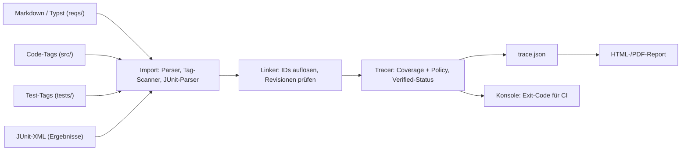
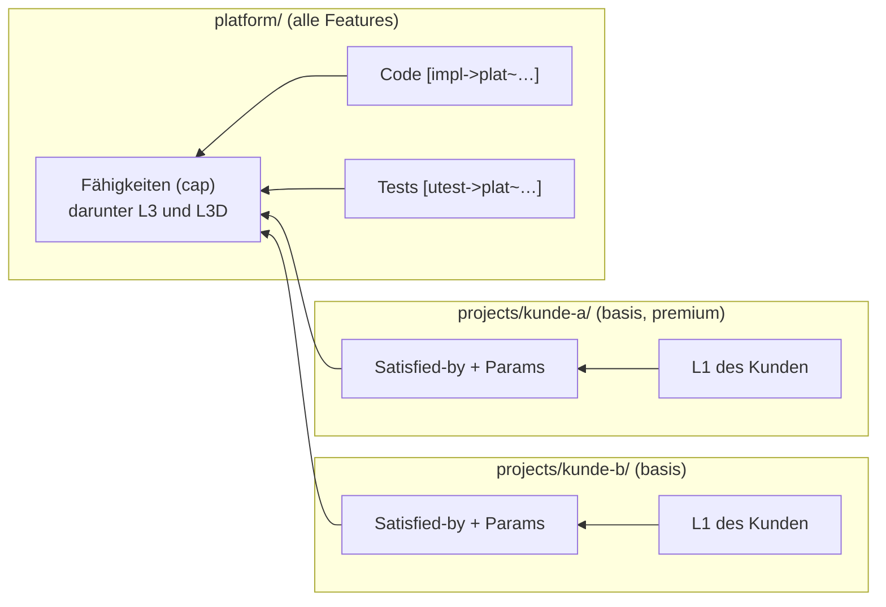
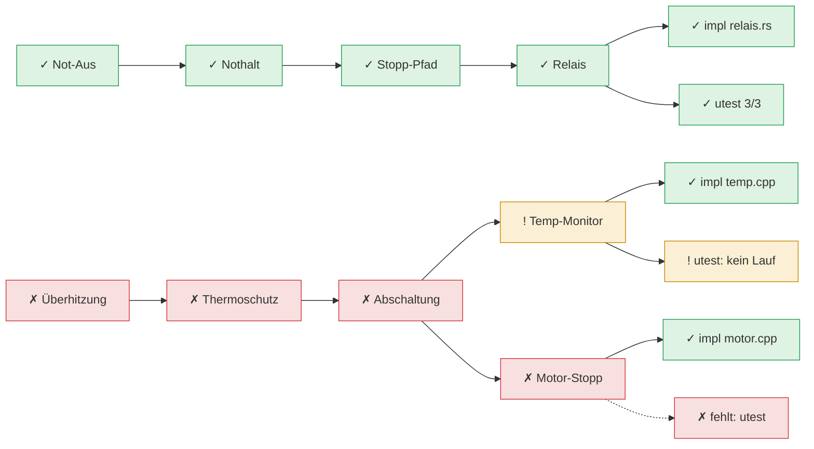

# shall – Requirements as Code: Konzept & Implementierungsplan

Oct 12, 2026 · @Peter

## Ziel & Kontext

Ein neues Projekt führt seine Requirements von Anfang an als Markdown-Dateien im Git-Repository, direkt neben dem Code. Git ist die einzige Quelle der Wahrheit, DOORS spielt keine Rolle. Ein Werkzeug in Rust prüft die Verlinkung über alle Ebenen bis zu Implementierung und Validierung und erzeugt einen HTML-Report.

Anforderungen an das System:

- **Requirements as Code:** ein Requirement = ein Markdown-Abschnitt mit eindeutiger ID und Metadaten, versioniert in Git, reviewbar per Merge Request.
- **Frei konfigurierbare Ebenen:** z. B. L1 (High-Level) → L2 → L3 (Requirements) → L3D (Design-Entscheidungen) wie im Automotive-Umfeld; andere Projekte definieren eigene Ebenen.
- **Blatt-Ebene:** jedes unterste Item teilt sich in mindestens eine Implementierung (Code) und mindestens eine Validierung (Unit-Test, Integrationstest, Review, Analyse).
- **Report:** HTML und PDF mit allen Requirements, Links nach oben und unten, am Ende Links auf Code-Stellen und Tests samt Ergebnis, plus Abdeckung je Ebene und Defektliste.
- **Betrieb:** lokal mit einem Kommando erzeugbar; im Regelfall baut die CI den Report als Ordner statischer Dateien, den ein beliebiger Pages-Dienst oder Webserver hostet.
- **Nebenbedingungen:** Rust (performant, stabil, eine statische Binary ohne Laufzeit), Open Source für ein breites Publikum, erweiterbar über Plugins, deterministische Ausgabe; Hosting und CI-System wählt der Anwender.

## Gibt es das schon? Marktüberblick

Ja: OpenFastTrace (OFT) deckt das Konzept fast vollständig ab – Markdown als natives Format, frei definierbare Ebenen über `Needs:`/`Covers:`, Tags in C++- und Rust-Code und ein HTML-Report. Was keinem Tool out of the box gelingt, ist die Kombination aus DOORS-Import, Markdown **und** echten Testergebnissen (pass/fail) im selben Report.

| Tool | Format der Requirements | Ebenen / Links | Code & Tests | Report | DOORS-Weg | Lizenz / Stack |
| --- | --- | --- | --- | --- | --- | --- |
| [OpenFastTrace](https://github.com/itsallcode/openfasttrace/blob/main/doc/user_guide.md) | Markdown (nativ), ID `req~name~1` | beliebige Artefakttypen (feat → req → dsn → impl/utest/itest), Shallow- und Deep-Coverage, Revision invalidiert Links | Tags `// [impl->dsn~x~1]` in C, C++, Rust u. v. m. | Plain, HTML, XML (aspec) | nur SpecObject/ReqM2-XML, kein ReqIF | GPL-3.0, Java 17 |
| [StrictDoc](https://strictdoc.readthedocs.io/en/stable/stable/docs/strictdoc_24_development_plan.html) | eigenes SDoc-Format; Markdown seit 2026 in Arbeit | Parent/Child-Relationen, Rollen, Traceability-Matrix | Marker im Code, Rust-Parsing seit 2026-Q1, Tests/Coverage geplant | statisches HTML + Web-UI | **ReqIF Import/Export** | Apache-2.0, Python |
| [Sphinx-Needs](https://www.sphinx-needs.com/) + [Test-Reports](https://sphinx-test-reports.readthedocs.io/en/stable/) | RST, Markdown via MyST | frei konfigurierbare Need-Typen und Link-Typen | Codelinks aus Kommentaren; JUnit-XML (gtest) als Testergebnis-Objekte | Sphinx-HTML, Tabellen, Graphen | über kommerzielles ubConnect | MIT, Python; useblocks GmbH (DE) |
| [LOBSTER (BMW)](https://github.com/bmw-software-engineering/lobster/wiki) | TRLC, Codebeamer, JSON – kein Markdown | Tracing-Policy mit Ebenen | eigene Tools für C++, gtest, Python | HTML- und CI-Report | über Codebeamer/JSON | AGPL-3.0, Python |
| [Doorstop](https://pypi.org/project/doorstop/) | ein YAML/Markdown-Item pro Datei | Dokumente mit Parent-Dokument | `ref`-Feld auf Dateien | HTML/Markdown publish | Import aus CSV/XLSX | LGPL, Python |

**Einordnung:**

- **OpenFastTrace** passt am besten zu deinem Bild. Ein JabRef-Beispiel zeigt den Ablauf: Requirement unter einer Markdown-Überschrift, `Needs: impl`, im Code ein Kommentar-Tag ([JabRef Devdocs](https://devdocs.jabref.org/requirements)). Lücken: keine Testergebnisse, kein ReqIF, Java-Runtime nötig. Für Rust gibt es den OFT-kompatiblen Klon [cargo-ovft](https://docs.rs/cargo-ovft).
- **StrictDoc** ist am stärksten beim DOORS-Übergang (ReqIF), aber Markdown ist dort noch jung.
- **Sphinx-Needs** ist das mächtigste Ökosystem inkl. Testergebnissen, verlangt aber den Sphinx-Build und hat viel Konfiguration.
- **LOBSTER** und **Doorstop** passen wegen fehlendem Markdown bzw. Ein-Datei-pro-Item weniger.

**Empfehlung:** Da Testergebnisse im Report und frei konfigurierbare Ebenen gewünscht sind, lohnt sich ein eigenes Werkzeug in Rust mit **OFT-kompatibler Syntax**. OFT bleibt so als Gegenprobe nutzbar. Vorher einen Nachmittag OFT am Beispielprojekt aus Schritt 0.2 ausprobieren, um die Lücken konkret zu sehen.

## Architektur des eigenen Systems

Das Werkzeug (`shall`, kurz für „Specifications Hooked to Actual Lines of Logic“ – und das Schlüsselwort jedes Requirements) ist eine Kommandozeilen-Anwendung, die vier Quellen einliest, daraus einen Graphen baut, ihn gegen eine Policy prüft und einen HTML-Report schreibt. Vorschlag: Rust als Sprache – gewählt, weil performant, speichersicher und als einzelne statische Binary lokal wie in der CI lauffähig.

### Repository-Layout

```text
reqs/
  L1_high_level/*.md     # Typ l1
  L2_system/*.md         # Typ l2
  L3_requirements/*.md   # Typ l3
  L3D_design/*.md        # Typ l3d (Blatt-Ebene)
  verification/*.md      # Typ vrev / vana (Reviews, Analysen)
src/                     # Code mit [impl->l3d~...~N]
tests/                   # Tests mit [utest->l3d~...~N]
shall.toml            # Ebenen, Policy, Quellen, Report
```

### Requirement-Format (OFT-kompatibel)

Ein Requirement ist ein Abschnitt in einer Markdown-Datei. Erlaubte Schlüsselwörter: `Status`, `Rationale`, `Comment`, `Covers`, `Needs`, `Depends`, `Tags`; zusätzlich `Source` für die Herkunft (z. B. Lastenheft-Kapitel oder Ticket).

```markdown
### Motor bei Übertemperatur abschalten
`l3~motor.overtemp-shutdown~2`

Die Software schaltet den Motor innerhalb von 100 ms ab, wenn die
Wicklungstemperatur 85 °C überschreitet.

Rationale:
Schutz der Wicklung, siehe Thermomodell.

Status: approved
Source: Lastenheft Kap. 4.2

Covers:
- l2~motor.thermal-protection~1

Needs: l3d
```

Die Blatt-Ebene fordert Implementierung und Validierung:

```markdown
### Temperaturüberwachung im 10-ms-Task
`l3d~motor.temp-monitor~1`

Der Task `TempMonitor` liest alle 10 ms den Sensor und setzt bei
> 85 °C das Abschaltsignal.

Covers:
- l3~motor.overtemp-shutdown~2

Needs: impl, utest
```

### Alternative: Requirements in Typst

Neben Markdown können Requirements in [Typst](https://typst.app) geschrieben werden. Das lohnt sich vor allem für Formeln, Tabellen und eine sauber gesetzte Spezifikation als PDF. Beide Formate dürfen im selben Projekt gemischt werden; das Format ergibt sich aus der Dateiendung (`.md` bzw. `.typ`), IDs und Links funktionieren formatübergreifend.

```typst
#import "@preview/shall:0.1.0": req

== Motor bei Übertemperatur abschalten
#req(
  id: "l3~motor.overtemp-k4f2~2",
  covers: "cap~motor.overtemp-protection~1",
  needs: "l3d",
  status: "approved",
  source: "Lastenheft Kap. 4.2",
  rationale: [Schutz der Wicklung, siehe Thermomodell.],
)[
  Die Software schaltet den Motor innerhalb von $t <= 100 "ms"$ ab,
  wenn die Wicklungstemperatur $T_W > 85 degree.C$ überschreitet.
]
```

- **Gleiches Modell:** `id`, `covers`, `needs`, `depends`, `satisfied_by`, `params`, `features`, `tags`, `status`, `source` und `rationale` entsprechen eins zu eins den Markdown-Schlüsselwörtern. Listenfelder akzeptieren einen einzelnen String oder ein Array, damit niemand über Typsts `("x",)` für Ein-Element-Arrays stolpert.
- **Typst-Paket `shall`:** Die Funktion `req` setzt das Item im PDF als Kasten mit ID, Status und anklickbaren Links auf die abgedeckten Items (über `label(id)`, weil die Kurzschreibweise `<…>` kein `~` erlaubt). So ist die kompilierte Spezifikation selbst navigierbar.
- **Bonus:** `typst compile reqs/main.typ` liefert eine fertige Spezifikation als PDF für Kunden oder Audits – ohne Umweg über den Report.

**Was dadurch zusätzlich zu tun ist:**

| Thema | Aufgabe | Risiko |
| --- | --- | --- |
| Einlesen | Dateien mit der Crate `typst-syntax` parsen (nur Syntax, kein Kompilieren) und `req(…)`-Aufrufe samt Zeilennummern extrahieren. Argumente müssen Literale sein; berechnete Werte werden als Defekt gemeldet. | gering: schnell, keine Fonts, kleine Abhängigkeit |
| Berechnete Items (optional) | Modus `typst.mode = "eval"`: Dokument mit der `typst`-Bibliothek auswerten und alle `req`-Elemente per Introspektion abfragen – nötig, wenn Items per Schleife, `#include` oder Variablen entstehen. | mittel: langsamer, große Abhängigkeit, darum eigene Cargo-Feature |
| Text im HTML-Report | Beschreibung und Rationale als Typst-Inhalt rendern: bevorzugt über Typsts HTML-Export (Formeln seit 0.15 als MathML), sonst je Item als SVG, notfalls als reiner Text. | hoch: der HTML-Export ist laut Typst noch experimentell und hinter einem Feature-Flag |
| Typst-Paket | `req` für den PDF-Satz schreiben und auf Typst Universe veröffentlichen; Version passend zu `shall` halten. | gering |
| Versionen | Typst ist vor 1.0 und ändert sich zwischen Versionen. Crate-Versionen pinnen, unterstützte Typst-Version in der Doku nennen, Fixtures je Version testen. | mittel |
| Werkzeuge | `shall new --format typ` erzeugt das Gerüst in Typst; `shall export --oft` wandelt Typst-Items in Markdown (Formeln nur als Text, also verlustbehaftet). | gering |
| Tests | Beispielprojekt aus 0.2 zusätzlich in Typst; Goldtest: beide Fassungen müssen dieselbe `trace.json` ergeben. | gering |

Im Editor hilft der Typst-Sprachserver Tinymist (Vorschau, Vervollständigung); `shall`-Meldungen im Format `datei.typ:42: …` sind wie bei Markdown anklickbar.

Quellen: [Typst HTML-Export (Doku)](https://www.typst.app/docs/reference/html), [Typst 0.15.0 Release Notes](https://github.com/typst/typst/releases/tag/v0.15.0)

### ID-Schema und ID-Vergabe

IDs müssen eindeutig sein und werden vom Werkzeug erzeugt, nicht von Hand ausgedacht. Fortlaufende Nummern scheiden aus: Zwei Branches vergeben sonst dieselbe Nummer, und beim Merge müsste eine umnummeriert werden – mit gebrochenen Links und Code-Tags.

**Format:** `typ~slug-zufall~revision`, z. B. `l3~motor.overtemp-k4f2~1`

| Teil | Herkunft | Zweck |
| --- | --- | --- |
| `typ` | Ebene aus `shall.toml` (nur ASCII-Buchstaben und Ziffern) | Position in der Hierarchie |
| `slug` | aus dem Titel beim Anlegen, punktgetrennt nach Komponente | Lesehilfe in Code-Tags und Reviews |
| `zufall` | 4–5 Zeichen Base32 beim Anlegen | macht parallele Branches praktisch kollisionsfrei |
| `revision` | startet bei 1, von Hand erhöht | markiert inhaltliche Änderungen |

**Regeln:**

- **Erzeugen statt ausdenken:** `shall new l3 "Motor bei Übertemperatur abschalten"` legt ein fertiges Item-Gerüst mit neuer ID an; ein VSCode-Snippet bzw. Task ruft dasselbe auf.
- **Nie umbenennen:** Slug und Zufall bleiben nach dem Anlegen fest, auch wenn sich der Titel ändert. Der Slug ist eine Lesehilfe, keine Beschreibung, die aktuell gehalten werden muss.
- **Nicht aus Inhalt oder Position ableiten:** Kein Hash über den Text, keine Nummer nach Reihenfolge in der Datei – sonst ändert sich die ID bei jeder Bearbeitung.
- **Inhaltliche Änderung = neue Revision:** Eine sachliche Änderung erhöht `~1` auf `~2`. Alle Links auf die alte Revision werden ungültig und müssen bewusst nachgezogen werden – das ist der Mechanismus für Impact-Analyse. Tippfehler-Korrekturen brauchen keine neue Revision.
- **Eindeutigkeit wird erzwungen:** Doppelte IDs sind ein Defekt der höchsten Schwere – über alle Dateien, Plattform und Projekte hinweg. Plattform-Items tragen beim Import den Namensraum (`plat~…`).
- **Gelöschte IDs werden nicht wiederverwendet:** `shall new` prüft gegen die Git-Historie, damit alte Links in Reports und Tickets nie auf etwas Neues zeigen.

Die übrigen Beispiele in diesem Dokument lassen den Zufallsanteil der Lesbarkeit halber weg.

### Links und Policy

| Link | Richtung | Bedeutung |
| --- | --- | --- |
| `Covers:` | Kind → Eltern | dieses Item verfeinert/erfüllt das Eltern-Item |
| `Needs:` | Eltern → Typen | welche Artefakttypen das Item abdecken müssen |
| `Depends:` | seitlich | Abhängigkeit, ohne Einfluss auf Coverage |
| `l2 --> l3 : l1~x~1` | Weiterleitung | Ebene l2 wird für dieses Item übersprungen |
| Tag `[impl->…]` | Code → Blatt (l3d) | Implementierung |
| Tag `[utest->…]`, `[itest->…]` | Test → Blatt | Validierung durch Test |
| Item `vrev`/`vana` mit `Covers:` | Doku → Blatt | Validierung durch Review/Analyse |

In `shall.toml` steht die erlaubte Kette (welcher Typ welchen abdecken darf). Ein Link, der dagegen verstößt, ist ein Fehler.

### Konfigurierbare Ebenen

Die Ebenen sind nicht fest eingebaut, sondern stehen in `shall.toml`. Die L1/L2/L3/L3D-Kette ist eine mitgelieferte Vorlage; ein kleines Projekt kommt mit `req` und `dsn` aus.

```toml
[[level]]
type  = "l1"
name  = "L1 – High-Level-Requirements"
needs = ["l2"]

[[level]]
type  = "l2"
name  = "L2 – System-Requirements"
needs = ["l3"]

[[level]]
type  = "l3"
name  = "L3 – Software-Requirements"
needs = ["l3d"]

[[level]]
type  = "l3d"
name  = "L3D – Design-Entscheidungen"
needs = ["impl", "utest"]   # Default, pro Item überschreibbar

[verification]
types = ["utest", "itest", "vrev", "vana"]

[sources]
impl  = ["src/**/*.{rs,cpp,hpp,c,h}"]
utest = ["tests/**", "src/**/*_test.cpp"]
junit = ["build/test-results/**/*.xml"]

[report]
code_url = "https://git.example.org/team/projekt/src/commit/{sha}/{path}#L{line}"
```

**Wenn eine Ebene der darüberliegenden 1:1 entspricht** (wie L1 = L2 im letzten Projekt), muss niemand abschreiben. Eine Weiterleitung `l2 --> l3 : l1~bremse.notbremse~1` (OFT-Syntax) erklärt das L1-Item direkt für L3 zuständig; der Report zeigt es als „durchgereicht“ statt als Lücke.

### Code- und Test-Tags

```cpp
// [impl->l3d~motor.temp-monitor~1]
void TempMonitor::run() { /* ... */ }

// [utest->l3d~motor.temp-monitor~1]
TEST(TempMonitor, ShutsDownAbove85C) { /* ... */ }
```

```rust
// [utest->l3d~motor.temp-monitor~1]
#[test]
fn shuts_down_above_85c() { /* ... */ }
```

Der Scanner merkt sich Datei und Zeile und erkennt die direkt folgende Testdefinition (`TEST`, `TEST_F`, `TEST_P` bzw. `#[test] fn`). So lässt sich das Tag mit dem Ergebnis aus der JUnit-XML verbinden (gtest: `--gtest_output=xml`; Rust: z. B. `cargo nextest` mit JUnit-Ausgabe).

### Status-Regeln für ein Requirement

- **Covered:** jeder Typ aus `Needs` hat mindestens ein gültiges abdeckendes Item.
- **Deep covered:** zusätzlich sind alle abdeckenden Items selbst (rekursiv) covered.
- **Verified:** deep covered **und** alle verknüpften Tests sind in der letzten Ausführung grün; Reviews haben Status `approved`.
- **Defekte:** fehlende Coverage, veraltete Revision, unbekannte ID, doppelte ID, verbotener Link, Tag ohne Ziel (verwaister Code), fehlgeschlagener oder nicht ausgeführter Test.

### Verarbeitungs-Pipeline



Alle Quellen werden zu einem Graphen zusammengeführt; `trace.json` ist die einzige Datenquelle für den HTML-Report, die Konsole liefert den Exit-Code für die CI.

## Wiederverwendung: Plattform, Projekte, Varianten

Die Codebasis wird zur **Plattform** mit eigenen Requirements für alles, was sie kann. Ein neuer Auftrag oder eine neue Variante ändert die Plattform nicht, sondern **ordnet nur zu und wählt aus**. In der Fachsprache ist das Produktlinien-Entwicklung mit einem „150-%-Modell“: Die Plattform enthält mehr, als ein einzelnes Projekt braucht.



Alle Pfeile zeigen vom Projekt in die Plattform; die Plattform kennt keine Kunden und bleibt bei jedem neuen Auftrag unverändert.

### Rollen

| Rolle | Ort | Inhalt | Ändert sich bei neuem Auftrag? |
| --- | --- | --- | --- |
| Plattform | Ordner `platform/` im Monorepo | Plattform-Requirements (Fähigkeiten, Design), Code, Tests, Feature-Liste | nein |
| Komponente | Ordner, Git-Submodul oder externes Repo | eigene Requirements, Code, Tests; wird von Plattform und/oder Projekten importiert | nein |
| Projekt | Ordner `projects/<kunde>/` | Kundenanforderungen (L1/L2), Zuordnung zu Plattform und Komponenten, Parameter, Ergänzungen | ja – nur hier wird gearbeitet |
| Variante | Abschnitt in der `shall.toml` des Projekts | Auswahl von Features | ein neuer Eintrag |

### Ebenen der Plattform: eine stabile Fähigkeiten-Ebene

Die Plattform bekommt oberhalb von L3 eine eigene Ebene **Fähigkeiten** (Typ `cap`). Kundenprojekte verlinken mit `Satisfied-by:` nur auf diese Ebene.

```text
Kunde L1 ──Satisfied-by──▶ plat cap ──▶ plat L3 ──▶ plat L3D ──▶ Code / Test
```

- **Stabilität für Projekte:** Eine Fähigkeit ist grob formuliert, z. B. „Übertemperaturschutz für den Motor; Schwelle und Reaktionszeit sind parametrierbar.“ Die Plattform kann L3 und L3D darunter verfeinern und umbauen, ohne dass ein Projekt betroffen ist. Nur wenn sich eine Fähigkeit selbst ändert, müssen Projekte nachziehen.
- **Leistungsbeschreibung:** Die Liste der Fähigkeiten beschreibt zugleich lesbar, was die Plattform kann – nützlich für Angebote an neue Kunden.
- **Weniger Links:** Ein Kunde ordnet einige Dutzend Fähigkeiten zu statt hunderter Detail-Requirements.

```toml
# platform/shall.toml
[[level]]
type  = "cap"
name  = "Fähigkeiten"
needs = ["l3"]

[[level]]
type  = "l3"
name  = "L3 – Software-Requirements"
needs = ["l3d"]

[[level]]
type  = "l3d"
name  = "L3D – Design-Entscheidungen"
needs = ["impl", "utest"]

[satisfied_by]
targets  = ["cap"]   # Kundenanforderungen dürfen nur auf Fähigkeiten zeigen
fallback = ["l3"]    # optional erlaubt, erzeugt aber eine Warnung
```

Für das Werkzeug bleibt das Konfiguration: Die Vorlage `shall init --template platform` legt diese Ebenen an, andere Projekte können es anders schneiden.

### Kernregel: Links zeigen vom Projekt zur Plattform

Im OFT-Modell zeigt `Covers:` vom Kind zum Eltern-Item. Für Wiederverwendung wäre das falsch herum: Ein Plattform-Item müsste die IDs jeder Kundenanforderung kennen, und jedes neue Projekt würde die Plattform ändern. Deshalb bekommt das Werkzeug das zusätzliche Schlüsselwort `Satisfied-by:`. Es steht im Kunden-Item, zeigt nach unten und gilt im Graphen wie ein umgekehrtes `Covers`.

```markdown
### Abschaltung bei Übertemperatur
`l1~kunde-a.overtemp~1`

Der Antrieb schaltet bei Übertemperatur innerhalb von 100 ms ab.

Satisfied-by:
- plat~motor.overtemp-protection~1

Params:
- motor.shutdown_time_ms = 100
```

- `Params:` hält fest, mit welchem Parameterwert die Plattform die Anforderung erfüllt; der Report zeigt ihn neben dem Link.
- Kann die Plattform eine Kundenanforderung nicht erfüllen, bekommt das Item ganz normal `Needs: l3` und wird im Projekt-Repo verfeinert und umgesetzt – oder als Erweiterung an die Plattform gemeldet.
- `Satisfied-by:` und `Params:` sind bewusste Erweiterungen gegenüber OFT. Für die Gegenprobe wandelt `shall export --oft` sie in Standard-`Covers` um.

### Repository-Struktur und Importe

Standard ist ein Monorepo. Komponenten, die auch außerhalb gebraucht werden, können zusätzlich als Git-Submodul oder externes Repo eingebunden werden.

```text
repo/
  shall.toml              # Workspace: Liste aller Mitglieder
  platform/
    shall.toml            # Ebenen, Features, Importe der Plattform
    reqs/  src/  tests/
  components/
    can-stack/               # z. B. Git-Submodul mit eigenem shall.toml
  projects/
    kunde-a/
      shall.toml          # Importe, Varianten, Parameter
      reqs/
    kunde-b/
```

```toml
# projects/kunde-a/shall.toml
[[import]]
name = "plat"
path = "../../platform"

[[import]]
name = "can"
path = "../../components/can-stack"     # Submodul im Monorepo
# extern: git = "https://git.example.org/team/can-stack.git", rev = "v1.2.0"
```

**Regeln für das Import-Geflecht (1:n):**

- Eine Komponente kann von beliebig vielen Projekten und auch von der Plattform importiert werden. Importe sind transitiv: Importiert die Plattform `can-stack`, sieht das Projekt beides.
- Jede Komponente hat genau einen Namensraum (`can~…`). Wird sie über zwei Wege erreicht, lädt das Werkzeug sie nur einmal.
- Zwei verschiedene Stände derselben Komponente im selben Projekt sind ein Defekt – wie ein Versionskonflikt bei Abhängigkeiten.
- Zyklen im Import-Graphen sind ein Defekt.
- Links zeigen nur in Importrichtung: Projekt → Plattform → Komponente, nie zurück.

**Plattform-Stand im Monorepo:** Requirements, Code und Tests müssen immer aus demselben Stand kommen – sonst bescheinigt der Report etwas, das gar nicht gebaut wird. Daraus folgen drei Regeln:

- **Interne Importe (`path` im selben Repo) folgen immer dem aktuellen Stand.** Erhöht jemand die Revision eines Plattform-Items, zeigen die betroffenen Projekte sofort veraltete Links – im selben Merge Request, in dem die Änderung passiert. Ein `rev` an einem internen Import ist ein Konfigurationsfehler.
- **Einen Projektstand einfrieren** (z. B. nach einer Kundenabnahme) geht über einen Release-Branch oder Tag des **ganzen** Repos, etwa `release/kunde-a-1.0`. Dort passen Requirements, Code und Tests zusammen, und der Report dieses Branches bleibt stabil.
- **Feste Stände per `rev` gibt es nur für externe Komponenten** (externes Repo oder Submodul): Dort sind Code und Requirements gemeinsam auf denselben Stand festgelegt.

`shall upgrade-check` zeigt auf einem Release-Branch, was beim Nachziehen auf den aktuellen `master` zu prüfen wäre, und bei externen Komponenten, was ein neuer `rev` verändert.

### Varianten über Features

Plattform-Items tragen die Features, zu denen sie gehören; Code-Tags und Tests erben sie über das Item, auf das sie zeigen.

```markdown
`plat~diag.uds-readout~1`

Features: diag_uds
```

```toml
[variant.basis]
features = ["motor_ctrl", "can"]

[variant.premium]
features = ["motor_ctrl", "can", "diag_uds", "ota"]
```

- Feature-Namen sind identisch mit den Cargo-Features bzw. CMake-Optionen. So steuert eine Liste Build **und** Traceability.
- `shall report --variant premium` blendet alles aus, was nicht zur Variante gehört.
- Ausdrücke wie `Features: ota && !eu_market` sind ein späterer Ausbau.

### Was „mehr als gefordert“ im Report bedeutet

- **Plattform-Report:** alle Fähigkeiten, alle Features. Code muss hier immer auf ein Plattform-Item zeigen, sonst gilt er als verwaist.
- **Projekt-Report pro Variante:** Kundenanforderung → Plattform → Code und Tests. Plattform-Items der gewählten Features, die kein Kunde verlangt, erscheinen als **„bereitgestellt, nicht angefordert“** – eine Information, kein Defekt. Items außerhalb der Variante tauchen nicht auf.
- **Testergebnisse** kommen aus dem Build der jeweiligen Variante (eine JUnit-XML pro Variante), weil Features das Verhalten ändern.

### Neuer Auftrag in der Praxis

1. Projektordner anlegen: `shall new-project projects/kunde-c` (Vorlage mit `shall.toml` und Ordnern).
2. Plattform und benötigte Komponenten per `[[import]]` einbinden; externe Komponenten mit festem `rev`.
3. Kundenanforderungen als L1 (und bei Bedarf L2) schreiben.
4. Pro Kundenanforderung `Satisfied-by:` auf vorhandene Plattform- oder Komponenten-Items setzen; der Report listet alle noch nicht zugeordneten.
5. Varianten als Feature-Auswahl eintragen.
6. Lücken projektspezifisch umsetzen oder als Plattform-Erweiterung einplanen.

Die Plattform-Requirements werden dabei nicht angefasst.

## Erweiterbarkeit und Open Source

Das Werkzeug wird als Open-Source-Projekt für ein breites Publikum entwickelt. Der Kern bleibt schlank und allgemein; Spezialfälle wie ein eigenes Importformat, eine Firmenregel oder ein besonderer Report kommen über Erweiterungen dazu, ohne den Kern zu forken.

### Drei Stufen der Erweiterung

| Stufe | Mittel | Geeignet für | Aufwand für Anwender |
| --- | --- | --- | --- |
| 1. Konfiguration | eigene Felder, Ebenen, Regex-Regeln und Report-Templates (`minijinja`) bzw. CSS in `shall.toml` | Layout, Firmen-Branding, einfache Prüfregeln, Zusatzfelder | keine Programmierung |
| 2. Prozess-Plugins | externes Programm, Austausch per JSON über stdin/stdout | Importer, Exporter, eigene Checks, Tag-Scanner für weitere Sprachen | beliebige Sprache, z. B. ein Python-Skript |
| 3. Rust-Bibliothek | `shall-core` als Crate einbinden und eigenes Werkzeug bauen | tiefe Eingriffe, eigene Pipelines | Rust |

Bewusst **nicht** vorgesehen sind nativ nachgeladene Bibliotheken (`.so`/`.dll`): Rust hat keine stabile ABI, und ein abstürzendes Plugin würde das ganze Werkzeug mitreißen. WebAssembly-Plugins (Sandbox, plattformunabhängig) sind ein möglicher späterer Ausbau.

### Erweiterungspunkte

| Punkt | Pipeline-Schritt | Beispiele |
| --- | --- | --- |
| `importer` | Import | ReqIF, Excel/CSV, Jira, Polarion-Export |
| `scanner` | Import | Tags in weiteren Sprachen oder Annotationsformen (`@req` in Doxygen) |
| `results` | Import | Testergebnisse aus anderen Formaten als JUnit-XML |
| `build` | Build-Abgleich (M9) | weitere Build-Systeme |
| `check` | Tracer | Firmenregeln, Normen-Checklisten, Formulierungs-Lint |
| `exporter` | Ausgabe | Confluence, Excel-Matrix, eigene HTML-Ansichten |

```toml
[[plugin]]
name    = "jira-import"
kind    = "importer"
command = ["shall-jira", "--project", "ABC"]

[[plugin]]
name    = "wording-lint"
kind    = "check"
command = ["python3", "tools/wording_lint.py"]
```

**Plugin-Protokoll:** `shall` startet das Programm, schreibt eine JSON-Anfrage nach stdin (`schema_version`, Art, Konfiguration, bei Checks und Exportern der Graph) und liest die Antwort von stdout – Items, Defekte oder Dateien. stderr landet im Log, ein Absturz wird als Plugin-Fehler gemeldet und reißt den Lauf nicht mit. Zusätzlich funktionieren Unterbefehle wie bei `git` und `cargo`: Ein Programm `shall-foo` im `PATH` ist als `shall foo` aufrufbar.

### Grundsätze für ein breites Publikum

- **Stabile, versionierte Verträge:** Markdown-Syntax, `shall.toml`, `trace.json` und das Plugin-Protokoll haben je ein veröffentlichtes JSON-Schema mit Versionsnummer. Brechende Änderungen nur mit neuer Hauptversion (SemVer).
- **Englisch als Projektsprache:** Code, CLI-Meldungen, Dokumentation und Standard-Schlüsselwörter auf Englisch; der Report ist übersetzbar (zunächst Englisch und Deutsch).
- **Keine Annahmen über Branche oder Werkzeuge:** Automotive-Ebenen sind nur eine von mehreren Vorlagen; Hosting, Git-Server und CI bleiben dem Anwender überlassen.
- **Einfache Installation:** fertige Binaries für Linux, macOS und Windows, `cargo install`, Container-Image.
- **Dogfooding:** Das Werkzeug verfolgt seine eigenen Requirements mit sich selbst; der eigene Report ist zugleich die beste Demo.
- **Lizenz:** MIT – kurz, verständlich, für Firmen ohne Hürde und mit fast allem kombinierbar. Beiträge laufen über ein Developer Certificate of Origin (DCO, `Signed-off-by` im Commit), kein CLA. Ein späterer Wechsel neuer Versionen auf eine andere Lizenz (z. B. EUPL-1.2) bleibt möglich; veröffentlichte Versionen bleiben MIT. Da nur die Syntax von OFT übernommen wird und kein Code, gibt es keine Bindung an dessen GPL.

## Implementierungsplan in Arbeitspaketen

Der Plan hat zwölf Meilensteine; nach M2 gibt es ein nutzbares MVP (Konsole), nach M5 den vollständigen HTML-Report. Jedes Paket ist so geschnitten, dass es in einer Sitzung von 1–4 Stunden fertig wird und mit Tests abgeschlossen ist. Größen: S = unter 2 h, M = 2–4 h, L = mehrere Sitzungen.

### M0 – Fundament

- [ ] **0.1 Projekt-Skelett (S)**
  - `cargo new shall`, Crates: `clap` (CLI), `anyhow`/`thiserror` (Fehler), `serde` + `toml` (Konfiguration).
  - Unterbefehle als Stubs: `shall check`, `shall report`, `shall new`.
  - Fertig, wenn: `shall --version` lokal und in der CI läuft.
- [ ] **0.2 Beispielprojekt als Testfixture (M)**
  - Ordner `fixtures/motor/` mit 3 Ebenen, ca. 8 Requirements, etwas C++-Code mit gtest und einer JUnit-XML.
  - Absichtlich eingebaute Fehler: ein unabgedecktes Requirement, eine veraltete Revision, ein verwaistes Code-Tag, ein roter Test.
  - Datei `expected-defects.txt` als „goldene“ Erwartung.
  - Fertig, wenn: die Fixture eingecheckt ist und jeder Fehler dokumentiert ist.
- [ ] **0.3 Datenmodell (M)**
  - `ItemId { typ, name, revision }` mit `FromStr`/`Display` für `typ~name~rev`.
  - `Item { id, title, description, rationale, status, needs: Vec<Typ>, covers: Vec<ItemId>, depends, tags, source, location: Datei+Zeile }`.
  - Fertig, wenn: Unit-Tests für gültige und ungültige IDs grün sind.

### M1 – Markdown-Import

- [ ] **1.1 ID-Erkennung (M)**
  - Zeilenbasierter Zustandsautomat: Eine Zeile, die nur aus `` `typ~name~rev` `` besteht, startet ein Item; die direkt vorangehende Überschrift wird Titel.
  - Code-Blöcke (```` ``` ````) werden übersprungen, damit Beispiele nicht als Items zählen.
  - Fertig, wenn: alle Items der Fixture mit Datei und Zeile erkannt werden.
- [ ] **1.2 Schlüsselwörter (M)**
  - `Needs:` (kommagetrennt), `Covers:`/`Depends:` (Aufzählungsliste), `Status:`, `Tags:`, `Source:`, `Rationale:`, `Comment:`.
  - Freier Text bis zum ersten Schlüsselwort = Beschreibung; nächstes Item oder gleich hohe Überschrift beendet das Item.
  - Fertig, wenn: Snapshot-Tests (Crate `insta`) die geparsten Items der Fixture festschreiben.
- [ ] **1.3 Diagnose-Ausgabe (S)**
  - Fehler im Format `datei.md:42: unbekanntes Schlüsselwort 'Neds'`, damit VSCode sie im Terminal anklickbar macht.
  - Doppelte IDs melden, auch über Plattform und Projekt hinweg; höchste Schwere.

* [ ] **1.4 `shall new` – ID-Erzeugung (M)**
  - Slug aus dem Titel (Umlaute transliterieren, Kleinbuchstaben, Bindestriche), 4–5 Zeichen Base32-Zufall anhängen (Crate `rand`).
  - Gegen alle bekannten IDs prüfen, auch gelöschte aus der Git-Historie (`git log -S`); bei Kollision neu würfeln.
  - Item-Gerüst mit Titel, ID, `Covers:`-Platzhalter und Default-`Needs` der Ebene an die Zieldatei anhängen.
  - VSCode-Task bzw. Snippet, der das Kommando aufruft.
  - Fertig, wenn: 10 000 erzeugte IDs ohne Kollision sind und eine gelöschte ID nie wieder vergeben wird (Test).

### M2 – Linker, Coverage, Konsole (MVP)

- [ ] **2.1 Index und Auflösung (M)**
  - `HashMap<(typ,name), Vec<Item>>`; jedes `Covers` auflösen.
  - Defekte: unbekannte ID, falsche Revision (`COVERING_WRONG_VERSION`), doppelte ID.
- [ ] **2.2 Shallow Coverage (S)**
  - Pro Item: welche Typen aus `Needs` sind abgedeckt, welche fehlen, welche Abdeckung war nicht gefordert.
- [ ] **2.3 Deep Coverage (M)**
  - Rekursive Auswertung mit Memoisierung und Zyklenerkennung (Zyklus = Defekt).
- [ ] **2.4 Policy aus `shall.toml` (M)**
  - Erlaubte Kette, z. B. `l1→l2→l3→l3d→{impl,utest,itest,vrev}`; verbotene Links als Defekt.
- [ ] **2.5 Konsolen-Report und Exit-Code (S)**
  - Ausgabe ähnlich OFT: `ok`/`not ok`, Coverage pro Item, Zusammenfassung; Exit-Code abhängig vom Prüfmodus (siehe 7.5).
  - Fertig, wenn: `shall check fixtures/motor` genau die Defekte aus `expected-defects.txt` liefert (Integrationstest).
- [ ] **2.6 Gegenprobe mit OFT (S)**
  - Dieselbe Fixture mit `oft trace` laufen lassen und Ergebnisse vergleichen; Abweichungen dokumentieren.

### M3 – Code- und Test-Tags

- [ ] **3.1 Tag-Scanner (M)**
  - Dateien mit Crate `ignore` durchlaufen (respektiert `.gitignore`), Tags per Regex `\[\s*(\w+)(~[^\]\s]*)?\s*->\s*([^\]\s]+)\s*\]` finden.
  - Jedes Tag erzeugt ein Item `impl~<name>-<hash>~0` mit `Covers` auf das Ziel.
- [ ] **3.2 Testnamen erkennen (M)**
  - Nach einem `utest`/`itest`-Tag die nächste Testdefinition suchen: gtest `TEST(_F|_P)?\((\w+),\s*(\w+)\)`, Rust `#[test]` + `fn (\w+)`.
  - Ergebnis: `test_key = Suite.Name` bzw. `modulpfad::name`.
- [ ] **3.3 Konfigurierbare Quellen (S)**
  - In `shall.toml`: Globs pro Quelle, z. B. `impl = ["src/**/*.{cpp,hpp,rs}"]`, `utest = ["tests/**"]`.

### M4 – Testergebnisse und weitere Validierung

- [ ] **4.1 JUnit-XML einlesen (M)**
  - Crate `quick-xml`; `testcase classname/name` → `passed | failed | skipped`.
- [ ] **4.2 Ergebnisse zuordnen (S)**
  - Join über `test_key`; Tag ohne Ergebnis = „nicht ausgeführt“ (Defekt, konfigurierbar als Warnung).
- [ ] **4.3 Reviews und Analysen (S)**
  - Items vom Typ `vrev`/`vana` in Markdown, mit `Covers:` und `Status: approved` als Nachweis.
- [ ] **4.4 Status „Verified“ hochrechnen (M)**
  - Ein Requirement ist verified, wenn alle Blätter darunter implementiert und erfolgreich validiert sind.

### M5 – HTML-Report

- [ ] **5.1 JSON-Export (S)**
  - Der komplette Graph als `trace.json` – einzige Datenquelle für den Report und für spätere Auswertungen.
- [ ] **5.2 Seitengerüst (M)**
  - Templates mit `minijinja`; eine einzelne HTML-Datei mit eingebettetem CSS.
  - Startseite: Zusammenfassung (Anzahl Items, Coverage % je Ebene, Defektzahl), dann eine Tabelle pro Ebene.
- [ ] **5.3 Requirement-Detail (L)**
  - Text mit `pulldown-cmark` gerendert; Anker = ID, z. B. `#swr~motor.overtemp-shutdown~2`.
  - Links nach oben (Covers) und nach unten (abdeckende Items).
  - Am Ende: Implementierungen als Permalink `…/blob/<commit-sha>/src/x.cpp#L42` und Tests mit Ergebnis-Badge.
- [ ] **5.4 Baumansicht (M)**
  - Aufklappbarer Baum Stakeholder → Design → Code/Test mit `<details>`/`<summary>`, ohne JavaScript.
- [ ] **5.5 Filter und Suche (M)**
  - Wenig Vanilla-JS: Filter nach Status, Typ, Tag; Volltextsuche über Titel und ID.
- [ ] **5.6 Defektliste (S)**
  - Eigener Abschnitt mit allen Defekten, sortiert nach Schwere, jeweils mit Link zur Fundstelle.

#### Green Graph – jede L1-Kette auf einen Blick

Der Report zeigt die Abhängigkeiten jeder L1-Anforderung als Graph von links nach rechts: L1 → L2 → L3 bzw. Fähigkeit → L3D → Code und Tests. Jeder Knoten trägt einen Status, und der schlechteste Status eines Kindes wandert nach oben – eine L1 ist nur grün, wenn die gesamte Kette darunter grün ist.

| Status | Zeichen | Bedeutung |
| --- | --- | --- |
| grün | ✓ | vollständig abgedeckt, alle Tests bestanden, Reviews `approved`; mit M9 zusätzlich nachweislich gebaut |
| gelb | ! | Kette vollständig, aber Nachweis fehlt noch: Test nicht gelaufen, Item im Status `draft`, keine Build-Daten |
| rot | ✗ | Lücke oder Defekt: fehlende Abdeckung, veraltete Revision, roter Test, nicht gebaut |
| grau | – | außerhalb der gewählten Variante oder „bereitgestellt, nicht angefordert“ |

Fehlende Abdeckung erscheint als gestrichelter roter Platzhalter-Knoten, z. B. „fehlt: utest“ – die Lücke ist so direkt dort sichtbar, wo sie entsteht.



Oben ist die Kette bis zum bestandenen Test geschlossen. Unten macht der fehlende Test unter „Motor-Stopp“ die ganze Kette bis zur L1 rot; der nicht gelaufene Test unter „Temp-Monitor“ allein wäre nur gelb.

**Gestaltung:**

- **Nie nur Farbe:** Jeder Status hat zusätzlich ein Zeichen (✓ ! ✗), weil rund 8 % der Männer Rot und Grün schlecht unterscheiden. Eine farbenblind-freundliche Palette ist wählbar.
- **Zwei Ebenen der Ansicht:** Eine Übersicht zeigt alle L1 als farbige Kacheln, gruppiert nach Tags oder Komponenten – das skaliert auch bei Hunderten. Ein Klick öffnet den Graphen genau dieser L1.
- **Blätter bündeln:** Viele Implementierungen oder Tests unter einem L3D werden zu einem Knoten wie „utest 12/12 ✓“ zusammengefasst und lassen sich aufklappen.
- **Ohne Server und ohne große Bibliothek:** Layout (Ebenen-Layout nach Sugiyama) und SVG entstehen beim Erzeugen des Reports in Rust; im Browser braucht es nur wenig JavaScript für Klicken, Aufklappen und Zoom. Damit bleibt `index.html` offline nutzbar und deterministisch.
- **Variante wählbar:** Der Graph zeigt die gewählte Variante; nicht enthaltene Teile sind grau oder ausgeblendet.

* [ ] **5.9 Status je Knoten (M)**
  - Grün/Gelb/Rot/Grau nach der Tabelle oben berechnen; schlechtester Kind-Status wandert nach oben; Platzhalter-Knoten für fehlende Abdeckung erzeugen. Ergebnis landet in `trace.json`.
* [ ] **5.10 Graph-Layout und SVG (L)**
  - Ebenen-Layout (Sugiyama: Ebenen zuweisen, Kreuzungen minimieren, Positionen setzen) in Rust, Ausgabe als Inline-SVG; Blätter zu Zähl-Knoten bündeln.
* [ ] **5.11 Übersicht als Kacheln (M)**
  - Alle L1 als farbige Kacheln mit Zeichen, gruppiert nach Tag oder Komponente; Klick öffnet den Graphen.
* [ ] **5.12 Interaktion (M)**
  - Wenig Vanilla-JS: aufklappen, Zoom und Verschieben, Klick auf Knoten springt zum Requirement bzw. zur Code-Stelle.
* [ ] **5.13 Badge und Export (S)**
  - SVG-Badge für das README („L1: 42/45 grün“); Graph zusätzlich als DOT oder Mermaid exportierbar.

#### PDF-Export

Neben HTML erzeugt `shall report --format pdf` (oder `--format html,pdf`) denselben Report als PDF – für Audits, Kundenabnahmen und Archivierung. Gesetzt wird er mit der Typst-Bibliothek direkt aus `trace.json`: kein Browser, kein LaTeX, keine externe Installation, und das für Requirements in Markdown wie in Typst.

**Inhalt:**

- **Deckblatt:** Projekt, Variante, Commit-SHA und Datum aus `--build-info`, Prüfmodus.
- **Zusammenfassung:** Abdeckung je Ebene, Anzahl Defekte, Green-Graph-Kacheln aller L1.
- **Green Graph je L1** als eingebettete Vektorgrafik (dasselbe SVG wie im HTML).
- **Traceability-Matrix** je Ebenenpaar als Tabelle, über Seiten umbrechend.
- **Requirement-Details** mit Beschreibung, Rationale, Status und internen Links nach oben und unten; Code- und Test-Links als Permalinks auf den Commit, Testergebnisse mit Status.
- **Defektliste** und Anhang mit Plugin- und Konfigurationsübersicht.

**Eigenschaften:**

- **Klickbar:** Inhaltsverzeichnis, Lesezeichen und alle Querverweise sind PDF-Links; jede Requirement-ID ist ein Sprungziel.
- **Archivtauglich:** optional als PDF/A (`--pdf-standard a-2b`), für langfristige Ablage bei Audits.
- **Reproduzierbar:** Schriften sind eingebettet und werden mitgeliefert, Erstellungsdatum kommt aus `--build-info`; gleicher Stand ergibt dasselbe PDF.
- **Anpassbar:** eigenes Typst-Template mit Firmenlogo, Farben und Kopfzeile über `[report.pdf] template = "reqs/report-template.typ"` (Erweiterungsstufe 1).
- **Große Projekte:** `--pdf-scope l1` (nur Zusammenfassung und L1) oder ein PDF je Variante, damit Dokumente nicht ausufern.

* [ ] **5.14 Typst-Template für den Report (M)**
  - Deckblatt, Zusammenfassung, Matrix, Details, Defektliste als Typst-Template; Daten aus `trace.json` (Typst liest JSON nativ).
* [ ] **5.15 Markdown → Typst (M)**
  - Beschreibungen aus Markdown (`pulldown-cmark`) in Typst-Markup umsetzen: Absatz, Hervorhebung, Listen, Tabellen, Code, Links; Typst-Items werden direkt eingebettet.
* [ ] **5.16 PDF über die Typst-Bibliothek erzeugen (M)**
  - In-Prozess kompilieren, mitgelieferte Schriften, Datum aus `--build-info`, optional PDF/A; Cargo-Feature `pdf`, in den Release-Binaries aktiv.
* [ ] **5.17 Goldtest und eigene Templates (S)**
  - PDF des Beispielprojekts zweimal erzeugen und byte-gleich vergleichen; `[report.pdf] template` und `--pdf-scope` umsetzen.

### M6 – Konfigurierbare Ebenen

- [ ] **6.1 Ebenen aus `shall.toml` (M)**
  - `[[level]]`-Einträge einlesen und prüfen: eindeutige Typen, `needs` verweist nur auf bekannte Typen, keine Zyklen.
  - Default-`Needs` pro Ebene, damit nicht jedes Item `Needs:` wiederholen muss.
  - Kann vor 2.4 gezogen werden, die Policy baut darauf auf.
- [ ] **6.2 Weiterleitung (S)**
  - Syntax `l2 --> l3 : l1~x~1` parsen; im Tracer zählt das Item als von l2 abgedeckt, sobald l3 es abdeckt.
- [ ] **6.3 Projektvorlagen (S)**
  - `shall init --template automotive` (L1/L2/L3/L3D), `--template platform` (Fähigkeiten/L3/L3D), `--template project` (Kunden-L1 mit Plattform-Import) bzw. `--template simple` (req/dsn) legt Ordner, Beispiel-Items und `shall.toml` an.
- [ ] **6.4 Ebenen-Namen im Report (S)**
  - Überschriften, Spalten und Filter im HTML nutzen die Namen aus der Konfiguration.

### M7 – CI und Alltag

- [ ] **7.1–7.4** siehe Abschnitt „CI-Integration“.

### M8 – Plattform, Projekte, Varianten

- [ ] **8.1 Workspace und Importe per Pfad (M)**
  - Workspace-`shall.toml` im Root listet alle Mitglieder; `[[import]]` mit `path`; jedes Item kennt seine Herkunft.
  - `shall check --workspace` prüft alle Projekte in einem Lauf und parst gemeinsam genutzte Plattform und Komponenten nur einmal.
- [ ] **8.2 Import-Graph (M)**
  - Transitive Importe auflösen, Komponenten deduplizieren, Defekte für zwei Stände derselben Komponente, Zyklen und Links gegen die Importrichtung.
- [ ] **8.3 Externe Komponenten (M)**
  - `git`/`rev` auflösen und in `.shall/cache/<name>/<rev>` ablegen (Crate `gix` oder `git`-Aufruf); `--offline` nutzt nur den Cache. Submodule liefern ihren Stand über den Submodul-Commit; ein `rev` an einem internen `path`-Import wird als Konfigurationsfehler gemeldet.
- [ ] **8.4 `Satisfied-by:` und `Params:` (M)**
  - Parsen, im Graphen als umgekehrte Coverage-Kante einhängen, Parameter am Link speichern; erlaubte Zielebenen aus `[satisfied_by]` prüfen (Standard: nur `cap`, `fallback` als Warnung).
- [ ] **8.5 Features und Varianten (M)**
  - `Features:` am Item, `[variant.*]` in der Konfiguration, Filterschritt vor dem Tracer.
  - `--variant <name>` bzw. `--all-variants` schreibt `site/<projekt>/<variante>/` plus eine Übersichtsseite.
- [ ] **8.6 Status „bereitgestellt, nicht angefordert“ (S)**
  - Eigener Status und Filter im Report; zählt nicht als Defekt.
- [ ] **8.7 Upgrade-Bericht (M)**
  - `shall upgrade-check --to master` (auf einem Release-Branch) bzw. `shall upgrade-check can --to v1.3.0` (externe Komponente) listet alle Zuordnungen, die durch Revisionssprünge ungültig würden.
- [ ] **8.8 `shall export --oft` (S)**
  - Erweiterungen in Standard-OFT umschreiben, damit die Gegenprobe weiter funktioniert.

### M9 – Build-Abgleich: Ist der verlinkte Code wirklich gebaut?

Ein `[impl->…]`-Tag beweist nur, dass Code existiert. M9 prüft, ob er im Build der jeweiligen Variante tatsächlich landet, in drei Stufen:

| Stufe | Frage | Quelle |
| --- | --- | --- |
| 1. Datei | Wird die Datei mit dem Tag gebaut? | `compile_commands.json` + `.d`-Dateien / `ninja -t deps` (CMake), `.d`-Dateien unter `target/` (Cargo), `bazel aquery` (Bazel) |
| 2. Region | Liegt die Stelle im aktiven Zweig von `#ifdef` bzw. `#[cfg]`? | `clang -E -C` mit den Flags je Übersetzungseinheit; Rust: `#[cfg]` per `syn` gegen aktive Features auswerten |
| 3. Binary | Ist der Code nach dem Linker im Binary? | DWARF-Zeilentabelle des Binarys mit Debug-Infos (Crate `gimli`) |

```toml
[build.premium]                       # pro Variante
compile_commands = "build/premium/compile_commands.json"
depfiles         = ["build/premium/**/*.d"]
binaries         = ["build/premium/bin/steuergeraet.elf"]
```

- [ ] **9.1 Datei-Abgleich C/C++ (M)**
  - `compile_commands.json` einlesen; Header über `.d`-Dateien bzw. `ninja -t deps` auflösen. Ergebnis: Menge gebauter Dateien pro Variante.
- [ ] **9.2 Datei-Abgleich Cargo und Bazel (M)**
  - Cargo: `.d`-Dateien unter `target/<profil>/deps/`. Bazel: `bazel aquery --output=jsonproto`, alternativ über eine erzeugte `compile_commands.json`.
- [ ] **9.3 Binary-Abgleich per DWARF (L)**
  - Zeilentabellen aller angegebenen Binaries einlesen; ein Implementierungs-Link gilt als „im Binary“, wenn Zeilen der getaggten Funktion vorkommen.
  - Funktionsgrenze: vom Tag bis zur nächsten Funktionsdefinition bzw. über DWARF-Subprogramm-Einträge.
  - Bekannte Grenzen dokumentieren: Inlining/LTO, nicht instanziierte Templates.
- [ ] **9.4 Region-Abgleich (L, optional)**
  - Nur nötig ohne Binary mit Debug-Infos, z. B. bei reinen Bibliotheken. C/C++ per `clang -E -C`, Rust per `syn` + cfg-Auswertung; Ergebnisse cachen.
- [ ] **9.5 Status und Defekte im Report (M)**
  - Status je Implementierungs-Link: `im Binary` · `kompiliert` · `nicht kompiliert` · `unbekannt` (keine Build-Daten).
  - Defekt **„angefordert, aber nicht gebaut“:** Requirement gehört zur Variante, aber keine seiner Implementierungen ist im Build.
  - Defekt **„gebaut, aber nicht in der Variante“:** Code für ein abgewähltes Feature landet trotzdem im Binary.
  - Ein Requirement zählt erst als „verified“, wenn mindestens eine Implementierung den Status `kompiliert` oder besser hat (abschaltbar für Projekte ohne Build-Daten).

Tests brauchen diesen Abgleich kaum: Ein Ergebnis in der JUnit-XML beweist bereits, dass der Test kompiliert und gelaufen ist.

### M10 – Erweiterbarkeit und Open-Source-Release

- [ ] **10.1 Crate-Struktur (M) – gleich zu Beginn, zusammen mit 0.1**
  - Cargo-Workspace: `shall-core` (Modell, Parser, Graph, Tracer), `shall-report`, `shall-cli`, `shall-plugin` (Protokoll-Typen und Hilfen für Rust-Plugins).
  - Der Kern hat keine Abhängigkeit auf CLI oder Report, damit er als Bibliothek nutzbar ist.
- [ ] **10.2 Versionierte Schemas (M)**
  - JSON-Schemas für `shall.toml`, `trace.json` und das Plugin-Protokoll aus den Rust-Typen erzeugen (Crate `schemars`) und mit veröffentlichen; `schema_version` in jeder Datei.
- [ ] **10.3 Prozess-Plugins (L)**
  - `[[plugin]]` einlesen, Programm mit Timeout starten, JSON über stdin/stdout austauschen; Erweiterungspunkte `importer`, `scanner`, `results`, `check`, `exporter`.
  - Fehler und Abstürze isolieren und als Plugin-Defekt melden.
- [ ] **10.4 Externe Unterbefehle (S)**
  - Unbekannter Befehl `foo` → `shall-foo` im `PATH` suchen und mit Kontext (Workspace-Pfad, Konfiguration) aufrufen.
- [ ] **10.5 Eigene Templates und Felder (M)**
  - Report-Templates und CSS aus dem Projekt überschreibbar; zusätzliche Item-Felder in `shall.toml` deklarieren und im Report anzeigen.
- [ ] **10.6 Beispiel-Plugins und Doku (M)**
  - Ein Python-Check-Plugin und ein Rust-Exporter als Vorlagen; Plugin-Handbuch auf Englisch.
- [ ] **10.7 Release-Pipeline (M)**
  - Releases sind annotierte Git-Tags nach SemVer (`v0.3.0`, Vorabversionen `v0.3.0-rc.1`) auf `master`, keine Release-Branches. Ein gepushter Tag startet die Pipeline: Binaries für Linux, macOS, Windows; Veröffentlichung auf crates.io; Container-Image; Release-Seite mit dem Changelog-Abschnitt aus `git-cliff`.
  - Versionssprung aus den Conventional Commits: `fix`/`perf` → Patch, `feat` → Minor, Breaking Change → Major (vor 1.0: Minor).
- [ ] **10.8 Dogfooding (S)**
  - Eigene Requirements im Repo pflegen und den eigenen Report als öffentliche Demo hosten.

### M11 – Requirements in Typst

- [ ] **11.1 Syntax festlegen und Typst-Paket (M)**
  - Signatur von `req` (Felder wie Markdown, String oder Array), Darstellung im PDF, Links über `label(id)`; Paket `shall` für Typst Universe.
- [ ] **11.2 Syntax-Importer (M)**
  - `typst-syntax` parsen, `req`-Aufrufe finden, Literale auslesen, Spans in Zeilennummern umrechnen; nicht-literale Argumente als Defekt melden.
  - Fertig, wenn: das Beispielprojekt in Typst dieselbe `trace.json` ergibt wie in Markdown (Goldtest).
- [ ] **11.3 Inhalt im Report rendern (L)**
  - Beschreibung und Rationale über Typsts HTML-Export einbetten (Formeln als MathML); Fallback SVG je Item, letzter Fallback reiner Text. Hinter Cargo-Feature `typst-render`.
- [ ] **11.4 Eval-Modus (L, optional)**
  - Dokument mit der `typst`-Bibliothek auswerten und `req`-Elemente per Introspektion sammeln; Cargo-Feature `typst-eval`.
- [ ] **11.5 Werkzeuge und Doku (S)**
  - `shall new --format typ`, `shall export --oft` für Typst, Abschnitt in der Doku inklusive unterstützter Typst-Version.

M11 braucht M1 und M2; 11.3 sinnvollerweise nach M5. Weil der Typst-HTML-Export noch experimentell ist, sollte 11.3 erst nach dem ersten Release kommen – 11.1 und 11.2 können früher dabei sein.

**Reihenfolge:** M0 → M1 → M2 nacheinander, wobei 6.1 vor 2.4 passt. M3 und M5.1–5.2 können parallel laufen, M4 braucht M3. M8.1, 8.4 und 8.5 sollten vor M5.3 fertig sein, damit der Report Herkunft und Varianten von Anfang an kennt. M9 setzt M8.5 (Varianten) und M5 voraus; 9.1 und 9.3 bringen den größten Nutzen und sollten zuerst kommen. 10.1 gehört an den Anfang, 10.2 vor M5. Der Rest von M10 und M7 kommt zuletzt.

## Ausgabe-Artefakte und Hosting

`shall report --out site/` schreibt einen Ordner statischer Dateien. Lokal öffnet man `site/index.html` direkt im Browser; die CI lädt denselben Ordner als Artefakt hoch oder veröffentlicht ihn – das Werkzeug selbst weiß nichts vom Hosting.

```text
site/
  index.html     # Report, selbst-enthaltend (CSS, JS und Daten eingebettet)
  trace.json     # kompletter Graph, maschinenlesbar
  report.pdf     # optional: derselbe Report als PDF (--format html,pdf)
  defects.txt    # Defekte als datei:zeile: meldung
  junit.xml      # optional: Defekte als Testfälle für CI-Oberflächen
```

- **Funktioniert ohne Server:** Die Daten stecken eingebettet in `index.html`, weil Browser `fetch()` auf `file://` blockieren.
- **Deterministisch:** sortierte Ausgabe, keine Zeitstempel außer über `--build-info` (Commit-SHA, Pipeline-ID). Gleicher Stand ergibt byte-gleiche Dateien.
- **Permalinks:** Code-Links nutzen `code_url` mit dem Commit-SHA, damit ein alter Report auf den damaligen Code zeigt.
- **Hosting-Varianten:** bleibt dem Anwender überlassen – jeder Dienst für statische Dateien funktioniert, etwa Forgejo/Codeberg Pages, GitLab Pages, GitHub Pages, S3-kompatibler Speicher oder ein eigener Webserver. Empfehlung für die Doku: pro Branch bzw. Merge Request ein Unterordner (`/master/`, `/mr-42/`).

```yaml
# Beispiel Forgejo Actions
- run: cargo nextest run --profile ci   # schreibt JUnit-XML
- run: shall check                   # Exit-Code je nach Prüfmodus
- run: shall report --out site/ --build-info "$GITHUB_SHA"
- uses: actions/upload-artifact@v4
  with: { name: trace-report, path: site/ }
```

- [ ] **5.7 Ausgabeordner und `--build-info` (S)** – ergänzt M5.
- [ ] **5.8 `defects.txt` und `junit.xml` (S)** – ergänzt M5.

## CI-Integration, Qualitätsregeln, offene Punkte (M7)

Der Report entsteht bei jedem Merge Request automatisch; ob Defekte den Merge blockieren, entscheidet das Team über den Prüfmodus und die Branch-Schutzregel.

- [ ] **7.1 CI-Job (M)**
  - Ablauf: bauen → Tests mit JUnit-Ausgabe → `shall check` → `shall report --out site/` → als Artefakt bzw. statische Seite veröffentlichen.
  - Passt zu Forgejo Actions (z. B. Codeberg oder selbst gehostet) und GitLab CI gleichermaßen.
  - Ob der Job fehlschlägt, steuert der Prüfmodus; den Merge blockiert er erst, wenn er in der Branch-Schutzregel als erforderlicher Check eingetragen ist.
- [ ] **7.2 Pre-commit-Hook (S)**
  - Nur M1/M2 auf geänderten Markdown-Dateien: schnell, fängt Tippfehler in IDs vor dem Push.
- [ ] **7.3 Änderungsübersicht im Merge Request (M)**
  - `shall diff master..HEAD`: neue, gelöschte und in der Revision erhöhte Requirements plus dadurch ungültig gewordene Links, als Kommentar im MR.
- [ ] **7.4 Editor-Unterstützung (S)**
  - VSCode-Snippets für ein neues Item und `tasks.json` mit Problem-Matcher für die Ausgabe aus 1.3.
  - Dank OFT-kompatibler Syntax lässt sich der [OpenFastTrace Language Server](https://github.com/fgorke/openfasttrace-language-server) für Sprung-zu-Definition nutzen.

### Prüfmodi: erst berichten, später blockieren

Das Werkzeug blockiert nie von selbst. `shall check` meldet Defekte immer; **ob** der Prozess mit einem Fehlercode endet, bestimmt der Prüfmodus. **Ob** ein fehlschlagender Job den Merge verhindert, entscheidet allein die Branch-Schutzregel im Git-Server („required status check“). So können Code und Requirements am Anfang parallel wachsen, und das Team zieht die Schraube an, sobald die Requirements reif sind.

| Modus | Fehlercode bei | typische Phase |
| --- | --- | --- |
| `report` (Standard) | nie – nur Bericht und Annotationen | Anfang, paralleles Entwickeln |
| `new` | nur Defekten, die gegenüber dem Ziel-Branch neu sind | Übergang: es darf nicht schlechter werden |
| `mature` | Defekten an Items, die eine Reifeschwelle erreicht haben, z. B. `Status: approved` | Requirements werden schrittweise stabil |
| `strict` | jedem Defekt | Release-Stand |

```toml
[check]
mode          = "report"          # report | new | mature | strict
mature_status = ["approved"]      # ab diesem Status zählt ein Item in "mature"

[check.level.l1]                  # optional: einzelne Ebenen früher verschärfen
mode = "mature"
```

- Die Reife kommt aus dem bekannten `Status:`-Feld (`draft` → `proposed` → `approved`). Items im Status `draft` erzeugen in `mature` höchstens Warnungen.
- `shall check --mode strict` überschreibt die Konfiguration, z. B. für einen Release-Job.

**GitHub Action (läuft so auch in Forgejo Actions):**

```yaml
# .github/workflows/requirements.yml
name: requirements
on: [pull_request, push]
jobs:
  trace:
    runs-on: ubuntu-latest
    steps:
      - uses: actions/checkout@v4
        with: { fetch-depth: 0 }          # Historie für Modus "new" und ID-Prüfung
      - run: cargo nextest run --profile ci  # schreibt JUnit-XML
      - uses: example-org/shall-action@v1
        with:
          mode: report                    # später: new, mature, strict
          workspace: true
          out: site/
      - uses: actions/upload-artifact@v4
        with: { name: trace-report, path: site/ }
```

Blockierend wird das erst, wenn der Job `trace` in der Branch-Schutzregel als erforderlicher Check eingetragen ist. Der Wechsel in eine strengere Phase ist dann eine geänderte Zeile `mode:`.

- [ ] **7.5 Prüfmodi (M)**
  - `report`, `new`, `mature`, `strict` aus Konfiguration und `--mode`; Verschärfung pro Ebene.
  - `new` vergleicht mit der `trace.json` des Ziel-Branches: entweder als Datei übergeben (`--compare-to`) oder per `git worktree` am Merge-Base selbst berechnet.
- [ ] **7.6 CI-gerechte Ausgabe (S)**
  - GitHub-/Forgejo-Annotationen (`::warning file=…,line=…::`), damit Defekte direkt im Diff des Pull Requests erscheinen.
  - Kurze Markdown-Zusammenfassung nach `$GITHUB_STEP_SUMMARY`; optional SARIF-Ausgabe für Code-Scanning-Ansichten.
- [ ] **7.7 Wiederverwendbare Action (M)**
  - Composite Action `shall-action`: Release-Binary laden und cachen, `check` und `report` ausführen; Eingaben `mode`, `workspace`, `variant`, `out`.
  - Dasselbe als GitLab-CI-Vorlage zum Einbinden.

### Qualitätsregeln (Linter, optional)

- Ein Item enthält genau eine Anforderung (Warnung bei mehreren „muss“ oder „und“-Ketten).
- `Status: approved` darf kein „TBD“ enthalten.
- Ab Systemebene ist `Rationale` Pflicht.
- Jedes Blatt hat mindestens eine Implementierung **und** eine Validierung.

### Spätere Erweiterungen

- Baselines über Git-Tags und Vergleich zweier Baselines im Report.
- Code-Coverage (gcov/llvm-cov) pro Requirement: welche Zeilen die zugeordneten Tests wirklich ausführen.
- ReqIF-Export, falls ein Kunde das Format verlangt.
- WebAssembly-Plugins als Sandbox-Variante für Erweiterungen.

### Offene Entscheidungen

- [x] Eigenes Werkzeug mit OFT-kompatibler Syntax
- [x] Rust
- [x] Git als einzige Quelle der Wahrheit, kein DOORS
- [x] Ebenen konfigurierbar, L1/L2/L3/L3D als Vorlage
- [x] Wiederverwendung über Plattform + Projekte + Varianten
- [x] Monorepo als Standard; Komponenten zusätzlich als Submodul oder externe Repos (1:n)
- [x] Defekte blockieren nicht automatisch; Prüfmodus und Branch-Schutzregel steuern die Verschärfung
- [x] Hosting und CI-System wählt der Anwender; das Werkzeug liefert nur statische Dateien
- [x] Open Source für ein breites Publikum, erweiterbar über Konfiguration, Prozess-Plugins und als Bibliothek
- [x] Lizenz: MIT, Beiträge per DCO
- [x] Monorepo-Projekte folgen immer dem aktuellen Stand; Einfrieren per Release-Branch, feste Stände nur für externe Komponenten
- [x] Plattform mit eigener Fähigkeiten-Ebene (`cap`) über L3/L3D; Kundenprojekte verlinken nur darauf

## Quellen

- [OpenFastTrace User Guide](https://github.com/itsallcode/openfasttrace/blob/main/doc/user_guide.md)
- [JabRef: Requirements mit OpenFastTrace](https://devdocs.jabref.org/requirements)
- [cargo-ovft](https://docs.rs/cargo-ovft)
- [StrictDoc Development Plan](https://strictdoc.readthedocs.io/en/stable/stable/docs/strictdoc_24_development_plan.html)
- [Sphinx-Needs](https://www.sphinx-needs.com/), [Sphinx-Test-Reports](https://sphinx-test-reports.readthedocs.io/en/stable/)
- [LOBSTER Wiki](https://github.com/bmw-software-engineering/lobster/wiki)
- [Doorstop auf PyPI](https://pypi.org/project/doorstop/)
